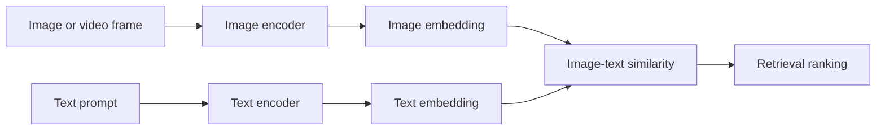

# SigLIP 2

[← Catalog](../../README.md) · [한국어](../ko/siglip-2.md)

SigLIP 2 encodes images and text for cross-modal retrieval and related vision tasks. A pair of encoders maps each modality into a representation that can be compared.

## How it works

The image encoder embeds patches and the text encoder embeds tokens. Training uses a pairwise sigmoid image-text objective and adds captioning and self-supervised signals described in the paper. Fixed-resolution and NaFlex checkpoints differ in how they prepare images. For video retrieval, an application can sample frames and define how to aggregate the resulting scores.

*Guide diagram based on the official references below.*

## A practical workflow

Index thumbnails from robot demonstrations. Rank them using both Korean and English prompts for the same motion, then look at false positives and verify that the selected frames actually show the requested event.

## What to verify

Use the checkpoint’s tokenizer and image preprocessing. Evaluate recall using manually labeled examples. Validate temporal coverage separately because a frame-level embedding can miss brief actions.

## License and availability

Check each model card and checkpoint license. Model limitations and bias must be evaluated for the intended dataset.

## Official references

- [Official technical reference](https://arxiv.org/abs/2502.14786)
- [Checkpoint card and examples](https://huggingface.co/google/siglip2-base-patch16-224)
