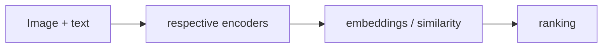

# SigLIP 2

[← All projects](../../README.md) · [한국어](../ko/siglip-2.md) · [Official source](https://huggingface.co/google/siglip2-base-patch16-224) · [Documentation / related project](https://huggingface.co/google/siglip2-base-patch16-224)

A Google vision-language model family that represents images and text for cross-modal tasks.

**Availability and terms:** Check each model card and checkpoint license. Model limitations and bias must be evaluated for the intended dataset.

## Architecture and workflow

*Conceptual illustration for this guide; refer to official sources for supported implementations.*

Preprocess images and candidate text with the checkpoint’s processor, compute embeddings or scores, and rank or classify candidates. Video applications commonly sample frames; verify the specific pipeline.

## Use cases

Zero-shot image classification and image–text retrieval.

## Connections

Embeddings can support data curation or search alongside video ingestion and labeling systems.

## Official references

- [Project source](https://huggingface.co/google/siglip2-base-patch16-224)
- [Documentation / related project](https://huggingface.co/google/siglip2-base-patch16-224)
