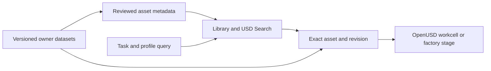

# SimReady Central Library

[← Catalog](../../README.md) · [한국어](../ko/simready-central-library.md)

SimReady Central Library is a discovery interface for contributed simulation assets. It helps users find an asset by task or metadata and then retrieve the versioned package from the owner’s dataset.

## Architecture

| Component | Responsibility and data boundary |
|---|---|
| Owner-hosted datasets | Asset owners publish and version OpenUSD packages in their Hugging Face namespaces. The dataset card and individual package describe use terms and supported profiles. |
| Search and preview | The browser and USD Search use indexed USD and asset metadata to discover matching packages. A preview helps inspect visual fit before fetching and composing the asset. |
| Scene assembly and runtime | The consumer selects exact revisions and composes them with references or payloads into an OpenUSD scene. The target simulator interprets the authored physics or sensor metadata. |

Guide diagram based on the official references below.

### Official figures and examples

NVIDIA’s ecosystem diagram shows owner datasets feeding USD search and simulation authoring workflows. [Original figure and context](https://huggingface.co/blog/nvidia/simready-central-assets-robotics-ai-factories)

The official AI factory example uses referenced equipment assets to compare layout alternatives and aisle clearances. [Original figure and context](https://huggingface.co/blog/nvidia/simready-central-assets-robotics-ai-factories)

## Walkthrough

1. For a robotic workcell, search for an arm, compatible gripper, pallet and target objects. Read profiles and licenses before selecting versions.
2. Reference selected assets into a USD scene and adjust mounts and frames. Test grasping and reach. For a factory layout, check rack clearances and overlaps as separate layout constraints.
3. Record asset dataset revisions and runtime versions so others can recreate the workcell. Compare a second layout by varying only the relevant placement or task conditions.

## Validation

- Check the individual asset license even when the catalog is public. A search result can include non-commercial assets.
- The presence of USD metadata or a render preview does not replace compatibility testing. Inspect geometry units, joint articulation, materials and the needed profiles.

## License and scope

Browsing the library is public. Each hosted asset package has its own access and reuse terms.

## Related guides

[SimReady Central](simready-central.md) · [SimReady](simready.md) · [OpenUSD](openusd.md) · [Isaac Sim](isaac-sim.md)

## Official references

- [SimReady Central Library documentation](https://docs.omniverse.nvidia.com/simready/latest/simready-central.html)
- [Official library browser](https://huggingface.co/spaces/nvidia/simready-central)
- [Library dataset card and contributor process](https://huggingface.co/datasets/nvidia/simready-central-library)
- [Official workcell and AI factory examples](https://huggingface.co/blog/nvidia/simready-central-assets-robotics-ai-factories)
