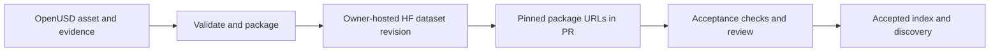

# SimReady Central

[← Catalog](../../README.md) · [한국어](../ko/simready-central.md)

SimReady Central’s GitHub repository is the submission and review index. Contributors keep asset packages in owner-hosted Hugging Face datasets. The GitHub submission lists the exact versions that should be reviewed.

## Architecture

| Component | Responsibility and data boundary |
|---|---|
| Asset preparation and hosting | The submission tooling checks and packages OpenUSD assets, then uploads to the contributor’s Hugging Face dataset. Package definitions describe metadata and evidence. |
| Pinned submission manifest | A file under `submissions/<namespace>/<dataset>` lists immutable package-definition URLs with Hugging Face commit hashes. Each update supplies the full intended list. |
| PR validation and indexing | Automated checks and reviewer approval gate merge. Accepted data becomes eligible for discovery according to the service and license conditions. The package stays with its owner. |

Guide diagram based on the official references below.

### Official figures and examples

NVIDIA’s contributor workflow connects OEM asset preparation and validation with submission and developer discovery. [Original figure and context](https://huggingface.co/blog/nvidia/simready-central-assets-robotics-ai-factories)

## Walkthrough

1. For an equipment manufacturer publishing a gripper, complete the documented onboarding. Pick a profile, validate the asset and package it in your own dataset with license and validation evidence.
2. Submit the package-definition URL pinned to the intended dataset commit. To update a submission, preserve the other package lines that should stay available.
3. Use the repository’s local library workflow to inspect submitted package fields such as owner, version, license and validation. Fix failures in the package before requesting review again.

## Validation

- Use an immutable commit URL. A moving branch URL makes it difficult to reproduce the reviewed asset.
- Onboarding, acceptance and discovery are separate stages. Confirm applicable licensing and acceptance criteria before submitting.

## License and scope

The submission repository has an Apache-2.0 license. Onboarding, hosted services and contributed asset packages have separate terms.

## Related guides

[SimReady Central Library](simready-central-library.md) · [SimReady Foundation](simready-foundation.md)

## Official references

- [Official submission index and flow](https://github.com/NVIDIA-Omniverse/simready-central)
- [Acceptance criteria](https://github.com/NVIDIA-Omniverse/simready-central/blob/main/docs/acceptance-criteria.md)
- [Inspect a submission locally](https://github.com/NVIDIA-Omniverse/simready-central/blob/main/docs/index-to-library-guide.md)
- [Submission repository license](https://github.com/NVIDIA-Omniverse/simready-central/blob/main/LICENSE)
