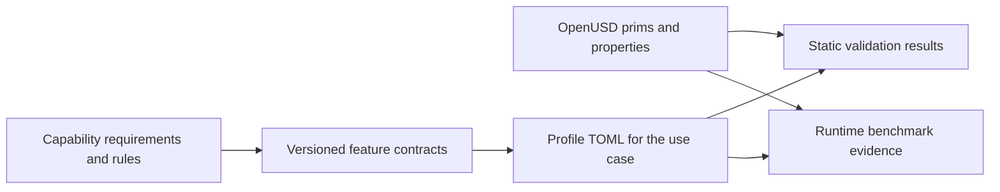

# SimReady Foundation

[← Catalog](../../README.md) · [한국어](../ko/simready-foundation.md)

SimReady Foundation turns simulation use cases into versioned OpenUSD content contracts. Its catalogs and rules give asset authors and tool developers a shared way to describe and validate the same requirements.

## Architecture

| Component | Responsibility and data boundary |
|---|---|
| Capabilities and requirements | Capabilities describe USD properties such as physical bodies, colliders or semantic data. Requirements and validation rules check whether the relevant properties appear in a supported structure. |
| Feature JSON and profile TOML | Features group related requirements. Profiles combine versioned features and optional features for a workload such as Robotics-Prop or Robot-Body. The catalog files are machine-readable contracts. |
| Tier, validator and benchmark | The Core tier contains a base set of contracts and static validation rules. The validator checks authored USD. Optional benchmark tests can assess runtime behavior where a suitable runtime is available. |

Guide diagram based on the official references below.

### Official figures and examples

NVIDIA’s overview separates SimReady Foundation requirements from the tools that author and validate OpenUSD assets. [Original figure and context](https://huggingface.co/blog/nvidia/simready-central-assets-robotics-ai-factories)

## Walkthrough

1. For a reusable rigid prop, choose a version of `Robotics-Prop` and inspect its pinned feature list. Author the physical body and collision representation on the intended USD prim hierarchy.
2. Run the validator with the matching tier and profile. Resolve missing APIs, inconsistent units or invalid prim relationships at the source asset level.
3. Capture validation evidence and run a small simulation test when packaging the asset. Store the profile version and asset revision with the results.

## Validation

- Pin profile and feature versions. A later release may move a requirement between profiles or add a check.
- Check validation scope when comparing assets. A package or visualization profile can satisfy different requirements from a robot or manipulation profile.

## License and scope

NVIDIA-authored Foundation material is Apache-2.0. Third-party assets and dependencies have their own terms.

## Related guides

[SimReady](simready.md) · [SimReady Central](simready-central.md) · [OpenUSD](openusd.md)

## Official references

- [SimReady Foundation source and specifications](https://github.com/NVIDIA/simready-foundation)
- [Core tier and profile versions](https://nvidia.github.io/simready-foundation/latest/tiers/core.html)
- [Isaac Sim asset validation](https://docs.isaacsim.omniverse.nvidia.com/latest/robot_setup/asset_validation.html)
