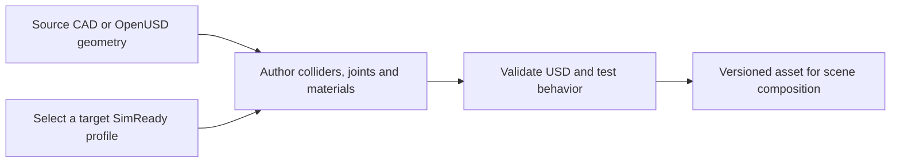

# SimReady

[← Catalog](../../README.md) · [한국어](../ko/simready.md)

SimReady describes what an OpenUSD asset must provide for a specific simulation use. A robot arm may need correct articulation and joint limits, a manipulation prop needs usable collision and mass data, and a perception asset may need semantic labels.

## Architecture

| Component | Responsibility and data boundary |
|---|---|
| Authored USD content | Source CAD supplies geometry. Asset authoring adds hierarchy, scale, materials and domain data such as physics schemas or semantic labels. |
| Profile and features | A named profile defines the required feature set for an intended runtime use. Pin the profile version when deciding what the asset must contain. |
| Validation and runtime | A validator checks authored USD properties against the selected profile. A simulation test checks whether the asset behaves as expected in its actual scene and runtime. |

Guide diagram based on the official references below.

### Official figures and examples

NVIDIA’s specification diagram places SimReady content requirements around OpenUSD core and domain data. [Original figure and context](https://docs.omniverse.nvidia.com/simready/latest/simready-faq.html)

NVIDIA’s YuMi physics overlay exposes collision shapes and joint axes. Those authored properties can be checked separately from the visible mesh. [Original figure and context](https://developer.nvidia.com/blog/5-steps-to-create-simready-assets-for-robotics-with-frontier-ai-models)

## Walkthrough

1. Follow NVIDIA’s YuMi walkthrough from CAD import through visual materials, joint axes, collider approximations, mass and inertia. Decide which properties need authoritative manufacturer data.
2. Validate the asset against the appropriate robot profile, then load it into Isaac Sim. Exercise joint limits and use a simple pick-and-place task to check finger coupling and contacts.
3. Reference the validated asset in the task stage. Record the asset revision, profile version and simulator used for the check.

## Validation

- Choose a profile for the actual use case. A visually detailed asset can still lack the collision, units or joint data needed for robot control.
- Treat static validation and runtime testing as separate checks. Inspect contact response, control axes and pose conventions in the final scene.

## License and scope

Specification, validation tooling and individual assets have distinct terms. Check the Foundation and the exact asset card.

## Related guides

[SimReady Foundation](simready-foundation.md) · [SimReady Central Library](simready-central-library.md) · [Isaac Sim](isaac-sim.md) · [OpenUSD](openusd.md)

## Official references

- [Official SimReady FAQ and profile model](https://docs.omniverse.nvidia.com/simready/latest/simready-faq.html)
- [CAD-to-simulation YuMi walkthrough](https://developer.nvidia.com/blog/5-steps-to-create-simready-assets-for-robotics-with-frontier-ai-models)
- [SimReady Foundation specifications](https://github.com/NVIDIA/simready-foundation)
