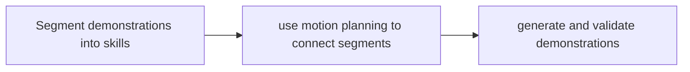

# SkillGen / SkillMimicGen

[← All projects](../../README.md) · [한국어](../ko/skillgen.md)

## Overview

Connects demonstration segments with motion planning.

## Conceptual workflow

## Workflow and use

Segment demonstrations into skills → use motion planning to connect segments → generate and validate demonstrations. This is a conceptual workflow; check the official source for version-specific prerequisites and supported configurations.

**Example use case:** connecting task segments in new arrangements. Check applicability, supported inputs and model versions in the official source.

**Related technologies:** Isaac Lab, cuRobo.

## Architecture and practical details

SkillGen requires manually annotated starts and ends for subtask segments. It samples goals, uses cuRobo to plan transitions between transformed skill segments, stitches the resulting trajectory and checks task success. For example, generate cube-stacking demonstrations with changed object placements, while reviewing planner failures.

[Official documentation](https://isaac-sim.github.io/IsaacLab/v3.0.0/source/features/imitation-learning/skillgen.html)

## Availability and terms

Check terms for the Isaac Lab implementation and dependencies such as cuRobo separately; paper and implementation names differ. Verify the exact version and the terms of any models, datasets, binaries and dependencies before use.

## Official sources

[Isaac Lab documentation](https://github.com/isaac-sim/IsaacLab/blob/main/docs/source/features/imitation-learning/skillgen.rst)
