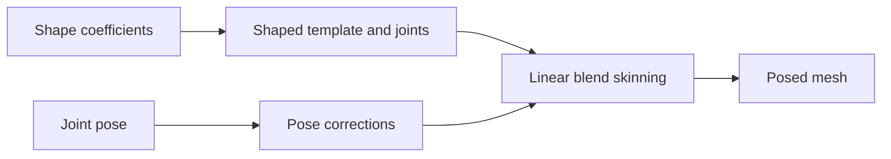

# SMPL

[← Catalog](../../README.md) · [한국어](../ko/smpl.md)

SMPL is a learned parametric human body mesh. A sequence of fitted body parameters represents motion and can be an intermediate for retargeting.

## How it works

Shape coefficients deform a template and influence joint locations. Pose parameters articulate the joints and drive pose-dependent corrective shapes. Linear blend skinning moves the vertices with the skeleton. A separate fitting system estimates parameters from observations.

## A practical workflow

Use parameters from a licensed motion dataset to reconstruct the body mesh and joint trajectory. Check the skeleton against a known motion, then map the selected joints and contacts to the target robot’s morphology.

## What to verify

Confirm model variant, units, root orientation and joint definitions. Check foot contact and motion continuity after retargeting. Verify the terms for the full model and for the specific SMPL-Body subset separately.

## License and availability

Model data, code, derivatives, research and commercial use may have different terms; consult the exact model license and access conditions.

## Official references

- [Official technical reference](https://smpl.is.tue.mpg.de/)
- [SMPL-Body license scope](https://smpl.is.tue.mpg.de/license.html)
