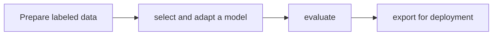

# TAO Toolkit

[← All projects](../../README.md) · [한국어](../ko/tao-toolkit.md)

## Overview

Vision AI model training and fine-tuning.

## Conceptual workflow

## Workflow and use

Prepare labeled data → select and adapt a model → evaluate → export for deployment. This is a conceptual workflow; check the official source for version-specific prerequisites and supported configurations.

**Example use case:** adapting a detection model to a new domain. Check applicability, supported inputs and model versions in the official source.

**Related technologies:** Replicator, TensorRT, DeepStream.

## Architecture and example

TAO reference workflows chain model actions such as training, evaluation and inference with data services between them. Model architectures and export paths depend on the chosen task.

Fine-tune an object detector with labeled factory images, evaluate it on held-out data and prepare it for deployment.

[Official technical source](https://docs.nvidia.com/tao/tao-toolkit/latest/text/reference_workflows/index.html)

## Availability and terms

Product/SDK; check model and component terms. Verify the exact version and the terms of any models, datasets, binaries and dependencies before use.

## Official sources

[Official page](https://developer.nvidia.com/tao-toolkit)
