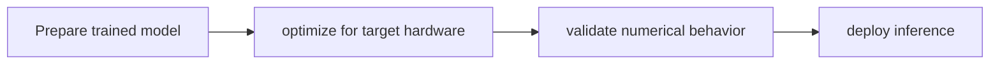

# TensorRT public code

[Catalog](../../README.md) · [한국어](../ko/tensorrt.md)

The TensorRT repository provides inference optimization samples, plugins and tooling; the distributed SDK has separate terms.

**Official sources:** [Repository](https://github.com/NVIDIA/TensorRT)

**License and access:** Repository: Apache-2.0; this does not cover the entire TensorRT binary SDK. Models, data, dependencies and hosted services may have separate terms; check each source before use.

## Workflow

The following conceptual diagram is an explanatory overview, not an official architecture diagram.

## Use case

Reduce inference latency for perception or robot-policy applications.

## Related technologies

CUDA, ONNX, Isaac ROS, Jetson. Confirm compatibility and runtime requirements in the documentation for each version.
