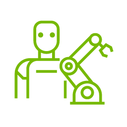

# Video-to-Data (V2D)

[← Back to catalog](../../README.md) · [한국어](../ko/video-to-data.md)

   
  <a href="https://nvidia-isaac.github.io/video_to_data/">Official Video-to-Data project-site icon (favicon)</a>

Video to Data (V2D) turns a human demonstration video into inspectable 3D artifacts and a robot-learning workflow. Each stage writes intermediate results, so a clip can be reselected, reconstructed or retargeted without rerunning unrelated stages.

## Architecture and data flow

| Component | Inputs, processing and outputs |
|---|---|
| **Video Ingestion Agent** | A LangGraph workflow divides video into action clips, extracts entities and their relations and embeds frames with SigLIP 2. The graph and vector databases let users retrieve candidate clips by natural-language queries. |
| **Reconstruction** | Containerized vision modules take selected RGB or stereo video and estimate artifacts such as depth, masks, textured meshes, object poses and human body parameters. Multi-view examples also use camera calibration and recorded sensor streams. |
| **Robotic Grounding** | Motion is retargeted onto a robot embodiment and used as a tracking reference in a reconstructed Isaac Lab scene. A reference policy can be learned with PPO and rolled out to produce expert demonstrations. |
| **Downstream fine-tuning** | The reference E2E workflow converts expert rollouts to LeRobot-format data, fine-tunes GR00T N1.7 and evaluates the resulting policy in a closed loop. |

Follow the official overview from video to selected clips, 3D reconstruction and robotic grounding. The arrows represent concrete artifacts that can be checked before training or deployment. [Official figure source](https://github.com/nvidia-isaac/video_to_data)

The CHORD research figure zooms in on robotic grounding, with reconstructed motions and contacts contributing to the learning objective. [Official project figure](https://nvidia-isaac.github.io/video_to_data/chord/)

## Worked example

1. Use the reference tissue-box workflow, which starts with a raw iPhone egocentric demonstration. First inspect the scene and motion reconstruction before running the robotic stages.
2. Retarget onto the supported Sharpa embodiment and train or load the reference expert. Capture rollouts and convert the dataset for the GR00T stage.
3. Run closed-loop evaluation and compare the final task completion with the quality of intermediate reconstruction and tracking.

## What to verify

- Check scale and camera/world frames before retargeting. A visually convincing reconstruction can still misplace contact surfaces.
- Check dependencies and hardware per stage. Retrieval, reconstruction and robot learning use different environments and may have separate model terms.

## Official references and terms

The code uses Apache-2.0. The documentation and skills use CC BY 4.0. Dependent models and data carry their own terms.

- [Repository and supported E2E workflow](https://github.com/nvidia-isaac/video_to_data)
- [Pipeline documentation](https://nvidia-isaac.github.io/video_to_data/)
- [Robotic Grounding project](https://nvidia-isaac.github.io/video_to_data/chord/)

## Related guides

[EgoHand](egohand-egopost.md) · [Isaac Lab](isaac-lab.md) · [Isaac GR00T](isaac-gr00t.md)
