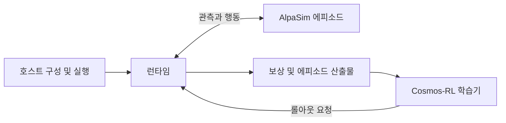

# AlpaGym

[← 프로젝트 홈](../../README.ko.md) · [English](../en/alpagym.md)

AlpaGym은 자율주행 정책을 AlpaSim의 폐루프 경험과 Cosmos-RL의 분산 정책 갱신에 연결합니다.

## 폐루프 주행은 어떻게 학습용 점수가 될까요?

### 실제 테스트 실행 설정 읽기

공식 2 GPU 스모크 테스트는 `clipgt-a309e228-26e1-423e-a44c-cb00aa7378cb` 장면 하나를 지정합니다. `control_timestep_us=200000`은 제어 간격이 0.2초, `n_sim_steps=30`은 총 30스텝이라는 뜻입니다. `force_gt_duration_us=1600000`이면 처음 1.6초에는 기록된 자차 움직임을 적용합니다. 이 설정은 평가에 쓸 스텝을 `expected_valid_steps=22`로 둡니다. 실제 주행할 때는 에피소드가 완료되었는지와 유효 스텝 수를 함께 확인합니다. [공식 스모크 설정](https://github.com/NVlabs/alpagym/blob/972d160eed0e23d388497851504a3a233fec5879/packages/policies/alpamayo_r1/src/alpagym_alpamayo_r1/configs/experiment/alpamayo_1_5_local_2gpu_smoke.yaml)

### 보상 함수의 공식 테스트 예시

아래 값은 AlpaGym 저장소의 **보상 단위 테스트**에 들어 있는 입력과 기대 출력입니다. 실제 주행에서 측정한 값은 별도의 에피소드 기록에서 읽습니다.

| 지표 | 테스트 값 | 가중치 | 보상에 더하는 값 |
|---|---:|---:|---:|
| 기준 경로와의 XY RMSE | 1.0m | −1.0 | −1.0 |
| 경로 진행도 `progress` | 0.5 | +1.0 | +0.5 |
| 충돌 발생 `collision_any` | 1.0 | −5.0 | −5.0 |
| 합계 | | | **−5.5** |

실제 학습에서는 구성 프로필이 가중치를 정합니다. 주행 결과에서 점수를 계산해 Cosmos RL로 전달하고, 학습한 정책으로 다음 주행 경험을 모읍니다. 합계만 높아졌다면 어떤 항목이 바뀌었는지 개별 지표도 확인하세요. [공식 보상 테스트](https://github.com/NVlabs/alpagym/blob/972d160eed0e23d388497851504a3a233fec5879/packages/runtime/src/alpagym_runtime/rewards/tests/test_compute.py) · [학습 프로세스와 롤아웃](cosmos-rl.md) · [AlpaSim 평가 실습](workflows/alpasim-closed-loop.md)

## 작동 방식

호스트는 Hydra 구성을 확정하고 서비스를 시작하며 로컬 또는 Slurm 실행 파일을 관리합니다. GPU 컨테이너의 런타임은 Cosmos-RL의 롤아웃 요청을 받고 gRPC로 AlpaSim 에피소드를 실행합니다. 정책 어댑터가 추론을 배치 처리합니다. 보상 함수가 주행을 평가하고 에피소드 전송 계층이 학습 데이터를 반환합니다.

### 구성 요소별 입출력

| 구성 요소 | 입력 | 출력 |
|---|---|---|
| 호스트 | 확정한 실험 구성과 장면 목록 | 시뮬레이터 실행 설정과 실험 산출물 |
| 런타임 | 롤아웃 요청, 정책과 AlpaSim 관측 | 채점한 에피소드와 학습용 관측 |
| Cosmos-RL | 롤아웃 산출물과 학습 설정 | 갱신된 정책 가중치 |

## 사용 순서

공식 AlpaSim 튜토리얼부터 실행합니다. 소규모 고정 장면에서 지원 체크포인트로 학습합니다. 별도로 남겨 둔 경로에서 전후 체크포인트를 평가하고, 보상은 높아졌지만 주행이 악화된 사례를 찾아봅니다.

## 검증할 항목

확정된 설정, 장면 분할, 보상 가중치와 정책 체크포인트를 저장합니다. 해당 소스 버전이 지원하는 정책 어댑터를 확인합니다. 충돌과 경로 진행률은 롤아웃 처리량과 별도로 측정합니다.

## 공개 범위와 라이선스

Apache-2.0 코드; 의존성·모델 별도. 모델, 데이터, 의존성 및 배포 서비스에는 별도 조건이 적용될 수 있으므로 사용 전 각 출처를 확인합니다.

## 공식 자료

- [아키텍처와 워크플로 공식 문서](https://github.com/NVlabs/alpagym#architecture)
- [시작 안내와 사전 요구사항](https://github.com/NVlabs/alpagym/blob/main/docs/ONBOARDING.md)
- [관련 공식 자료 · github.com](https://github.com/NVlabs/alpagym)

## 연관 도구

롤아웃과 학습기 사이의 인터페이스 및 업스트림 유지보수 상태는 [Cosmos RL](cosmos-rl.md)을 참고하세요.
