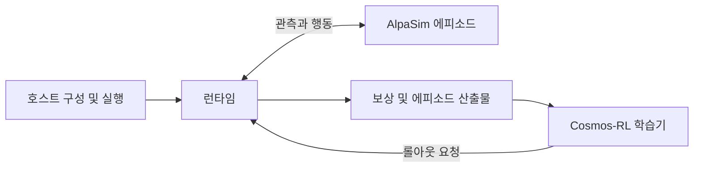

# AlpaGym

[← 전체 목록](../../README.ko.md) · [English](../en/alpagym.md)

AlpaGym은 자율주행 정책을 AlpaSim의 폐루프 경험과 Cosmos-RL의 분산 정책 갱신에 연결합니다.

## 어떻게 동작하나

호스트는 Hydra 구성을 확정하고 서비스를 시작하며 로컬 또는 Slurm 실행 파일을 관리합니다. GPU 컨테이너의 런타임은 Cosmos-RL의 롤아웃 요청을 받고 gRPC로 AlpaSim 에피소드를 실행합니다. 정책 어댑터가 추론을 배치 처리합니다. 보상 함수가 주행을 평가하고 에피소드 전송 계층이 학습 데이터를 반환합니다.

### 구성 요소별 입출력

| 구성 요소 | 입력 | 출력 |
|---|---|---|
| 호스트 | 확정한 실험 구성과 장면 목록 | 시뮬레이터 실행 설정과 실험 산출물 |
| 런타임 | 롤아웃 요청, 정책과 AlpaSim 관측 | 채점한 에피소드와 학습용 관측 |
| Cosmos-RL | 롤아웃 산출물과 학습 설정 | 갱신된 정책 가중치 |

## 실전 워크플로

공식 AlpaSim 튜토리얼부터 실행합니다. 소규모 고정 장면에서 지원 체크포인트로 학습합니다. 별도로 남겨 둔 경로에서 전후 체크포인트를 평가하고, 보상은 높아졌지만 주행이 악화된 사례를 찾아봅니다.

## 검증할 항목

확정된 설정, 장면 분할, 보상 가중치와 정책 체크포인트를 저장합니다. 해당 소스 버전이 지원하는 정책 어댑터를 확인합니다. 충돌과 경로 진행률은 롤아웃 처리량과 별도로 측정합니다.

## 공개 범위와 라이선스

Apache-2.0 코드; 의존성·모델 별도. 모델, 데이터, 의존성 및 배포 서비스에는 별도 조건이 적용될 수 있으므로 사용 전 각 출처를 확인한다.

## 공식 자료

- [아키텍처와 워크플로 공식 문서](https://github.com/NVlabs/alpagym#architecture)
- [시작 안내와 사전 요구사항](https://github.com/NVlabs/alpagym/blob/main/docs/ONBOARDING.md)
- [관련 공식 자료 · github.com](https://github.com/NVlabs/alpagym)
