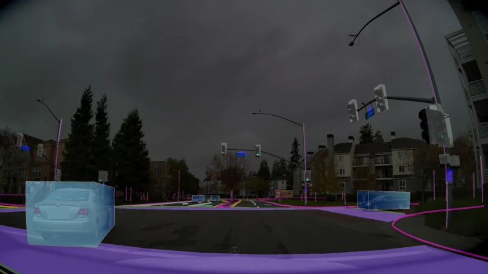

# AlpaSim

[← 전체 목록](../../README.ko.md) · [English](../en/alpasim.md)

   
  <a href="https://github.com/NVlabs/alpasim/blob/affc2eab209fa43bdfa2f26c0f8d437922d78a68/docs/VIDEO_MODEL.md#how-it-works">AlpaSim 공식 비디오 렌더러 문서의 대표 카메라 프레임</a>

AlpaSim은 자율주행 정책을 폐루프로 평가합니다. 정책이 자차를 움직이면 다음 센서 관측은 변경된 상태에서 렌더링됩니다.

*런타임이 구성 요소를 호출하고 별도 평가 모듈이 읽을 로그를 작성합니다. 관측이 다시 드라이버로 돌아가는 위치에서 폐루프가 형성됩니다.* [공식 그림 출처](https://github.com/NVlabs/alpasim/blob/main/docs/DESIGN.md)

*에피소드 지표와 함께 확인할 수 있는 주행 영상 출력의 예입니다.* [공식 그림 출처](https://github.com/NVlabs/alpasim)

## 어떻게 동작하나

런타임이 시뮬레이션 시간을 진행시키고 gRPC로 Python 서비스를 호출합니다. 렌더러는 장면과 자세에서 관측을 생성하고, 드라이버는 관측으로 주행 계획을 계산합니다. 제어와 물리 단계가 차량·지면 제약에 맞춰 자차 상태를 갱신합니다. 평가 모듈은 주 루프 밖에서 기록을 처리합니다. 공식 설계에서 신경 재구성 및 영상 모델 렌더러는 같은 서비스 인터페이스를 사용할 수 있습니다.

### 구성 요소별 입출력

| 구성 요소 | 입력 | 출력 |
|---|---|---|
| 렌더러 | 장면, 카메라 구성, 시뮬레이션 상태 | 드라이버가 읽는 프레임 |
| 드라이버와 제어기 | 렌더링 관측, 경로, 자차 상태 | 정책 궤적과 제어 명령 |
| 런타임과 평가기 | 서비스 출력과 시뮬레이션 클록 | 에피소드 로그와 평가 지표 |

## 실전 워크플로

튜토리얼 장면과 참조 드라이버로 시작합니다. 장면, 경로, 초기 자세를 고정한 채 정책 체크포인트 하나를 바꿉니다. 로그에서 궤적, 충돌, 경로 진행을 확인하고 실패 전후의 렌더 영상을 봅니다. 여러 장면에서 반복해 특정 재구성에 따른 편향을 줄입니다.

## 검증할 항목

정책 비교 전에 장면과 렌더러 호환성, 서비스 상태, 경로·카메라 구성을 확인합니다. 설계는 센서 재현성과 규모를 우선하므로 정밀 차량 동역학이나 실시간 동작은 별도 환경에서 검증합니다.

## 공개 범위와 라이선스

Apache-2.0 코드; 모델·데이터 별도. 모델, 데이터, 의존성 및 배포 서비스에는 별도 조건이 적용될 수 있으므로 사용 전 각 출처를 확인한다.

## 공식 자료

- [아키텍처와 워크플로 공식 문서](https://github.com/NVlabs/alpasim/blob/main/docs/DESIGN.md)
