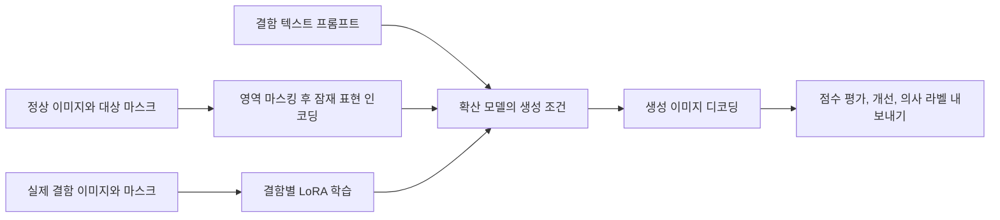

# AnomalyGen

[← 전체 목록](../../README.ko.md) · [English](../en/anomalygen.md)

AnomalyGen은 외관 검사에 사용할 결함 이미지와 대상 마스크를 생성한다. 텍스처 결함 경로에서는 실제 결함과 정상 이미지로 시작해 특정 결함에 맞춘 어댑터를 학습한다.

## 결함 위치와 이미지 생성의 연결

이 공식 그림은 Auto Mask Placement 경로다. 규칙에 따라 기존 결함 부분 마스크를 배치한다. 공식 문서의 기본 Agentic Mask Generation 경로는 시각 언어 모델을 이용해 후보를 제안하고, 판정하고, 수정한다. 두 경로 모두 이후 생성에 사용할 위치 정보를 만든다. [공식 워크플로](https://github.com/NVIDIA/cdf-anomalygen#overview) · [Agentic Mask Generation](https://github.com/NVIDIA/cdf-anomalygen/blob/main/docs/tutorial/texture/3-agentic-mask-generation.md)

학습에 쓰는 실측 샘플과 생성에 쓰는 입력을 구분한 개념도다. 생성 배치를 실측 기준과 비교해 점수를 매긴다. 여러 후보 중 적합한 결과를 고른 뒤 인스턴스 주석이나 클래스별 학습 데이터로 내보낼 수 있다. [공식 평가와 개선 문서](https://github.com/NVIDIA/cdf-anomalygen/blob/main/docs/tutorial/texture/6-evaluation-and-refinement.md)

## 활용 예시 — 유리 표면 흠집 생성

실제 흠집 데이터 일부를 검증용으로 분리한다. 정상 이미지 몇 장에서 마스크가 허용된 영역에 놓이는지 확인하고, 생성된 변화가 그 영역에 남는지와 유사한 조명에서 실측 흠집과 비슷한지를 검토한다. 합성 예시를 사용한 분류기와 사용하지 않은 분류기를 같은 실측 검증 세트에서 비교한다. [유리 마스크 데이터셋](https://huggingface.co/datasets/nvidia/Cosmos-AnomalyGen-Glass-Masks)

코드, 기본 가중치, 어댑터, 입력 데이터의 조건을 각각 확인한다. [공식 저장소](https://github.com/NVIDIA/cdf-anomalygen)
