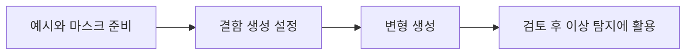

# AnomalyGen

[← 전체 목록](../../README.ko.md) · [English](../en/anomalygen.md)

이미지: 아래 공식 프로젝트 출처.

## 소개

소수 예시를 이용한 결함 이미지 생성 워크플로.

## 개념적 워크플로

## 활용 흐름과 사례

예시와 마스크 준비 → 결함 생성 설정 → 변형 생성 → 검토 후 이상 탐지에 활용. 개념적인 흐름이며 버전별 사전 요구사항과 지원 구성은 공식 문서를 확인한다.

**활용 사례:** 제조 결함 예시 생성. 지원 입력과 모델 버전은 공식 출처에서 확인한다.

**연결 기술:** Cosmos Data Factory.

## 구성과 구체적인 활용

공식 파이프라인은 실제 결함 예시와 마스크를 준비하고, 위치 마스크를 생성한 뒤 생성 모델을 미세조정한다. 이후 후보 이미지를 만들고 평가·개선해 의사 레이블을 만든다.

레이블이 있는 소수의 PCB 결함 예시를 이용해 검사 모델용 마스크 정렬 합성 결함을 만든다.

[공식 기술 자료](https://github.com/NVIDIA/cdf-anomalygen)

## 공개 및 이용 조건

공개 저장소; 코드·모델·어댑터 각각의 조건 미확인. 사용 전 해당 버전과 모델·데이터·바이너리·의존성의 조건을 각각 확인한다.

## 공식 출처

[저장소](https://github.com/NVIDIA/cdf-anomalygen)
