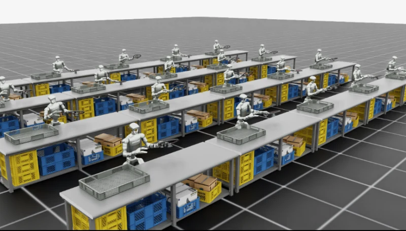

# AutoData

[← 목록으로](../../README.ko.md) · [English](../en/autodata.md)

   
  <a href="https://isaac-sim.github.io/AutoData/main/pages/workflows/humanoid_dexmimicgen/step_3_generate_dataset.html">AutoData 공식 가이드의 G1 데이터 생성 예시 이미지</a>

AutoData는 소수의 성공 시연을 시뮬레이션에서 다양한 궤적으로 확장합니다. 작업 정의에서 장면 초기화 방법, 기준 물체, 성공 판정 조건을 지정합니다. 생성 데이터셋에는 시뮬레이터에서 시연을 실행하며 얻은 로봇 행동과 관측이 들어갑니다.

## 아키텍처와 데이터 흐름

| 구성 요소 | 입력·처리·출력 |
|---|---|
| **원본 시연** | 주석이 달린 에피소드에서 하위 작업 경계, 기준 물체, 말단 장치의 시연 동작을 읽습니다. 하위 작업을 기준 물체에 대한 상대 자세로 표현하면 물체가 다른 위치에 있을 때도 재사용할 수 있습니다. |
| **생성 알고리즘** | MimicGen은 새 초기 배치에 맞게 물체 기준 구간을 변환하고 재생합니다. SkillGen은 변환된 구간을 실행하기 전에 cuRobo로 해당 구간까지의 이동을 계획합니다. |
| **시뮬레이션과 작업 검증** | 시뮬레이터가 목표 동작을 실행하고 작업 정의가 종료 및 성공 조건을 검사합니다. 결과는 실제 시뮬레이션 관측과 행동이 담긴 롤아웃입니다. |

공식 그림은 시연 입력, 생성 로직, 시뮬레이션을 분리해 보여줍니다. 시연 구간을 새 배치에서 재사용할 때도 작업 정의와 시뮬레이터가 관여합니다. [공식 그림 출처](https://github.com/isaac-sim/AutoData)

저장소의 시연 영상은 장면 조건을 바꿔 생성한 롤아웃을 보여줍니다. 달라진 시작 배치와 실제 실행된 경로를 비교해 볼 수 있습니다. [공식 그림 출처](https://github.com/isaac-sim/AutoData)

## 적용 예시

1. 성공한 집기·놓기 궤적을 준비하고 파지 및 배치 구간의 경계와 기준 물체를 표시합니다.
2. 장면을 초기화할 때 물체나 고정구 위치를 바꿉니다. 장면의 장애물을 고려해 보간 또는 경로 계획을 이용한 이동 방식을 선택합니다.
3. 통과한 시연을 재생하고, 데이터셋 설정·작업 성공 조건·에셋 버전을 생성 시연과 함께 보관합니다.

## 검증할 항목

- 전체 성공 건수와 함께 초기 배치 조건별 성공률을 비교합니다. 어려운 초기 자세가 생성 데이터셋에서 반복적으로 누락되는지 확인합니다.
- 이동 구간과 스킬 구간이 이어질 때 충돌, 불연속 동작, 그리퍼 타이밍 오류가 발생하는지 검사합니다.

## 공식 자료와 이용 조건

저장소 코드는 Apache-2.0입니다. 사용하는 구성에 포함된 Isaac Sim과 cuRobo 구성 요소의 조건은 별도로 확인합니다.

- [저장소와 공식 그림](https://github.com/isaac-sim/AutoData)
- [생성 알고리즘 설명](https://isaac-sim.github.io/AutoData/main/pages/concepts/algorithms.html)

## 연관 상세 페이지

[MimicGen](mimicgen.md) · [SkillGen](skillgen.md) · [cuRobo](curobo.md) · [Isaac Sim](isaac-sim.md)
