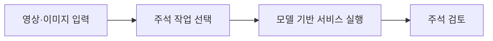

# CDF Auto Labeling (formerly paidf-auto-labeling)

[전체 목록](../../README.ko.md) · [English](../en/cdf-auto-labeling.md)

재사용 가능한 작업을 조합해 자동 주석 서비스를 구성하는 프레임워크다.

**공식 출처:** [Repository](https://github.com/NVIDIA/cdf-auto-labeling)

**라이선스 및 공개 여부:** Apache-2.0; models and services have separate terms. 모델, 데이터, 의존성 및 배포 서비스에는 별도 조건이 적용될 수 있으므로 사용 전 각 출처를 확인한다.

이미지 출처: [CDF Auto Labeling (formerly paidf-auto-labeling)](https://github.com/NVIDIA/cdf-auto-labeling)

**구조:** 공통 추상화를 제공하는 core, 개별 주석 작업 패키지, 작업을 조합하는 서비스 계층으로 구분된다. [공식 구조 설명](https://github.com/NVIDIA/cdf-auto-labeling/blob/main/AGENTS.md).

## 워크플로우

아래는 이해를 돕기 위한 개념도이며 공식 아키텍처 도면이 아니다.

## 활용 사례

탐지·추적·캡션 등의 후보 주석을 만들어 데이터 준비를 가속한다.

## 연결 기술

Cosmos Data Factory, Cosmos Curator. 실제 호환성과 실행 요건은 각 버전의 공식 문서를 확인한다.
