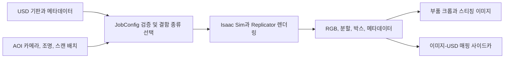

# CDF Simulation (formerly paidf-simulation)

[전체 목록](../../README.ko.md) · [English](../en/cdf-simulation.md)

CDF Simulation은 Isaac Sim과 Replicator로 라벨이 붙은 PCB 검사 장면을 렌더링한다. 준비된 USD 장면과 기판 메타데이터로 부품 위치를 정하고, 작업 설정에서 조명, 카메라, 스캔 범위와 결함 종류를 선택한다.

## 공식 렌더링 결과 읽기

공식 이미지에는 과납, 한쪽이 들린 부품, 시뮬레이션한 납땜 접합부와 젖음 불량이 서로 다른 조명과 카메라 각도로 나온다. 결함마다 잘 보이는 조건이 다르므로 실제 검사 장비와 렌더링 구성을 비교한다. [공식 PCB 시뮬레이션 저장소](https://github.com/NVIDIA/cdf-simulation)

공식 YAML과 Python 실행 경로를 요약한 개념도다. 렌더링 전에 YAML을 컴파일해 구성을 확인한다. 선택한 작업에 따라 스티칭 결과의 픽셀을 USD 좌표에 연결하는 파일도 남길 수 있다. [설정 가이드](https://github.com/NVIDIA/cdf-simulation/blob/main/pcb_aoi/config/README.md) · [이미지-USD 매핑 문서](https://github.com/NVIDIA/cdf-simulation/blob/main/docs/image-to-usd-sidecar.md)

검사 카메라로 본 기판 전체의 예시다. 확대된 부품 영역과 크롭이 전체 장면의 어디에서 나오는지 연결해서 볼 수 있다. [공식 시뮬레이션 레시피](https://github.com/NVIDIA/cdf-simulation/blob/main/COOKBOOK.md)

## 활용 예시 — AOI 결함 검증 세트 구성

카메라와 조명을 고정하고 정상 기판과 부품 위치가 틀어지거나 들린 예를 렌더링한다. RGB와 분할을 함께 확인하고, 스티칭 이후 크롭 상자에 결함이 남아 있는지 확인한다. 실측 검사 이미지와 비교한 뒤 합성 데이터를 학습에 포함한다. 같은 기판이나 부품의 변형이 학습과 검증에 섞이지 않도록 원본 ID를 기록한다. [공식 결함 변형 안내](https://github.com/NVIDIA/cdf-simulation/blob/main/docs/defect-variants.md)

코드는 Apache-2.0이다. Isaac Sim, 선택적 납땜 솔버, 컨테이너와 원본 장면에는 별도 요구사항과 이용 조건이 적용된다. [공식 요구사항 및 라이선스](https://github.com/NVIDIA/cdf-simulation#license)
