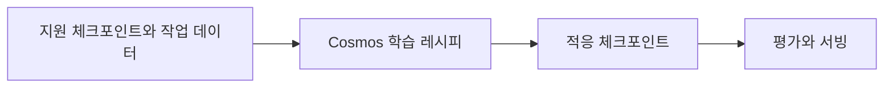

# Cosmos Framework

[← 전체 목록](../../README.ko.md) · [English](../en/cosmos-framework.md)

Cosmos 3 학습·후학습·평가·서빙 레시피.

## 아키텍처와 데이터 흐름

프레임워크는 지원 Cosmos 3 체크포인트를 데이터 전처리, 모델 실행과 학습 레시피에 연결합니다. Reasoner와 Generator의 입력과 학습 목표는 다릅니다. 공식 학습 옵션에는 SFT와 모델별 강화학습 또는 선호도 학습 흐름이 있습니다. 서빙과 평가에는 호환 체크포인트를 사용합니다.

아래 공식 자료를 바탕으로 정리한 개념도입니다.

## 물리 AI 활용 예시

지원 Cosmos 3 Reasoner를 타임스탬프가 있는 산업 영상 질의응답에 적응시킵니다. 소량 데이터로 입력 목록과 프로세서를 검증하고 별도 장면에서 학습 전후 정확도를 비교합니다. 서빙 단계에서도 같은 전처리를 적용하는지 확인합니다.

## 검증할 항목

체크포인트별 레시피와 산출물 조건을 확인합니다. 저장소는 OpenMDW-1.1을 명시하며 모델, 데이터셋과 서빙 조건은 별도로 확인합니다.

## 공개 범위와 라이선스

저장소 코드는 OpenMDW-1.1입니다. 개별 모델과 산출물의 조건을 확인합니다.

## 공식 자료

- [저장소](https://github.com/NVIDIA/cosmos-framework)
- [프레임워크 문서](https://nvidia.github.io/cosmos-framework/)
- [체크포인트와 서빙 지원표](https://nvidia.github.io/cosmos-framework/models/)
- [저장소 라이선스](https://github.com/NVIDIA/cosmos-framework/blob/HEAD/LICENSE)

## 관련 가이드

[Cosmos](cosmos.md) · [Cosmos RL](cosmos-rl.md)
