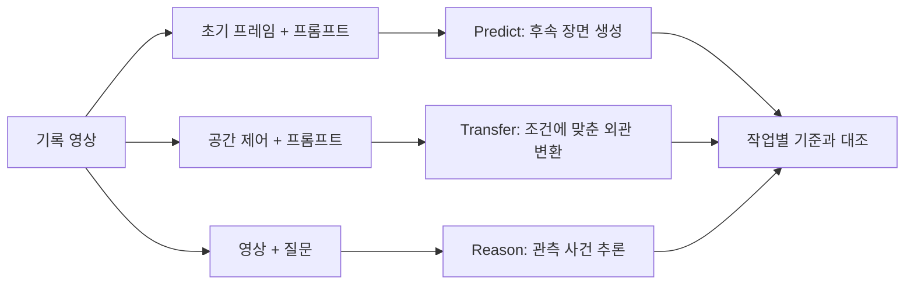

# Cosmos Predict / Transfer / Reason

[← 전체 목록](../../README.ko.md) · [English](../en/cosmos-models.md)

Predict, Transfer, Reason은 Cosmos 계열에서 수행하는 서로 다른 세 가지 작업이다. 필요한 입출력을 먼저 정한 뒤 해당 작업을 지원하는 이전 모델 또는 Cosmos 3 체크포인트를 고른다.

| 작업 | 조건 입력 | 결과 | 재사용 전 확인 |
|---|---|---|---|
| Predict | 모델이 지원하는 텍스트, 초기 프레임 또는 행동 | 시각적 후속 장면의 한 가지 후보 | 객체 유지 여부와 초기 움직임과의 일관성 |
| Transfer | 원본 영상 또는 에지, 깊이, 분할 등 공간 제어 | 제어 조건에 맞춰 외관을 바꾼 영상 | 기하 구조와 객체 타이밍, 주석 정렬 |
| Reason | 영상·이미지와 질문 또는 지시 | 지원 범위에 따른 텍스트, 시간 참조 또는 영역 정보 | 사람이 표기한 프레임과 일치하는지 |

## 하나의 기록으로 세 작업 비교하기

짧은 주행 영상으로 세 가지 실험을 구성할 수 있다. Predict에는 시작 장면에서 이어지는 영상을 요청하고, Transfer에는 도로 구조를 조건으로 조명을 바꾸도록 요청한다. Reason에는 누가 횡단보도에 들어왔는지 묻는다. 모델, 원본 버전, 프레임 시간, 프롬프트를 결과와 함께 기록한다. [공식 기술 소개](https://developer.nvidia.com/blog/scale-synthetic-data-and-physical-ai-reasoning-with-nvidia-cosmos-world-foundation-models/)

공식 예제는 생성한 1인칭 영상과 행동 조건을 함께 보여준다. 손이 입력 움직임을 따르는지, 여러 프레임에서 손과 도구의 접촉이 자연스럽게 이어지는지 확인한다. [NVIDIA Cosmos 공식 예제](https://github.com/NVIDIA/cosmos)

위 개념도는 작업별로 필요한 입력의 차이를 보여준다. [Cosmos 3](cosmos.md)는 Reasoner와 Generator를 통해 여러 작업을 지원한다. 이전 예제의 [Predict2](cosmos-predict2.md)와 [Reason2](cosmos-reason2.md)는 각각의 입력 형식을 사용한다. 선택한 가중치와 런타임에서 지원 매체와 이용 조건을 확인한다. [공식 모델 레퍼런스](https://docs.nvidia.com/cosmos/latest/cosmos3/model_reference.html)
