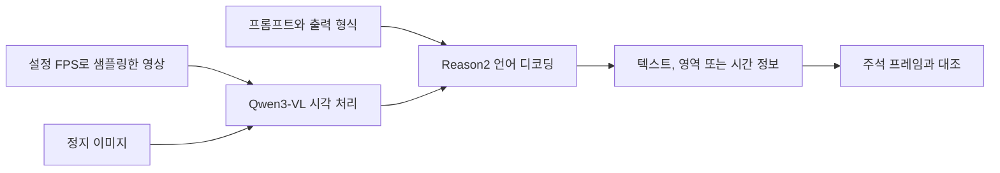

# Cosmos Reason2 code

[전체 목록](../../README.ko.md) · [English](../en/cosmos-reason2.md)

Cosmos Reason2는 물리 상식과 행동 맥락 추론을 위한 시각 언어 모델이다. 저장소에는 프롬프트, 추론 예제, 유틸리티가 있다. 가중치는 따로 받고 호환되는 추론 런타임을 선택한다.

## 모델을 통과하는 정보

위 개념도는 Qwen3-VL 기반 모델의 입출력을 요약한다. 질문과 지시가 답할 내용을 정하고, 이미지나 샘플링한 프레임이 장면의 근거가 된다. 샘플링이 느리면 실제 충돌과 아슬아슬하게 비껴간 상황을 구분하는 프레임을 놓칠 수 있다. 샘플링을 높이거나 영상을 길게 쓰면 컨텍스트 사용량도 늘어난다. [공식 추론 예제](https://github.com/nvidia-cosmos/cosmos-reason2#inference) · [모델 카드](https://huggingface.co/nvidia/Cosmos-Reason2-8B)

NVIDIA 정지 이미지 추론 예제의 입력이다. 같은 프롬프트와 예제 출력을 함께 읽고, 응답 내용이 장면에 보이는 근거와 일치하는지 비교한다. [행동 추론 프롬프트](https://github.com/nvidia-cosmos/cosmos-reason2/blob/main/prompts/embodied_reasoning.yaml) · [출력 예제](https://github.com/nvidia-cosmos/cosmos-reason2/blob/main/assets/outputs/embodied_reasoning.log)

## 활용 예시 — 창고 이벤트 구간 추정

짧은 영상에서 팔레트가 이동하기 시작한 시점과 멈춘 시점을 묻는다. 사용한 FPS를 기록하고 추론에 들어간 프레임을 저장한다. 예측 구간을 사람 주석과 비교하고 사람이 팔레트를 가린 구간에서 오탐이 있는지 확인한다. 더 촘촘한 FPS로 재실행하면 프레임 선택 문제와 추론 문제를 구분하는 데 도움이 된다. [시간 구간 추론 예제](https://github.com/nvidia-cosmos/cosmos-reason2#deployment)

2B, 8B, 32B 모델 카드가 있다. 소스는 Apache-2.0이며 공식 가중치는 NVIDIA Open Model License를 따른다. 통합 모델 계열은 [Cosmos 3](cosmos.md)에서 확인할 수 있다. [공식 라이선스 안내](https://github.com/nvidia-cosmos/cosmos-reason2#license-and-contact)
