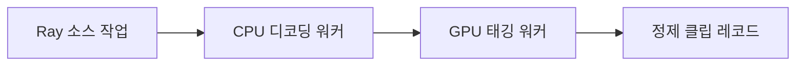

# Cosmos Xenna

[← 전체 목록](../../README.ko.md) · [English](../en/cosmos-xenna.md)

데이터 정제 파이프라인에서 사용하는 Ray 기반 분산 단계 실행.

> **제한적 유지보수**

## 아키텍처와 데이터 흐름

각 처리 단계의 워커를 Ray 액터로 만들고 오케스트레이터가 단계 사이 데이터를 이동합니다. 스트리밍 자동 확장은 처리량에 맞춰 자원을 배치합니다. NeMo Curator에는 Xenna 실행기가 문서화되어 있고 Cosmos Curator에는 Ray Data 경로도 있습니다.

아래 공식 자료를 바탕으로 정리한 개념도입니다.

## 물리 AI 활용 예시

클립 파이프라인에서 디코딩과 GPU 태깅 처리량을 나눠 측정합니다. 병목이 줄어들도록 워커 구성을 조정하고 큐와 실패를 기록합니다. 단일 워커의 기준 결과와 최종 레코드를 대조합니다.

## 검증할 항목

공식 저장소는 제한적 유지보수 상태를 명시합니다. Xenna 의존성을 추가하기 전에 정제 도구 릴리스의 실행 백엔드와 버전을 확인합니다.

## 공개 범위와 라이선스

저장소 코드는 Apache-2.0입니다. 모델 가중치, 외부 서비스와 의존성에는 별도 조건이 적용될 수 있습니다.

## 공식 자료

- [저장소](https://github.com/nvidia-cosmos/cosmos-xenna)
- [공식 Curator 실행기 통합](https://docs.nvidia.com/nemo/curator/about/concepts/video/architecture)
- [저장소 라이선스](https://github.com/nvidia-cosmos/cosmos-xenna/blob/HEAD/LICENSE)

## 관련 가이드

[NeMo Curator](nemo-curator.md) · [Cosmos Curator](cosmos-curator.md)
