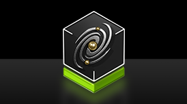

# Cosmos 및 Cosmos 3

[← 전체 목록](../../README.ko.md) · [English](../en/cosmos.md)

   
  <a href="https://github.com/NVIDIA/cosmos/blob/71317702510f7c456ba3d702b84fb103546caea2/assets/brand/cosmos-logo.png">NVIDIA Cosmos 공식 로고</a>

Cosmos는 NVIDIA의 Physical AI 월드 모델 플랫폼이다. Cosmos 3는 멀티모달 추론과 생성을 결합한 모델 계열이다. 플랫폼에서는 학습, 데이터 선별, 결과 평가 도구도 별도로 제공한다.

## 공식 아키텍처 읽기

Reasoner와 Generator는 표현을 공유하며 함께 학습하는 두 Transformer 타워다. Reasoner는 언어 요청을 영상 속 맥락과 연결한다. Generator는 해석된 맥락과 생성 조건을 이용해 체크포인트가 지원하는 결과를 만든다. NIM 이미지에는 Reasoner와 Generator 런타임이 따로 있어, 내부 모델 구성을 이해한 뒤에도 호출별 입력 규격을 구분해야 한다. [NVIDIA 기술 보고서](https://research.nvidia.com/labs/cosmos-lab/cosmos3/technical-report.pdf) · [NIM 아키텍처](https://docs.nvidia.com/nim/cosmos/latest/overview.html)

오른쪽 어텐션 마스크에서 보라색은 인과적 범위를 뜻한다. Reasoner는 앞선 시각·언어 토큰을 보고 다음 텍스트를 예측한다. 주황색은 Generator의 확산 토큰이 두 토큰 그룹을 모두 참조하는 범위다. 영상은 해당 분기의 시각 VAE를 거치고, 오디오와 행동에는 별도 인코더가 있다. 이렇게 Generator는 Reasoner가 해석한 맥락을 쓰고, Reasoner는 자체적으로도 동작한다. [Cosmos 3 기술 보고서의 모델 아키텍처](https://research.nvidia.com/labs/cosmos-lab/cosmos3/technical-report.pdf)

| 작업 | 입력 | 출력 |
|---|---|---|
| 추론 | 영상과 물체의 움직임에 관한 질문 | 서빙 설정에 따른 텍스트 또는 구조화된 관찰 결과 |
| 순방향 동역학 | 초기 관측과 체크포인트 형식에 맞춘 행동 시퀀스 | 주어진 행동을 조건으로 생성한 롤아웃 |
| 변환 | 프롬프트와 지원되는 공간 제어 데이터 | 제공한 장면 배치를 따르도록 생성한 영상 |
| 정책 | 대상 로봇에 맞춘 카메라 뷰, 작업, 상태 | 해당 체크포인트의 표현으로 기록된 행동 예측 |

체크포인트마다 프레임 수, 입력 매체, 행동 차원을 확인한다. Super, Nano, Edge는 계열 아키텍처를 공유하며 지원 작업과 추론 통합 방식에는 차이가 있다. [공식 모델 레퍼런스](https://docs.nvidia.com/cosmos/latest/cosmos3/model_reference.html)

## 활용 예시 — 자율주행 장면 변형

NVIDIA 예제에는 주행 장면의 공간 제어 입력과 생성 영상이 함께 나온다. 실험에서는 카메라 경로와 배치 조건을 고정하고 날씨 프롬프트를 바꾼 뒤, 생성 영상의 객체 위치, 차선 배치, 움직임 타이밍을 원래 조건과 비교한다. 모델 버전, 시드, 원본 시퀀스 ID를 결과마다 기록하고, 실제 주행 데이터에서 촬영 세션 단위로 분리한 검증 세트로 성능 변화를 측정한다. 충돌이나 접촉 여부는 적합한 시뮬레이터나 관측 기록에서 확인한다. [공식 예제와 레시피](https://github.com/NVIDIA/cosmos) · [Cosmos Evaluator](cosmos-evaluator.md)

## 공개 및 이용 조건

Cosmos 3 저장소는 코드와 모델에 OpenMDW-1.1을 명시한다. 이전 [Predict2](cosmos-predict2.md), [Reason2](cosmos-reason2.md) 저장소는 각각 이용 조건을 안내한다. [공식 라이선스](https://github.com/NVIDIA/cosmos#citation--license)

## 연관 도구

체크포인트별 학습·후학습·서빙 레시피는 [Cosmos Framework](cosmos-framework.md)를, 패키지형 추론 엔드포인트는 [NVIDIA NIM](nvidia-nim.md)을 참고하세요.
