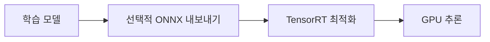

# CUDA / TensorRT / ONNX

[← 전체 목록](../../README.ko.md) · [English](../en/cuda-tensorrt-onnx.md) · [공식 소스](https://github.com/onnx/onnx) · [공식 문서 / 관련 프로젝트](https://developer.nvidia.com/tensorrt)

GPU 컴퓨팅 플랫폼 CUDA, 추론 최적화 SDK TensorRT, 모델 교환 형식과 생태계 ONNX를 함께 설명합니다.

**공개 및 이용 조건:** ONNX 코드와 사양의 조건을 확인하세요. CUDA·TensorRT 배포판, 드라이버와 제3자 구성 요소에는 별도 조건이 적용됩니다.

## 구성과 활용 흐름

*이 안내서의 개념도이며, 지원 구현은 공식 자료를 확인하세요.*

지원되는 모델을 필요에 따라 ONNX로 내보내고 대상 환경에서 추론 엔진을 만든 뒤 원본과 출력·성능을 비교합니다.

## 활용 사례

지원되는 비전 또는 로봇 정책의 NVIDIA GPU 추론을 최적화할 수 있습니다.

## 연계 기술

PyTorch는 지원 모델을 ONNX로 내보낼 수 있고 TensorRT는 NVIDIA GPU 소프트웨어를 사용합니다. 연산자 지원과 버전에 따라 실제 경로가 달라집니다.

## 공식 자료

- [프로젝트 자료](https://github.com/onnx/onnx)
- [공식 문서 / 관련 프로젝트](https://developer.nvidia.com/tensorrt)
- [CUDA](https://developer.nvidia.com/cuda-toolkit)
- [TensorRT](https://developer.nvidia.com/tensorrt)
- [ONNX](https://onnx.ai/)
