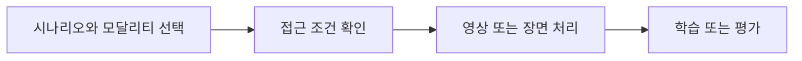

# 자율주행·영상·월드 모델 데이터

[전체 목록](../../README.ko.md) · [English](../en/datasets-driving-world-model.md)

공식 데이터셋 카드를 기준으로 형식, 접근 조건과 라이선스를 각각 확인한다. 공개 접근과 제한 없는 이용 권한은 다르다.

## 선택 및 활용 흐름

이 그림은 개념적 사용 흐름이다.

## 데이터셋별 상세

### PhysicalAI-Autonomous-Vehicles

실제 자율주행 다중 센서 데이터.

**라이선스·접근:** 별도 약관 확인; 로그인·접근 동의 필요.  
**공식 데이터셋 카드:** [PhysicalAI-Autonomous-Vehicles](https://huggingface.co/datasets/nvidia/PhysicalAI-Autonomous-Vehicles)

### PhysicalAI-Autonomous-Vehicles-NuRec

NuRec으로 재구성한 주행 장면.

**라이선스·접근:** 별도 약관 확인; 로그인·접근 동의 필요.  
**공식 데이터셋 카드:** [PhysicalAI-Autonomous-Vehicles-NuRec](https://huggingface.co/datasets/nvidia/PhysicalAI-Autonomous-Vehicles-NuRec)

### NuRec-AV-Object-Benchmark

자율주행 물체 중심 3D 재구성 벤치마크.

**라이선스·접근:** CC-BY-4.0; 공개.  
**공식 데이터셋 카드:** [NuRec-AV-Object-Benchmark](https://huggingface.co/datasets/nvidia/NuRec-AV-Object-Benchmark)

### PhysicalAI-Autonomous-Vehicles-NCore

NCore 기반 자율주행 센서 데이터.

**라이선스·접근:** 별도 약관 확인; 로그인·접근 동의 필요.  
**공식 데이터셋 카드:** [PhysicalAI-Autonomous-Vehicles-NCore](https://huggingface.co/datasets/nvidia/PhysicalAI-Autonomous-Vehicles-NCore)

### PhysicalAI-Autonomous-Vehicles-Foundation4D

4D 재구성을 위한 자율주행 데이터.

**라이선스·접근:** 별도 약관 확인; 로그인·접근 동의 필요.  
**공식 데이터셋 카드:** [PhysicalAI-Autonomous-Vehicles-Foundation4D](https://huggingface.co/datasets/nvidia/PhysicalAI-Autonomous-Vehicles-Foundation4D)

### PhysicalAI-Autonomous-Vehicle-Cosmos-Drive-Dreams

Cosmos 기반 합성 주행 데이터.

**라이선스·접근:** CC-BY-4.0; 공개.  
**공식 데이터셋 카드:** [PhysicalAI-Autonomous-Vehicle-Cosmos-Drive-Dreams](https://huggingface.co/datasets/nvidia/PhysicalAI-Autonomous-Vehicle-Cosmos-Drive-Dreams)

이미지 출처: [PhysicalAI-Autonomous-Vehicle-Cosmos-Drive-Dreams](https://huggingface.co/datasets/nvidia/PhysicalAI-Autonomous-Vehicle-Cosmos-Drive-Dreams)

### PhysicalAI-Autonomous-Vehicle-Cosmos-Synthetic

합성 주행 데이터; 데이터 카드에서 Cosmos Drive Dreams 참조.

**라이선스·접근:** CC-BY-4.0; 공개.  
**공식 데이터셋 카드:** [PhysicalAI-Autonomous-Vehicle-Cosmos-Synthetic](https://huggingface.co/datasets/nvidia/PhysicalAI-Autonomous-Vehicle-Cosmos-Synthetic)

### PhysicalAI-SmartSpaces

사람과 이동 장비 추적을 위한 다중 카메라 영상.

**라이선스·접근:** CC-BY-4.0; 공개.  
**공식 데이터셋 카드:** [PhysicalAI-SmartSpaces](https://huggingface.co/datasets/nvidia/PhysicalAI-SmartSpaces)

이미지 출처: [PhysicalAI-SmartSpaces](https://huggingface.co/datasets/nvidia/PhysicalAI-SmartSpaces)

### PhysicalAI-Traffic-Anomaly-Reasoning

교통 이상 상황 추론·평가 데이터.

**라이선스·접근:** CC-BY-4.0; 공개.  
**공식 데이터셋 카드:** [PhysicalAI-Traffic-Anomaly-Reasoning](https://huggingface.co/datasets/nvidia/PhysicalAI-Traffic-Anomaly-Reasoning)

### PhysicalAI-Human-1M-100K

동작·언어 주석이 포함된 사람의 1인칭 영상.

**라이선스·접근:** CC-BY-4.0; 공개.  
**공식 데이터셋 카드:** [PhysicalAI-Human-1M-100K](https://huggingface.co/datasets/nvidia/PhysicalAI-Human-1M-100K)

이미지 출처: [PhysicalAI-Human-1M-100K](https://huggingface.co/datasets/nvidia/PhysicalAI-Human-1M-100K)

### PhysicalAI-Spatial-Intelligence-Warehouse

창고 장면의 공간 지능 데이터.

**라이선스·접근:** CC-BY-4.0; 로그인·접근 동의 필요.  
**공식 데이터셋 카드:** [PhysicalAI-Spatial-Intelligence-Warehouse](https://huggingface.co/datasets/nvidia/PhysicalAI-Spatial-Intelligence-Warehouse)

### PhysicalAI-Robotics-NuRec

로봇용 신경 재구성 데이터.

**라이선스·접근:** CC-BY-4.0; 로그인·접근 동의 필요.  
**공식 데이터셋 카드:** [PhysicalAI-Robotics-NuRec](https://huggingface.co/datasets/nvidia/PhysicalAI-Robotics-NuRec)

### PhysicalAI-NuRec-PPISP

재구성·이미지 처리를 위한 장면 촬영 데이터.

**라이선스·접근:** CC-BY-4.0; 공개.  
**공식 데이터셋 카드:** [PhysicalAI-NuRec-PPISP](https://huggingface.co/datasets/nvidia/PhysicalAI-NuRec-PPISP)

### PhysicalAI-SpatialIntelligence-Lyra-SDG

공간 지능 연구용 합성 데이터.

**라이선스·접근:** CC-BY-4.0; 공개.  
**공식 데이터셋 카드:** [PhysicalAI-SpatialIntelligence-Lyra-SDG](https://huggingface.co/datasets/nvidia/PhysicalAI-SpatialIntelligence-Lyra-SDG)

### PhysicalAI-WorldModel-Synthetic-Autonomous-Driving-Scenarios

월드 모델용 합성 자율주행 장면.

**라이선스·접근:** 별도 약관 확인; 공개.  
**공식 데이터셋 카드:** [PhysicalAI-WorldModel-Synthetic-Autonomous-Driving-Scenarios](https://huggingface.co/datasets/nvidia/PhysicalAI-WorldModel-Synthetic-Autonomous-Driving-Scenarios)

### PhysicalAI-WorldModel-Synthetic-Embodied-Robot-Scenes

월드 모델용 합성 로봇 장면.

**라이선스·접근:** 별도 약관 확인; 공개.  
**공식 데이터셋 카드:** [PhysicalAI-WorldModel-Synthetic-Embodied-Robot-Scenes](https://huggingface.co/datasets/nvidia/PhysicalAI-WorldModel-Synthetic-Embodied-Robot-Scenes)

이미지 출처: [PhysicalAI-WorldModel-Synthetic-Embodied-Robot-Scenes](https://huggingface.co/datasets/nvidia/PhysicalAI-WorldModel-Synthetic-Embodied-Robot-Scenes)

### PhysicalAI-WorldModel-Synthetic-Digital-Human-Scenes

합성 디지털 휴먼 영상 장면.

**라이선스·접근:** 별도 약관 확인; 공개.  
**공식 데이터셋 카드:** [PhysicalAI-WorldModel-Synthetic-Digital-Human-Scenes](https://huggingface.co/datasets/nvidia/PhysicalAI-WorldModel-Synthetic-Digital-Human-Scenes)

### PhysicalAI-WorldModel-Synthetic-Physical-Interaction-Scenes

물리 시뮬레이션 기반 다중 물체 상호작용.

**라이선스·접근:** 별도 약관 확인; 공개.  
**공식 데이터셋 카드:** [PhysicalAI-WorldModel-Synthetic-Physical-Interaction-Scenes](https://huggingface.co/datasets/nvidia/PhysicalAI-WorldModel-Synthetic-Physical-Interaction-Scenes)

이미지 출처: [PhysicalAI-WorldModel-Synthetic-Physical-Interaction-Scenes](https://huggingface.co/datasets/nvidia/PhysicalAI-WorldModel-Synthetic-Physical-Interaction-Scenes)

### PhysicalAI-WorldModel-Synthetic-Warehouse-Operations-Scenes

합성 창고 운영 및 안전 이벤트 영상.

**라이선스·접근:** 별도 약관 확인; 공개.  
**공식 데이터셋 카드:** [PhysicalAI-WorldModel-Synthetic-Warehouse-Operations-Scenes](https://huggingface.co/datasets/nvidia/PhysicalAI-WorldModel-Synthetic-Warehouse-Operations-Scenes)

이미지 출처: [PhysicalAI-WorldModel-Synthetic-Warehouse-Operations-Scenes](https://huggingface.co/datasets/nvidia/PhysicalAI-WorldModel-Synthetic-Warehouse-Operations-Scenes)

### PhysicalAI-Event-Videos

영상 이상 상황·안전 이벤트 및 주석.

**라이선스·접근:** 별도 약관 확인; 공개.  
**공식 데이터셋 카드:** [PhysicalAI-Event-Videos](https://huggingface.co/datasets/nvidia/PhysicalAI-Event-Videos)

이미지 출처: [PhysicalAI-Event-Videos](https://huggingface.co/datasets/nvidia/PhysicalAI-Event-Videos)

### PhysicalAI-VANTAGE-Bench

고정 카메라 영상 이해 벤치마크.

**라이선스·접근:** 별도 약관 확인; 공개.  
**공식 데이터셋 카드:** [PhysicalAI-VANTAGE-Bench](https://huggingface.co/datasets/nvidia/PhysicalAI-VANTAGE-Bench)

이미지 출처: [PhysicalAI-VANTAGE-Bench](https://huggingface.co/datasets/nvidia/PhysicalAI-VANTAGE-Bench)

### PhysicalAI-VANTAGE-Bench-Subset

고정 카메라 영상 벤치마크의 부분집합.

**라이선스·접근:** 별도 약관 확인; 공개.  
**공식 데이터셋 카드:** [PhysicalAI-VANTAGE-Bench-Subset](https://huggingface.co/datasets/nvidia/PhysicalAI-VANTAGE-Bench-Subset)

이미지 출처: [PhysicalAI-VANTAGE-Bench-Subset](https://huggingface.co/datasets/nvidia/PhysicalAI-VANTAGE-Bench-Subset)

