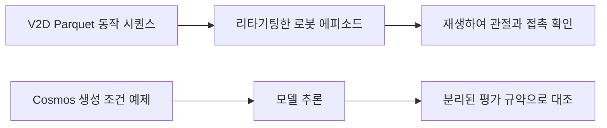

# V2D 및 Cosmos 데이터셋

[전체 목록](../../README.ko.md) · [English](../en/datasets-v2d-cosmos.md)

V2D와 Cosmos 워크플로의 여러 단계에 쓰이는 자료다. 동작과 행동 데이터, 생성 조건 예제, 평가 데이터는 요구하는 스키마와 사용 목적이 다르다.

## 작업과 산출물 맞추기

| 작업 | 대표 데이터 | 확인할 것 |
|---|---|---|
| 사람 동작을 로봇으로 옮긴 결과 확인 | [V2D 정교 조작 라이브러리](#video-to-data-robot-dexterity-task-library-and-dataset) | Parquet 동작 시퀀스, 로봇 에피소드, 로봇 형태, 행동 정의 |
| 영상 추론 후학습 또는 평가 | Reason1 [SFT](#cosmos-reason1-sft-dataset), [RL](#cosmos-reason1-rl-dataset), [벤치마크](#cosmos-reason1-benchmark) | 질의, 학습 신호, 평가용 분할의 역할 |
| Transfer 조건 예제 재현 | [LiDAR 예제](#cosmos-transfer-lidargen-example), [AV 샘플](#cosmos-transfer1-7b-sample-av-data-example) | 카메라, 제어 입력 종류, 프레임 속도와 체크포인트 호환성 |
| 로봇 에피소드 학습 또는 재생 | [Cosmos3-DROID](#cosmos3-droid), 아래 Cosmos Policy 데이터 | 카메라 뷰 키, 상태와 행동 배열, 시간, 에피소드 경계 |

이 개념도는 로봇 동작 재생과 조건부 생성을 나눈다. V2D 카드에는 영상, 궤적, 행동이 Parquet와 LeRobot v3 산출물로 설명돼 있다. Cosmos3-DROID는 별도의 LeRobot v3 변환으로, MP4 뷰 샤드, Parquet 상태·행동 행, 작업 메타데이터와 에피소드 경계를 포함한다. [V2D 데이터 카드](https://huggingface.co/datasets/nvidia/video-to-data-robot-dexterity-task-library-and-dataset) · [DROID 데이터 카드](https://huggingface.co/datasets/nvidia/Cosmos3-DROID)

공식 그림은 사람 시연 영상이 수집, 장면 재구성, Isaac Lab에서의 로봇 그라운딩으로 이어지는 과정을 보여준다. 아래 데이터셋에는 이 과정에서 생성한 동작과 행동의 예시가 담겨 있다. 이후 정책 학습이나 실물 로봇 배포를 하기 전에도 재생 가능한 산출물을 확인할 수 있다. [공식 Video to Data 파이프라인](https://github.com/nvidia-isaac/video_to_data)

## 활용 예시 — 학습 전 DROID 에피소드 하나 점검

meta/info.json에서 피처 이름을 확인하고 에피소드 하나의 외부 카메라와 손목 뷰를 디코딩한다. 같은 프레임의 관절과 그리퍼 값을 그리거나 재생한다. 다른 로봇에 적용하기 전에 행동 표현과 좌표계를 확인한다. V2D에서는 사람의 동작과 리타기팅한 로봇 실행을 따로 살펴 관절 한계와 접촉 실패를 찾는다. [DROID 스키마](https://huggingface.co/datasets/nvidia/Cosmos3-DROID#features) · [Video-to-Data](video-to-data.md)

## 데이터셋 상세

### video-to-data-robot-dexterity-task-library-and-dataset

V2D 사람 손 시연을 로봇 손으로 리타기팅한 데이터.

**라이선스·접근:** CC BY 4.0; 공개.  
**공식 데이터셋 카드:** [video-to-data-robot-dexterity-task-library-and-dataset](https://huggingface.co/datasets/nvidia/video-to-data-robot-dexterity-task-library-and-dataset)

### Cosmos-Reason1-RL-Dataset

추론 강화학습용 영상·텍스트 주석.

**라이선스·접근:** 라이선스 미확인; 공개.  
**공식 데이터셋 카드:** [Cosmos-Reason1-RL-Dataset](https://huggingface.co/datasets/nvidia/Cosmos-Reason1-RL-Dataset)

### Cosmos-Reason1-Benchmark

영상 추론 평가 주석.

**라이선스·접근:** 라이선스 미확인; 공개.  
**공식 데이터셋 카드:** [Cosmos-Reason1-Benchmark](https://huggingface.co/datasets/nvidia/Cosmos-Reason1-Benchmark)

### Cosmos-Reason1-SFT-Dataset

지도 추론 학습용 영상·텍스트 주석.

**라이선스·접근:** CC BY 4.0; 공개.  
**공식 데이터셋 카드:** [Cosmos-Reason1-SFT-Dataset](https://huggingface.co/datasets/nvidia/Cosmos-Reason1-SFT-Dataset)

### Cosmos-Transfer-LidarGen-Example

LiDAR 생성 예제 데이터.

**라이선스·접근:** 별도 약관; 접근 제한.  
**공식 데이터셋 카드:** [Cosmos-Transfer-LidarGen-Example](https://huggingface.co/datasets/nvidia/Cosmos-Transfer-LidarGen-Example)

### Cosmos-Transfer1-7B-Sample-AV-Data-Example

Cosmos Transfer용 자율주행 입력 예제.

**라이선스·접근:** CC BY 4.0; 접근 제한.  
**공식 데이터셋 카드:** [Cosmos-Transfer1-7B-Sample-AV-Data-Example](https://huggingface.co/datasets/nvidia/Cosmos-Transfer1-7B-Sample-AV-Data-Example)

### ALOHA-Cosmos-Policy

Cosmos Policy 학습용 실제 양손 조작 데이터.

**라이선스·접근:** CC 태그; 상세 약관 확인 필요.  
**공식 데이터셋 카드:** [ALOHA-Cosmos-Policy](https://huggingface.co/datasets/nvidia/ALOHA-Cosmos-Policy)

### LIBERO-Cosmos-Policy

Cosmos Policy용 LIBERO 시뮬레이션 데이터.

**라이선스·접근:** CC 태그; 상세 약관 확인 필요.  
**공식 데이터셋 카드:** [LIBERO-Cosmos-Policy](https://huggingface.co/datasets/nvidia/LIBERO-Cosmos-Policy)

### RoboCasa-Cosmos-Policy

Cosmos Policy용 RoboCasa 시뮬레이션 데이터.

**라이선스·접근:** CC 태그; 상세 약관 확인 필요.  
**공식 데이터셋 카드:** [RoboCasa-Cosmos-Policy](https://huggingface.co/datasets/nvidia/RoboCasa-Cosmos-Policy)

### Cosmos-HumanEval-v1

Cosmos 출력의 사람 평가 데이터.

**라이선스·접근:** 별도 약관 확인.  
**공식 데이터셋 카드:** [Cosmos-HumanEval-v1](https://huggingface.co/datasets/nvidia/Cosmos-HumanEval-v1)

### Cosmos-AnomalyGen-PCB-Dataset

PCB 결함 생성 데이터.

**라이선스·접근:** 별도 약관 확인.  
**공식 데이터셋 카드:** [Cosmos-AnomalyGen-PCB-Dataset](https://huggingface.co/datasets/nvidia/Cosmos-AnomalyGen-PCB-Dataset)

### Cosmos-AnomalyGen-Glass-Masks

유리 결함 생성용 마스크.

**라이선스·접근:** 라이선스 미확인; 공개.  
**공식 데이터셋 카드:** [Cosmos-AnomalyGen-Glass-Masks](https://huggingface.co/datasets/nvidia/Cosmos-AnomalyGen-Glass-Masks)

### Cosmos3-DROID

Cosmos 3용 로봇 조작 시연.

**라이선스·접근:** OpenMDW-1.1; 공개.  
**공식 데이터셋 카드:** [Cosmos3-DROID](https://huggingface.co/datasets/nvidia/Cosmos3-DROID)

### Cosmos3-Driving-Simulation-Evaluation

자율주행 시뮬레이션 평가용 제어 영상·설명.

**라이선스·접근:** OpenMDW-1.1; 공개.  
**공식 데이터셋 카드:** [Cosmos3-Driving-Simulation-Evaluation](https://huggingface.co/datasets/nvidia/Cosmos3-Driving-Simulation-Evaluation)
