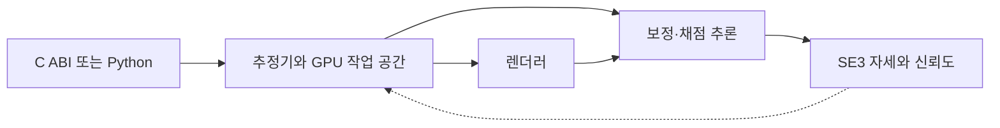

# FoundationPose Inference Library

[← 전체 목록](../../README.ko.md) · [English](../en/foundationpose-inference-library.md)

FoundationPose의 초기 자세 추정과 추적을 C ABI와 Python 바인딩으로 배포할 수 있는 라이브러리입니다.

## 어떻게 동작하나

추정기마다 지속 GPU 작업 공간, 물체 표현, CUDA 스트림을 유지합니다. 기본 렌더러는 CUDA 래스터라이저, 기본 추론 백엔드는 TensorRT입니다. 초기 추정은 RGB uint8, 미터 단위 float32 깊이, 카메라 내부 파라미터와 마스크를 받습니다. 추적은 새 마스크 없이 이전 자세를 보정합니다. 출력은 4×4 물체→카메라 변환과 신뢰도입니다. CPU와 GPU 메모리 입력은 복사 비용이 다릅니다.

### 구성 요소별 입출력

| 구성 요소 | 입력 | 출력 |
|---|---|---|
| 초기 추정 | RGB-D, 카메라 내부 파라미터, 마스크와 물체 표현 | 초기 물체→카메라 자세와 신뢰도 |
| 추적 | 새 RGB-D 프레임, 내부 파라미터와 이전 자세 | 보정된 변환과 신뢰도 |
| 통합 | 호스트 또는 장치 버퍼를 받는 C ABI 또는 Python 호출 | 로봇 애플리케이션이 사용할 자세 |

## 실전 워크플로

제공된 합성 예제나 BOP 예제부터 실행한 뒤 배포 RGB-D 카메라의 프레임을 전달합니다. 호스트 버퍼와 장치 버퍼의 자세 결과와 지연을 비교합니다. 메모리가 제한된 경우 보정 마이크로배치 크기를 줄여 초기 추정 지연을 측정합니다.

## 검증할 항목

입력 레이아웃과 단위, 보정과 변환 방향을 확인합니다. VRAM 최고 사용량과 초기 추정·추적 지연을 따로 기록합니다. 버전별 플랫폼 표와 별도 가중치 조건을 확인합니다.

## 공개 범위와 라이선스

코드 Apache-2.0; 모델 가중치 별도.

## 공식 자료

- [런타임 아키텍처와 초기 추정·추적 구성도](https://github.com/nvidia-isaac/foundation-pose-inference-library/blob/main/doc/ARCHITECTURE.md)
- [관련 공식 자료 · github.com](https://github.com/nvidia-isaac/foundation-pose-inference-library)
