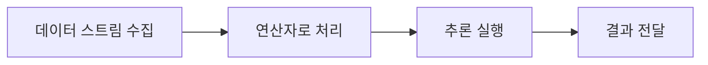

# Holoscan SDK

[전체 목록](../../README.ko.md) · [English](../en/holoscan-sdk.md)

저지연 스트리밍 및 센서 AI 애플리케이션을 위한 프레임워크다.

**공식 출처:** [Repository](https://github.com/nvidia-holoscan/holoscan-sdk)

**라이선스 및 공개 여부:** Apache-2.0; 외부 구성 요소 별도. 모델, 데이터, 의존성 및 배포 서비스에는 별도 조건이 적용될 수 있으므로 사용 전 각 출처를 확인한다.

## 워크플로우

아래는 이해를 돕기 위한 개념도이며 공식 아키텍처 도면이 아니다.

## 활용 사례

의료·산업 분야를 포함한 실시간 센서 처리 파이프라인을 개발한다.

## 연결 기술

CUDA, TensorRT, sensor devices. 실제 호환성과 실행 요건은 각 버전의 공식 문서를 확인한다.
