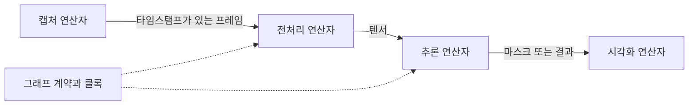

# Holoscan SDK

[← 전체 목록](../../README.ko.md) · [English](../en/holoscan-sdk.md)

Holoscan SDK는 센서 수집과 가속 처리, 시각화를 연결해 지연을 제어하는 스트리밍 애플리케이션을 구성합니다.

*4.0에서 프래그먼트가 연산자와 포트를 묶는 방식을 보여줍니다. 아래 5.0 그래프 API에서는 구성을 기술하는 단위가 달라졌습니다.* [공식 그림 출처](https://docs.nvidia.com/holoscan/archive/4.0.0/holoscan_core.html)

## 어떻게 동작하나

공식 5.0 그래프 API에서 연산자는 타입이 지정된 입출력 포트를 선언합니다. 그래프에서 포트를 연결하고, 계약에서 시간 규칙을 표현하며, 컴파일로 실행 계획을 확정합니다. 실행 세션은 계획을 활성화해 연산자 사이로 샘플을 이동시킵니다. 4.x의 애플리케이션·프래그먼트 API는 별도 문서로 제공됩니다.

## 실전 워크플로

카메라, 영상 포맷 변환, 분할 모델, 디스플레이를 연결합니다. 촬영부터 표시까지 샘플 시각을 추적합니다. 추론에 지연을 추가해 큐 동작을 관찰한 뒤 그래프 지연 설정을 조정합니다.

## 검증할 항목

장치 메모리 소유권, 샘플 시각, 큐 정책과 입력 급증 시 동작을 확인합니다. 예제가 설치한 SDK의 API 버전과 맞는지도 확인합니다.

## 공개 범위와 라이선스

Apache-2.0; 외부 구성 요소 별도. 모델, 데이터, 의존성 및 배포 서비스에는 별도 조건이 적용될 수 있으므로 사용 전 각 출처를 확인한다.

## 공식 자료

- [아키텍처와 워크플로 공식 문서](https://docs.nvidia.com/holoscan/sdk-user-guide/getting-started/core-concepts)
- [Holoscan 4.x 핵심 개념](https://docs.nvidia.com/holoscan/sdk-user-guide/using-the-sdk/holoscan-core)
- [관련 공식 자료 · github.com](https://github.com/nvidia-holoscan/holoscan-sdk)
