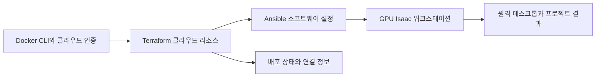

# Isaac Automator

[← 전체 목록](../../README.ko.md) · [English](../en/isaac-automator.md)

Isaac Automator는 지원 퍼블릭 클라우드에 Isaac Sim, Isaac Lab 또는 Isaac Lab-Arena용 GPU 워크스테이션을 만든다. 인프라 생성과 소프트웨어 설정을 묶고 개발과 시뮬레이션에 사용할 원격 데스크톱을 제공한다.

## 아키텍처

| 구성 요소 | 역할과 데이터 경계 |
|---|---|
| 로컬 컨테이너와 CLI | Docker 컨테이너에서 클라우드별 명령을 실행한다. 배포 입력에는 지역, GPU 인스턴스 유형, 인바운드 접근 범위, Isaac 애플리케이션 버전이 포함된다. |
| Terraform과 Ansible | 인프라와 소프트웨어 설정은 별도 단계다. Terraform으로 클라우드 리소스를 관리하고 Ansible로 워크스테이션을 구성한다. 복구도 단계별로 실행할 수 있다. |
| `state/`와 워크스테이션 | 로컬 배포 상태와 연결 안내로 CLI가 VM을 찾는다. noVNC 또는 NoMachine이 데스크톱을 제공하며 업로드·다운로드 명령으로 프로젝트 데이터를 이동한다. |

아래 공식 자료를 바탕으로 이 가이드에서 재구성한 그림입니다.

### 공식 그림과 예시

Isaac Automator 저장소의 프로젝트 이미지. 위 구성도에서 CLI, 인프라, 워크스테이션의 역할을 구분했다. [그림 출처와 원문 설명](https://github.com/isaac-sim/IsaacAutomator)

## 워크플로 예시

1. 재현 가능한 정책 평가 환경을 위해 클라우드와 GPU 할당량을 확인하고 Isaac 버전을 고정한다. 인바운드 접근 범위를 명시하고 배포 이름과 클라우드 설정을 기록한다.
2. 배포 후 연결 안내를 열고 프로젝트 에셋이나 가중치를 넣기 전에 Isaac Sim 기본 장면을 실행한다. 장면을 업로드하고 Arena 평가를 수행한 다음 로그를 내려받는다.
3. 클라우드 리소스는 정상인데 패키지 설정이 실패하면 소프트웨어 복구 경로를 사용한다. 작업이 끝나면 워크스테이션 재사용 여부에 따라 일시 정지 또는 삭제한다.

## 검증 포인트

- 배포 상태와 접속 자료는 비공개 위치에 보관한다. 로컬 컨테이너를 다시 시작해도 관리에 필요한 상태를 유지해야 한다.
- 지역별 용량과 정확한 앱 버전 지원을 확인한다. 워크스테이션을 정지해도 일부 영구 리소스와 비용이 남을 수 있다.

## 라이선스와 범위

Isaac Automator 코드는 Apache-2.0이다. 클라우드 리소스와 설치 소프트웨어에는 개별 조건이 적용된다.

## 관련 가이드

[Isaac Sim](isaac-sim.md) · [Isaac Lab](isaac-lab.md) · [Isaac Lab-Arena](isaac-lab-arena.md)

## 공식 자료

- [Isaac Automator 배포·운영 가이드](https://github.com/isaac-sim/IsaacAutomator)
- [원격 데스크톱 연결](https://github.com/isaac-sim/IsaacAutomator#connecting-to-deployed-isaac-workstation)
- [인프라·소프트웨어 복구](https://github.com/isaac-sim/IsaacAutomator#repairing)
