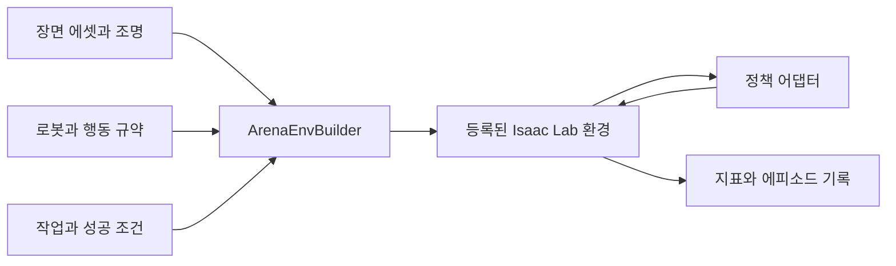

# Isaac Lab-Arena

[← 전체 목록](../../README.ko.md) · [English](../en/isaac-lab-arena.md)

Isaac Lab-Arena는 재사용 가능한 요소를 조합해 로봇 정책 평가 환경을 만든다. 작업을 고정한 상태에서 장면, 로봇 형태 또는 정책을 바꿔 실패가 어느 조건과 관련 있는지 추적할 수 있다.

NVIDIA는 CoRL 2026에서 **0.4 개발자 프리뷰**를 발표했다. Arena의 재사용 가능한 평가 구성 요소와 병렬 실행을 기반으로 한다. [NVIDIA 공식 발표](https://blogs.nvidia.com/blog/robotics-simulation-advancements-corl/)

## 아키텍처

| 구성 요소 | 역할과 데이터 경계 |
|---|---|
| 장면 (Scene) | 에셋 인스턴스, 배경, 조명을 제공한다. 한 벤치마크에 여러 배치나 물체 변형을 포함할 수 있다. |
| 로봇 형태 (Embodiment) | 로봇 기술 정보, 행동, 관측과 센서를 지정한다. 로봇을 바꾸면 정책에 제공하는 데이터 규약도 바뀐다. |
| 작업 (Task) | 물체를 지정 영역으로 옮기는 등 달성할 결과를 정의한다. 정책을 비교할 때는 성공 조건을 고정한다. |
| `ArenaEnvBuilder`와 정책 평가 | 세 입력을 Isaac Lab ManagerBasedRLEnv로 컴파일해 등록한다. 정책 어댑터와 평가 러너가 이 환경에서 행동을 입력하고 결과를 기록한다. |

아래 공식 자료를 바탕으로 이 가이드에서 재구성한 그림입니다.

### 공식 그림과 예시

NVIDIA 구성도는 파트너 에셋과 작업 정의를 정책 평가 프레임워크에 연결한다. [그림 출처와 원문 설명](https://developer.nvidia.com/blog/simplify-generalist-robot-policy-evaluation-in-simulation-with-nvidia-isaac-lab-arena)

Lightwheel 주방 작업 모음은 공통 작업 인터페이스에서 평가 장면을 바꿀 수 있는 사례다. [그림 출처와 원문 설명](https://developer.nvidia.com/blog/simplify-generalist-robot-policy-evaluation-in-simulation-with-nvidia-isaac-lab-arena)

## 워크플로 예시

1. 물체 배치나 전자레인지 문 열기 작업을 정의하고 스크립트 행동으로 성공 판정을 점검한다. 로봇을 선택해 관측과 행동 공간을 정책 인터페이스와 비교한다.
2. ArenaEnvBuilder로 환경을 등록한다. 같은 정책을 고정 초기 상태와 미사용 주방 배치에서 실행한다. 실패를 재생할 수 있도록 작업 메타데이터와 영상을 남긴다.
3. 기준 평가를 마친 뒤 두 번째 정책이나 로봇을 추가한다. 다른 작업 집합을 한 번에 평균내지 않고 장면·로봇별로 성공률을 보고한다.

## 검증 포인트

- 정책 어댑터 버전, 행동 규약, 리셋 시드, 벤치마크 정의를 기록한다. 비교에서는 동일한 에피소드 길이와 성공 기준을 쓴다.
- 작업 정의를 재사용하더라도 에셋·관측·행동 의미가 호환돼야 한다. 선택한 물리 백엔드와 로봇의 지원 범위를 확인한다.

## 라이선스와 범위

Arena 저장소는 Apache-2.0이다. 시뮬레이터, 평가 콘텐츠, 에셋과 정책의 이용 조건은 별도다.

## 관련 가이드

[Isaac Lab](isaac-lab.md) · [Isaac GR00T](isaac-gr00t.md) · [Isaac Sim](isaac-sim.md)

## 공식 자료

- [Isaac Lab-Arena 소스](https://github.com/isaac-sim/IsaacLab-Arena)
- [장면·로봇·작업 조합](https://isaac-sim.github.io/IsaacLab-Arena/main/pages/concepts/environment/index.html)
- [공식 평가·벤치마크 예시](https://developer.nvidia.com/blog/simplify-generalist-robot-policy-evaluation-in-simulation-with-nvidia-isaac-lab-arena)
