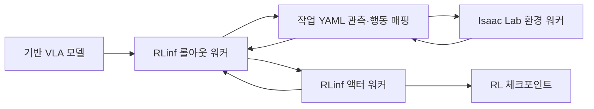

# Isaac RLPT

[← 전체 목록](../../README.ko.md) · [English](../en/isaac-rlpt.md)

Isaac Lab은 사전학습된 비전·언어·행동 모델을 강화학습으로 후학습하는 실험 기능을 제공한다. RLinf가 정책 추론·시뮬레이션·업데이트 워커를 실행하고 Isaac Lab이 작업 관측·행동·보상·리셋을 제공한다.

## 아키텍처

| 구성 요소 | 역할과 데이터 경계 |
|---|---|
| 환경 워커 | IsaacLabGenericEnv가 시뮬레이터를 진행한다. 작업 YAML로 카메라·언어·상태 키를 정책 표현에 맞추고 모델 행동을 환경 관절 배열로 변환한다. |
| 롤아웃 워커 | VLA 모델을 실행하고 환경과 관측·행동을 교환하며 여러 스텝의 경험을 모은다. |
| 액터 워커 | 문서 예제의 PPO처럼 강화학습 목적함수로 정책을 갱신한다. 평가에서는 기반 모델과 RL 체크포인트를 별도 입력으로 받는다. |

아래 공식 자료를 바탕으로 이 가이드에서 재구성한 그림입니다.

### 공식 그림과 예시

NVIDIA의 GR00T N1.7 모델 구성도. 영상·언어·상태 입력과 행동 출력을 보여 준다. RLinf 워커 구성은 위 가이드 그림에서 설명한다. [그림 출처와 원문 설명](https://developer.nvidia.com/blog/develop-humanoid-robot-policies-end-to-end-with-nvidia-isaac-gr00t/)

## 워크플로 예시

1. 문서에 명시한 시뮬레이터·정책·RLinf 버전으로 트로카 조립 작업을 재현한다. 기반 모델부터 실행해 성공·실패 영상을 남긴다.
2. 환경 하나에서 작업 YAML의 관측 키와 행동 변환을 확인한다. 후학습을 실행하고 실험 설정과 `global_step_<N>` 체크포인트를 보관한다.
3. 학습에서 제외한 조건을 포함해 동일한 리셋 분포에서 기반 모델과 RL 체크포인트를 평가한다. 성공률, 완료 시간, 실패 유형을 기록한다.

## 검증 포인트

- 학습 전 관절 슬라이스, 패딩, 정규화와 카메라 순서를 확인한다. 텐서 크기가 맞아도 잘못된 관절로 행동이 들어갈 수 있다.
- 문서의 의존성 버전을 고정하고 롤아웃 병렬도를 올릴 때 VRAM을 확인한다. 이 통합 기능은 실험 단계다.

## 라이선스와 범위

이 가이드는 Isaac Lab 문서의 통합 기능을 설명한다. Isaac Lab, RLinf, 모델 가중치, 에셋과 시뮬레이션 구성 요소마다 이용 조건이 별도다.

## 관련 가이드

[Isaac Lab](isaac-lab.md) · [Isaac GR00T](isaac-gr00t.md) · [Isaac Lab-Arena](isaac-lab-arena.md)

## 공식 자료

- [Isaac Lab RLinf 구조와 작업 YAML](https://docs.nvidia.com/isaaclab/experimental-features/rl-post-training-for-vla-models)
- [Isaac Lab 구현](https://github.com/isaac-sim/IsaacLab)
- [RLinf 소스](https://github.com/RLinf/RLinf)
