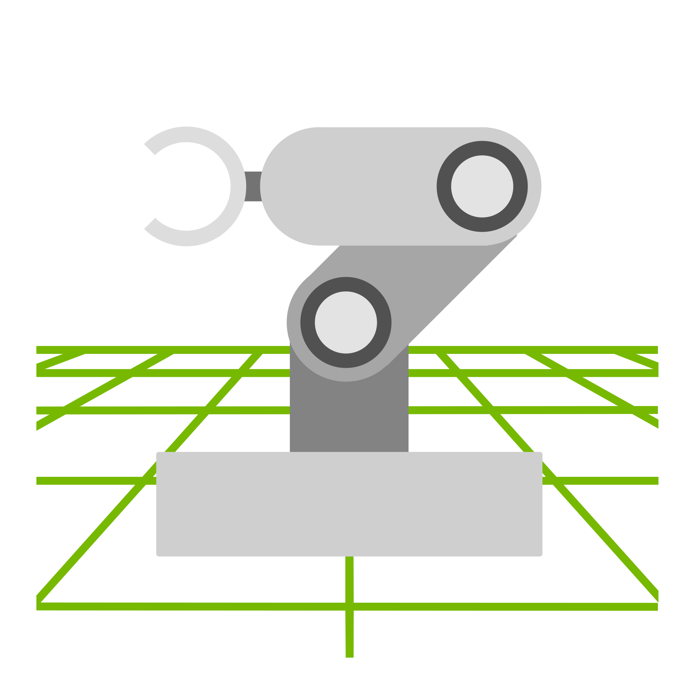
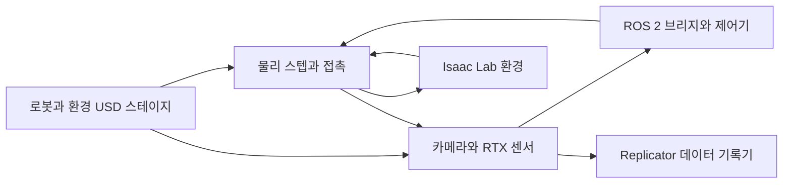

# Isaac Sim

[← 프로젝트 홈](../../README.ko.md) · [English](../en/isaac-sim.md)

   
  <a href="https://github.com/isaac-sim/IsaacSim/blob/7c206f75bdadd9e05fc457f19863ca4c3f0cb693/source/deprecated/isaacsim.replicator.domain_randomization/python/nodes/icons/isaac-sim.svg">Isaac Sim 공식 아이콘</a>

Isaac Sim에서는 OpenUSD로 장면을 만들고 로봇과 물체의 움직임을 시뮬레이션할 수 있습니다. 가상 카메라와 센서를 붙인 뒤 같은 장면을 ROS 2 연동 테스트, Replicator 합성 데이터 생성, Isaac Lab 정책 학습에 쓸 수 있습니다.

처음이라면 [큐브 낙하 실습](workflows/isaac-sim-first-cube.md)에서 강체와 충돌체를 적용해 보세요.

## 같은 장면에서 물리 계산과 카메라가 어떻게 연결될까요?

### 장면에서 화면까지

USD 스테이지에는 로봇과 물체, 충돌체, 카메라가 각각 프림으로 들어 있습니다. 재생하면 PhysX가 충돌과 관절 운동을 계산하고, 그 상태를 RTX가 카메라 시점에서 렌더링합니다. Replicator 어노테이터는 같은 화면에서 색, 깊이, 분할 라벨을 읽을 수 있습니다.

### 저장된 상태와 카메라 데이터 읽기

작업대 예제의 [USD 파일](../../labs/scene-to-data/workbench_scene.usda)에는 상판 `/World/Workbench/Tabletop`과 촬영용 `/World/InspectionCamera`가 있습니다. [저장된 기록](../../labs/scene-to-data/recorded.json)에서 큐브 중심 높이는 약 1.154m에서 0.862m로 바뀌었습니다. 물리 좌표는 3D 장면 기준 미터이고, 촬영한 RGB의 배열은 `[720, 1280, 3]`인 이미지 좌표입니다. 물체가 실제로 떨어졌는지 확인할 때는 영상과 높이 기록을 대조합니다. [Isaac Sim 공식 문서](https://docs.isaacsim.omniverse.nvidia.com/6.2.0/index.html) · [작업대 실습](labs/workbench-capstone.md)

## 릴리스 구분

**Isaac Sim 6.2.0**은 2026년 11월 13일 기준 최신 정식 버전이자 Isaac Lab 3.0의 대상 버전입니다. Newton 1.6.1과 Warp 1.17.0을 포함하고, 에셋 서버 확인에 시간 제한을 추가했습니다. Newton의 물리 서브스텝과 구동기 동작을 수정했고 Cortex는 제거했습니다. 이 가이드의 실습을 재현할 때는 6.2.0 정식 태그를 기준으로 삼습니다. [GitHub 릴리스](https://github.com/isaac-sim/IsaacSim/releases/tag/v6.2.0) · [6.2 릴리스 노트](https://docs.isaacsim.omniverse.nvidia.com/6.2.0/overview/release_notes.html)

**Isaac Sim 7.0.0 Alpha 1**은 C, C++, Python API를 제공하는 독립 실행형 시뮬레이션 라이브러리의 초기 버전입니다. NVIDIA는 초기 평가용으로 공개했으며 후속 알파에서 API와 패키지가 바뀔 수 있다고 안내합니다. 같은 확인일 기준으로 저장소의 `release/6.3` 브랜치에 대응하는 정식 릴리스 태그는 아직 없습니다. [7.0 Alpha 1 릴리스](https://github.com/isaac-sim/IsaacSim/releases/tag/v7.0.0a1) · [알파 버전 개요](https://docs.isaacsim.omniverse.nvidia.com/7.0.0a1/about.html) · [6.3 브랜치](https://github.com/isaac-sim/IsaacSim/tree/release/6.3)

## 아키텍처

| 구성 요소 | 역할과 주고받는 데이터 |
|---|---|
| 기하와 장면 제작 | URDF나 USD에서 로봇 기하와 구성 정보를 가져오고 관절체·콜라이더·구동기를 설정합니다. 환경 에셋은 별도 장면 구성 요소로 참조합니다. |
| 물리와 시간 | 물리 엔진은 물리 시간 간격에 맞춰 물체 자세와 접촉을 계산합니다. 앱·센서의 갱신률은 달라질 수 있어 인터페이스에서 시뮬레이션 시간을 전달해야 합니다. |
| 센서와 렌더러 | 카메라와 RTX 센서 파이프라인은 합성 장면과 자세를 사용합니다. 카메라 영상, LiDAR 출력, 물리 기반 접촉 측정은 서로 다른 센서 경로입니다. |
| 외부 사용처 | ROS 2로 명령과 관측을 교환할 수 있습니다. Replicator는 렌더 프로덕트와 주석 생성기 및 기록기를 결합합니다. Isaac Lab은 학습 환경에서 시뮬레이터 상태를 읽고 행동을 적용합니다. |

아래 공식 자료를 바탕으로 이 가이드에서 재구성한 그림입니다.

### 공식 그림과 예시

NVIDIA 참조 아키텍처는 로봇과 장면 제작, 상호작용, 데이터 생성, 평가 작업을 구분합니다. [그림 출처와 원문 설명](https://docs.isaacsim.omniverse.nvidia.com/6.1.0/introduction/reference_architecture.html)

Replicator 화면에서는 렌더링한 뷰와 함께 주석을 생성하는 데이터셋 경로를 확인할 수 있습니다. [그림 출처와 원문 설명](https://docs.isaacsim.omniverse.nvidia.com/6.1.0/introduction/reference_architecture.html)

## 워크플로 예시

1. 장애물 회피를 시험하려면 OpenUSD 창고 장면에 바퀴 로봇과 선반을 놓습니다. 충돌 형상을 확인하고 실제 장착 자세와 동일하게 LiDAR를 추가합니다.
2. ROS 2 브리지에서 센서 데이터를 발행하고 이동 명령을 받습니다. 고정 장애물과 스크립트 경로부터 시작해 점군·좌표 변환·시뮬레이션 시간·로봇 경로를 저장합니다.
3. 선반 배치나 조명을 바꾸고 같은 명령을 재생합니다. 인식 학습이 필요하면 Replicator에 주석 생성기와 기록기를 붙여 라벨 데이터셋을 별도로 생성합니다.

## 검증할 항목

- 주행 실패 원인을 판단하기 전에 스캔 좌표계, 토픽 타임스탬프와 장면 단위를 비교합니다.
- 릴리스, 센서 설정, 물리 시간 간격과 갱신률을 실험 메타데이터에 기록합니다. 로봇을 움직이기 전에 정지 상태의 센서 샘플을 확인합니다.

## 공개 범위와 라이선스

저장소 코드는 Apache-2.0입니다. Omniverse Kit SDK와 일부 배포 구성 요소, 에셋에는 별도 조건이 적용됩니다. [Isaac Sim 6.2 라이선스 원문](https://github.com/isaac-sim/IsaacSim/blob/v6.2.0/LICENSE)

## 관련 가이드

[OpenUSD](openusd.md) · [PhysX](nvidia-physx.md) · [Isaac Lab](isaac-lab.md) · [Replicator](replicator.md) · [ROS 2](ros-2.md)

## 공식 자료

- [Isaac Sim 소스](https://github.com/isaac-sim/IsaacSim)
- [참조 아키텍처와 작업 분류](https://docs.isaacsim.omniverse.nvidia.com/6.1.0/introduction/reference_architecture.html)
- [RTX 센서 인터페이스](https://docs.isaacsim.omniverse.nvidia.com/6.1.0/sensors/isaacsim_sensors_rtx.html)
- [ROS 2 연동 튜토리얼](https://docs.isaacsim.omniverse.nvidia.com/latest/ros2_tutorials/index.html)
