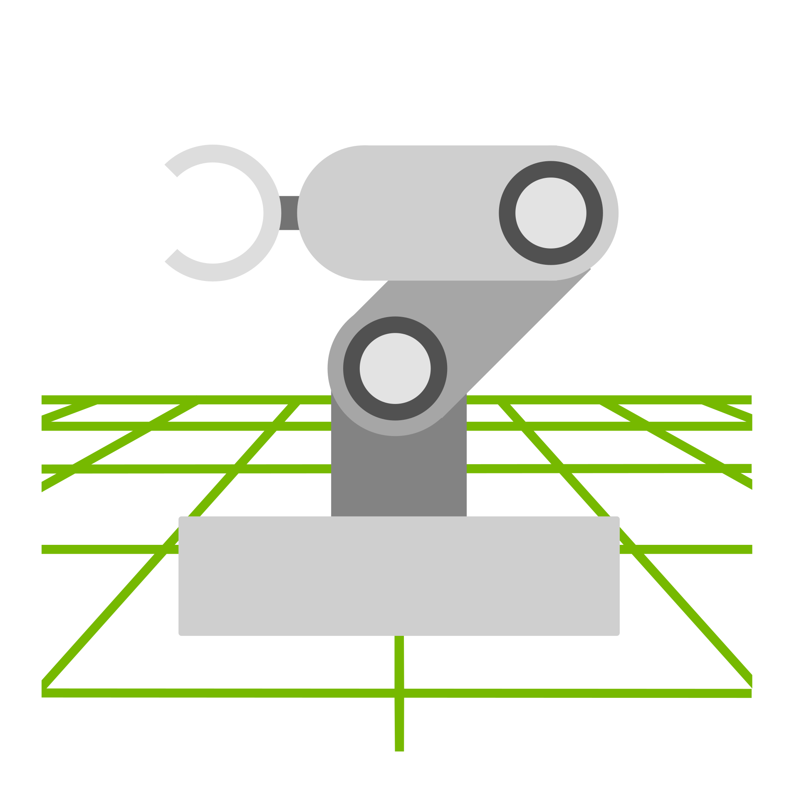
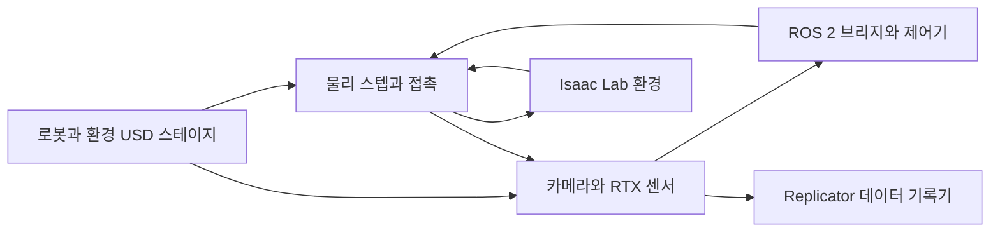

# Isaac Sim

[← 전체 목록](../../README.ko.md) · [English](../en/isaac-sim.md)

   
  <a href="https://github.com/isaac-sim/IsaacSim/blob/7c206f75bdadd9e05fc457f19863ca4c3f0cb693/source/deprecated/isaacsim.replicator.domain_randomization/python/nodes/icons/isaac-sim.svg">Isaac Sim 공식 아이콘</a>

Isaac Sim은 OpenUSD 장면을 구성하고 로봇·물체의 동역학을 진행하며 가상 센서를 제공하는 로봇 시뮬레이션 애플리케이션이다. 설정에 따라 한 장면을 ROS 2 연동 시험, Replicator 데이터 생성, Isaac Lab 학습 작업에 사용할 수 있다.

처음이라면 [큐브 낙하 실습](workflows/isaac-sim-first-cube.md)에서 강체와 충돌체를 적용해 보세요.

## 릴리스 구분

**Isaac Sim 6.2.0**은 2026년 11월 13일 기준 최신 정식 버전이자 Isaac Lab 3.0의 대상 버전입니다. Newton 1.6.1과 Warp 1.17.0을 포함하고, 에셋 서버 확인에 시간 제한을 추가했습니다. Newton의 물리 서브스텝과 구동기 동작을 수정했고 Cortex는 제거했습니다. 이 가이드의 실습을 재현할 때는 6.2.0 정식 태그를 기준으로 삼습니다. [GitHub 릴리스](https://github.com/isaac-sim/IsaacSim/releases/tag/v6.2.0) · [6.2 릴리스 노트](https://docs.isaacsim.omniverse.nvidia.com/6.2.0/overview/release_notes.html)

**Isaac Sim 7.0.0 Alpha 1**은 C, C++, Python API를 제공하는 독립 실행형 시뮬레이션 라이브러리의 초기 버전입니다. NVIDIA는 초기 평가용으로 공개했으며 후속 알파에서 API와 패키지가 바뀔 수 있다고 안내합니다. 같은 확인일 기준으로 저장소의 `release/6.3` 브랜치에 대응하는 정식 릴리스 태그는 아직 없습니다. [7.0 Alpha 1 릴리스](https://github.com/isaac-sim/IsaacSim/releases/tag/v7.0.0a1) · [알파 버전 개요](https://docs.isaacsim.omniverse.nvidia.com/7.0.0a1/about.html) · [6.3 브랜치](https://github.com/isaac-sim/IsaacSim/tree/release/6.3)

## 아키텍처

| 구성 요소 | 역할과 데이터 경계 |
|---|---|
| 기하와 장면 제작 | URDF나 USD에서 로봇 기하와 구성 정보를 가져오고 관절체·콜라이더·구동기를 설정한다. 환경 에셋은 별도 장면 구성 요소로 참조한다. |
| 물리와 시간 | 물리 엔진은 물리 시간 간격에 맞춰 물체 자세와 접촉을 계산한다. 앱·센서의 갱신률은 달라질 수 있어 인터페이스에서 시뮬레이션 시간을 전달해야 한다. |
| 센서와 렌더러 | 카메라와 RTX 센서 파이프라인은 합성 장면과 자세를 사용한다. 카메라 영상, LiDAR 출력, 물리 기반 접촉 측정은 서로 다른 센서 경로다. |
| 외부 사용처 | ROS 2로 명령과 관측을 교환할 수 있다. Replicator는 렌더 프로덕트와 주석 생성기 및 기록기를 결합한다. Isaac Lab은 학습 환경에서 시뮬레이터 상태를 읽고 행동을 적용한다. |

아래 공식 자료를 바탕으로 이 가이드에서 재구성한 그림입니다.

### 공식 그림과 예시

NVIDIA 참조 아키텍처는 로봇과 장면 제작, 상호작용, 데이터 생성, 평가 작업을 구분한다. [그림 출처와 원문 설명](https://docs.isaacsim.omniverse.nvidia.com/6.1.0/introduction/reference_architecture.html)

Replicator 화면에서는 렌더링한 뷰와 함께 주석을 생성하는 데이터셋 경로를 확인할 수 있다. [그림 출처와 원문 설명](https://docs.isaacsim.omniverse.nvidia.com/6.1.0/introduction/reference_architecture.html)

## 워크플로 예시

1. 장애물 회피를 시험하려면 OpenUSD 창고 장면에 바퀴 로봇과 선반을 놓는다. 충돌 형상을 확인하고 실제 장착 자세와 동일하게 LiDAR를 추가한다.
2. ROS 2 브리지에서 센서 데이터를 발행하고 이동 명령을 받는다. 고정 장애물과 스크립트 경로부터 시작해 점군·좌표 변환·시뮬레이션 시간·로봇 경로를 저장한다.
3. 선반 배치나 조명을 바꾸고 같은 명령을 재생한다. 인식 학습이 필요하면 Replicator에 주석 생성기와 기록기를 붙여 라벨 데이터셋을 별도로 생성한다.

## 검증 포인트

- 주행 실패 원인을 판단하기 전에 스캔 좌표계, 토픽 타임스탬프와 장면 단위를 비교한다.
- 릴리스, 센서 설정, 물리 시간 간격과 갱신률을 실험 메타데이터에 기록한다. 로봇을 움직이기 전에 정지 상태의 센서 샘플을 확인한다.

## 라이선스와 범위

저장소 코드는 Apache-2.0입니다. Omniverse Kit SDK와 일부 배포 구성 요소, 에셋에는 별도 조건이 적용됩니다. [Isaac Sim 6.2 라이선스 원문](https://github.com/isaac-sim/IsaacSim/blob/v6.2.0/LICENSE)

## 관련 가이드

[OpenUSD](openusd.md) · [PhysX](nvidia-physx.md) · [Isaac Lab](isaac-lab.md) · [Replicator](replicator.md) · [ROS 2](ros-2.md)

## 공식 자료

- [Isaac Sim 소스](https://github.com/isaac-sim/IsaacSim)
- [참조 아키텍처와 작업 분류](https://docs.isaacsim.omniverse.nvidia.com/6.1.0/introduction/reference_architecture.html)
- [RTX 센서 인터페이스](https://docs.isaacsim.omniverse.nvidia.com/6.1.0/sensors/isaacsim_sensors_rtx.html)
- [ROS 2 연동 튜토리얼](https://docs.isaacsim.omniverse.nvidia.com/latest/ros2_tutorials/index.html)
