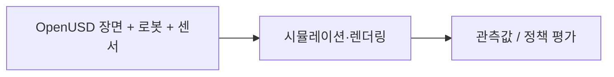

# Isaac Sim

[← 전체 목록](../../README.ko.md) · [English](../en/isaac-sim.md) · [공식 소스](https://github.com/isaac-sim/IsaacSim) · [공식 문서](https://docs.isaacsim.omniverse.nvidia.com/latest/index.html)

가상 환경, 로봇, 센서를 구성하고 로봇 워크플로우를 시뮬레이션하는 애플리케이션입니다.

**라이선스:** 저장소 코드 Apache-2.0; 배포판·에셋·의존성은 별도 조건 적용 가능. 사용 전에 해당 버전과 에셋·모델·의존성의 조건을 확인하세요.

*이미지 출처: [공식 프로젝트 저장소](https://github.com/isaac-sim/IsaacSim). 저작자 표시 및 재사용 조건은 원본을 확인하세요.*

## 구성과 아키텍처

확장 가능한 애플리케이션에서 장면 구성, 물리, 렌더링과 센서 시뮬레이션을 결합합니다. 지원되는 센서와 에셋, 물리 기능은 설치한 버전에 따라 다릅니다.

*이 안내서에서 만든 개념적 흐름도입니다. 실제 구현은 공식 문서를 확인하세요.*

## 활용 흐름

에셋으로 장면을 구성하고 로봇과 센서를 추가합니다. 상호작용을 시뮬레이션하고 센서 관측값을 생성하거나 로봇 정책을 평가합니다.

## 활용 사례

창고 로봇 동작 테스트, 합성 카메라 데이터 생성, 실제 장비 배포 전 정책 평가에 활용할 수 있습니다.

## 연계 기술

OpenUSD가 장면을 기술하고 PhysX가 물리 기능을 제공합니다. Isaac Lab은 호환 백엔드를 활용해 로봇 학습을 수행하며 Replicator는 합성 데이터 생성을 지원합니다.

## 공식 자료

- [프로젝트 저장소](https://github.com/isaac-sim/IsaacSim)
- [공식 문서](https://docs.isaacsim.omniverse.nvidia.com/latest/index.html)
