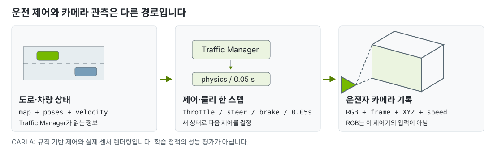

# 운전자 시점으로 네 가지 도로 환경 달려 보기

[English](../../en/labs/carla-ego.md) · [실습 코드](../../../labs/carla-ego/)

## 자동차와 카메라는 각각 무엇을 할까요?

먼저 아래의 4분할 영상을 보세요. **CARLA 0.9.16의 실제 RGB 센서**로 촬영한 화면입니다. Isaac Sim에서 경로를 재생한 영상과 달리 Unreal Engine이 도로와 교통을 렌더링합니다. 도심, 폭우가 내리는 교차로, 해 질 무렵의 젖은 주택가, 안개 낀 고속도로에 서로 다른 맵을 사용했습니다. 화면 아래에 보이는 보닛으로 카메라의 위치를 가늠할 수 있습니다.



### 운전하는 프로그램과 영상을 찍는 센서를 구분해 봅시다

CARLA의 **Traffic Manager**는 가상 차량과 도로 정보를 읽고 가속·조향·제동을 정하는 규칙 기반 제어기입니다. RGB 카메라는 그 차에서 보이는 풍경을 기록합니다. **Traffic Manager가 이 카메라 영상을 보고 운전하는 것은 아닙니다.** 다양한 센서·환경을 시험하는 예제이며, 학습한 자율주행 모델의 성능을 검증한 결과는 아닙니다. [Traffic Manager 공식 설명](https://carla.readthedocs.io/en/0.9.16/adv_traffic_manager/)

한 스텝마다 가상 시간이 `0.05초`씩 흐릅니다. 차량 기준 `(0.3, 0, 1.45)m`에 운전자 카메라를, `(-6, 0, 3)m`에 뒤따라가는 카메라를 달아 같은 스텝을 촬영합니다. 원본 센서 버퍼는 `[540, 960, 4]` 모양의 `uint8` 배열입니다. BGRA 순서이므로 알파를 빼고 BGR을 RGB로 바꾼 뒤 영상에 씁니다. 프레임 번호로 그 순간의 차량 위치·속도와 연결합니다.

```text
도로 + 현재 차량 상태 → Traffic Manager → 가속·조향·제동 명령
                                            ↓
                               CARLA 물리 계산 → 다음 차량 상태
                                            ↓
                             RGB 카메라 + 차량 자세 → 저장할 샘플
```

### 네 화면에서 볼 것

| 위치 | 환경 | 살펴볼 부분 |
|---|---|---|
| 왼쪽 위 | Town10HD / 맑은 낮 | 차선, 주변 차량, 건물과 운전자 시야 |
| 오른쪽 위 | Town03 / 폭우 | 젖은 노면과 교차로 시야 |
| 왼쪽 아래 | Town02 / 젖은 노면·일몰 | 주택가 도로와 빛의 변화 |
| 오른쪽 아래 | Town04 / 안개 | 먼 물체가 보이기 시작하는 거리 |

경로가 서로 다르므로 같은 도로의 날씨만 바꾼 성능 비교는 아닙니다. 각 영상은 20 FPS로 찍은 320프레임을 원래 속도로 재생합니다. 날씨에 따른 화면 차이를 보여주며, 이 실험에서 타이어 마찰 변화까지 확인한 것은 아닙니다.

## 내 환경에서 운전자 카메라로 촬영하기

### 1. 별도 CARLA 서버 띄우기

NVIDIA 그래픽 드라이버, Docker, NVIDIA Container Toolkit이 있는 Linux를 사용합니다. 먼저 `nvidia-smi`를 입력해 GPU가 보이는지 확인하세요. 이 단계에서 GPU가 보이지 않으면 [환경 설정 가이드](../onboarding/nvidia-linux.md)부터 따라갑니다. 서버와 Python 클라이언트는 모두 **0.9.16**으로 맞춥니다. 저장소의 최신 개발 브랜치와 이번에 사용한 배포판은 Unreal 버전이 다릅니다.

저장소 폴더에서 터미널 A를 열고 입력하세요.

```bash
docker pull carlasim/carla:0.9.16
docker run --rm --name physical-ai-carla --gpus all --shm-size=2g \
  -e NVIDIA_DRIVER_CAPABILITIES=all \
  -p 127.0.0.1:24000-24002:24000-24002 \
  carlasim/carla:0.9.16 /bin/bash CarlaUE4.sh \
  -RenderOffScreen -nosound -carla-rpc-port=24000 -quality-level=Epic
```

이 터미널은 켜 둡니다. `-RenderOffScreen`은 창을 띄우지 않고 실제 카메라를 렌더링하는 옵션입니다. 포트는 내 컴퓨터에서만 연결할 수 있습니다. 다른 시뮬레이터와 GPU를 동시에 점유하지 않도록 여유 있는 GPU에서 실행하세요.

### 2. 카메라를 달고 촬영하기

같은 저장소 폴더에서 터미널 B를 새로 엽니다.

```bash
python3 -m venv .venv-carla
source .venv-carla/bin/activate
python -m pip install carla==0.9.16 numpy pillow imageio imageio-ffmpeg
python labs/carla-ego/capture.py --output runs/carla-ego
```

환경마다 `synchronized frames` 메시지가 나올 때까지 기다리세요. 코드가 맵을 불러오고 차량·카메라를 만든 뒤 한 스텝씩 진행합니다. 결과 폴더에는 운전자·후방 추적 시점 MP4와 `result.json`이 생깁니다. JSON에는 프레임별 위치(m)와 속도(m/s)가 들어갑니다. 거의 움직이지 않은 경우에는 오류로 알려주므로 신호 대기, 교통, 출발 위치를 먼저 확인할 수 있습니다. 종료할 때는 이 코드가 만든 차량과 센서만 정리합니다.

### 3. 비교 영상으로 묶기

FFmpeg가 설치된 환경에서 실행합니다.

```bash
python labs/carla-ego/package.py --input runs/carla-ego --output runs/carla-web
python3 labs/carla-ego/check.py
```

플랫폼·맵 이름을 붙이고 용량을 줄인 개별 영상과 4분할 영상을 만듭니다. 촬영을 마치면 다른 터미널에서 `docker stop physical-ai-carla`로 직접 띄운 서버를 종료합니다.

## 결과를 검사하고 다음 실습으로 이어 가기

GPU가 없어도 영상과 [촬영 기록](../../../labs/carla-ego/recorded.json)을 보거나 `check.py`를 실행할 수 있습니다. 프레임 수, 시간 간격, 좌표의 유효성, 이동 거리와 공개 영상 해시를 검사합니다. 주행 안전성이나 정책 성능을 판정하는 검사는 아닙니다.

[CARLA → fVDB 복원 실습](spatial-reconstruction.md)에서는 여러 시점의 영상으로 실제 3DGS 공간을 만듭니다. 학습 모델의 출력은 [Alpamayo 실습](world-driving.md)에서, 필요한 장면 접근 권한을 갖춘 정책 평가는 [AlpaSim 가이드](../workflows/alpasim-closed-loop.md)에서 이어 갈 수 있습니다. 서로 독립된 실행 경로입니다.

**출처·이용 조건:** [CARLA 0.9.16](https://github.com/carla-simulator/carla/tree/0.9.16) 코드는 [MIT](https://github.com/carla-simulator/carla/blob/0.9.16/LICENSE), CARLA 자체 에셋은 CC-BY입니다. [README](https://github.com/carla-simulator/carla/tree/0.9.16#licenses)에는 CC-BY의 버전이 명시되어 있지 않습니다. Unreal Engine과 통합 구성요소에는 별도 조건이 적용됩니다. 공개 영상은 크기를 줄이고 설명을 덧붙였습니다. [미디어 출처](../../../site/public/showcase/SPATIAL-CREDITS.md)에서 확인할 수 있습니다.
