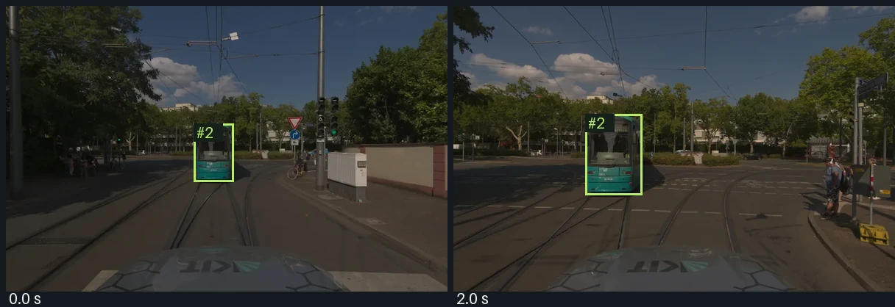

# 프랑크푸르트 RGB Reality View 만들기

[English](../../en/labs/frankfurt-reality.md)

## 브라우저에서 먼저 해보기

1. [프랑크푸르트 3D 데모](nurec-rgb-reality.md#frankfurt-3d)에서 **트램이 지나는 교차로**를 선택하고 **3D 시작**을 누르세요. Volvo가 촬영 경로를 따라가고, 오른쪽 위 **실사 추적 창**에는 선택한 카메라가 실제로 찍은 장면이 나옵니다.
2. **실사 RGB → 전방**을 선택하세요. **0.0초**와 **2.0초**를 번갈아 보면 트램이 화면 왼쪽으로 움직이며 커집니다. 추적 ID는 **#2**로 이어집니다.
3. 시간을 그대로 둔 채 **후방**, **3D 카메라** 순으로 바꿔 보세요. 같은 시간에 어디를 볼지만 달라집니다. **자유 시점**에서는 화면을 드래그해 차선을 다른 각도에서 볼 수 있습니다.



트램 구간의 실사 화면은 0.5초 간격으로 저장했습니다. 3D 화면은 촬영 위치 사이를 보간해 재생합니다. [28초 시연 영상](nurec-rgb-reality.md#reality-kitscenes-surround)에서 세 구간을 볼 수 있습니다.

## 사진이 3D 주행 화면이 되기까지

**카메라가 어디에 있었는지 찾습니다.** 한 시점에 카메라 6대가 찍은 RGB 사진을 묶습니다. 제공된 내부 파라미터 `K`에는 초점거리와 영상 중심이 들어 있습니다. Mask2Former로 사람·차량·하늘 등을 구분하고, 움직이는 물체와 하늘, 촬영 차량의 차체에 있는 특징점은 매칭에서 걸러냅니다. LoMa-B가 사진 사이의 공통점을 찾으면 COLMAP이 카메라 자세와 3D 점을 추정합니다. 번들 조정은 3D 점을 다시 사진에 투영했을 때 실제 특징점과의 거리가 줄도록 값을 맞춥니다.

**노면·하늘·주변을 따로 복원합니다.** 여러 사진에서 도로로 확인된 픽셀을 같은 표면에 옮겨 `ground.webp`로 합칩니다. 이렇게 하면 3D 시점을 옮겨도 차선이 비교적 선명하게 남습니다. 하늘은 촬영 방향별로 모아 `sky.webp`를 만듭니다. 건물과 나무 같은 정적 배경은 gsplat으로 학습한 뒤 브라우저용 `scene.spz`로 변환합니다. 가로수길에서는 촬영 샘플을 더 촘촘히 골랐고, 자차 경로 위에 남은 공중 잔상을 걸러냈습니다.

**주변 차량을 추적하고 Volvo를 도로에 맞춥니다.** RT-DETR가 실사 프레임에서 박스, 종류, 신뢰도를 얻습니다. 카메라별로 박스가 움직인 위치와 잘라낸 이미지의 색 분포를 비교해 ID를 이어 붙입니다. 트램 한 대를 버스와 열차로 중복 검출하는 경우는 하나로 묶습니다. 뷰어에서 박스는 해당 실사 프레임에만 표시합니다. 가림이 길거나 카메라를 바꾸면 같은 차량에도 다른 ID가 붙을 수 있습니다. 3D 화면에 추가한 Volvo는 촬영 경로를 따라가고, 모델 메시에서 찾은 네 타이어 접지점이 노면 높이에 맞춰집니다.

| 구간 | 시점 수 × 카메라 수 | 길이 |
| --- | ---: | ---: |
| 도심 교량 | 25 × 6 = 150 | 7.2초 |
| 트램 교차로 | 40 × 6 = 240 | 19.5초 |
| 가로수길 | 91 × 6 = 546 | 27.0초 |

입력은 RGB와 카메라 내부 파라미터입니다. 경로는 추정한 카메라 자세를 연결한 것으로, 장면 안의 상대 좌표를 씁니다. 세 구간의 출처는 [KITScenes Multimodal](https://kitscenes.org/multimodal/)의 [Voxel51 공개 배포본](https://huggingface.co/datasets/Voxel51/kitscenes-multimodal)이며, CC BY-NC 4.0과 KITScenes 이용 조건을 따릅니다. [데이터와 Volvo 모델 출처](https://james-joobs.github.io/awesome-nvidia-physical-ai/showcase/reality-kitscenes/ATTRIBUTION.txt).

## GPU 없이 공개 데이터 확인하기

내 컴퓨터의 터미널에서 Python 3와 curl을 사용합니다. 작은 JSON 파일 하나를 받아 앞에서 본 두 프레임의 박스를 출력합니다. `times`에서 시간을 찾은 순번이 `cameras`의 각 카메라 목록에도 그대로 적용됩니다.

```bash
python3 - <<'PYTHON'
import json
from subprocess import check_output

url = ("https://james-joobs.github.io/awesome-nvidia-physical-ai/"
       "showcase/reality-kitscenes/tram/road/tracks.json")
tracks = json.loads(check_output(
    ["curl", "-fsSL", "--max-time", "30", url]
))

for t in (0.0, 2.0):
    index = tracks["times"].index(t)
    row = next(item for item in tracks["cameras"]["front"][index] if item[0] == 2)
    track_id, category, box, score = row
    pixels = [round(v * size) for v, size in zip(box, (768, 498, 768, 498))]
    print(f"{t:.1f} s | ID {track_id} | {category} | {pixels} | {score:.2f}")
PYTHON
```

첫 줄에 ID `2`, 종류 `transit`, 픽셀 박스 `[327, 204, 395, 307]`, 신뢰도 `0.57`이 나오면 됩니다. JSON의 좌표 순서는 **왼쪽·위쪽·오른쪽·아래쪽**으로, 이미지 가로·세로 길이에 대한 비율입니다. 예를 들어 왼쪽 좌표 `0.4253`에 가로 길이 `768`을 곱하면 약 327픽셀입니다. 두 줄을 비교하면 박스 위치가 달라져도 ID는 같은 것을 확인할 수 있습니다.

## RTX 실습 환경 준비하기

NVIDIA GPU가 있는 Linux 머신에서 Bash 또는 Zsh 터미널을 여세요. 실습 재현에 사용한 구성은 RTX 5090 한 장, Python 3.12, CUDA 12.8용 PyTorch 2.9.1, CUDA 12.9 툴킷, Node.js 24입니다. `nvidia-smi`로 GPU와 드라이버를 확인하고, `nvcc`로 처음 실행하는 gsplat의 CUDA 확장을 빌드합니다. GPU가 잡히지 않으면 [NVIDIA Linux 환경 설정](../onboarding/nvidia-linux.md)부터 확인하세요.

```bash
nvidia-smi
python3.12 --version
node --version
c++ --version
git clone --depth 1 https://github.com/james-joobs/awesome-nvidia-physical-ai.git
cd awesome-nvidia-physical-ai
python3.12 -m venv .venv-frankfurt
source .venv-frankfurt/bin/activate

export CUDA_HOME=/usr/local/cuda
export PATH="$CUDA_HOME/bin:$PATH"
nvcc --version
python -m pip install 'torch==2.9.1' 'torchvision==0.24.1' \
  --index-url https://download.pytorch.org/whl/cu128
python -m pip install 'transformers==5.24.1' 'huggingface-hub==2.4.0' \
  'opencv-python==5.1.0.95' 'numpy==2.5.4' 'scipy==1.18.1' 'Pillow==13.0.0' \
  'pycolmap==4.2.1' 'gsplat==1.5.3' 'ninja==1.13.2' \
  'git+https://github.com/davnords/LoMa@ecc947d44ddc9d50387e887bbedc743d65ffac00'
python -c 'import torch; print(torch.cuda.is_available(), torch.version.cuda)'
```

이후 명령은 같은 터미널에서 저장소 폴더를 기준으로 실행하세요. 이미 저장소가 있다면 clone 대신 그 폴더로 들어가 가상환경을 만듭니다. CUDA 검사에 `False`가 나오면 드라이버와 PyTorch 설치를 먼저 확인하세요. CUDA 툴킷을 다른 곳에 설치했다면 `CUDA_HOME`에 해당 경로를 넣습니다.

## 7.2초 도심 교량 직접 복원하기

**1. 사진을 받고 카메라 위치를 맞춥니다.** 고정된 데이터 버전에서 25개 시점의 RGB 150장과 내부 파라미터를 받습니다. COLMAP 단계가 끝나면 등록된 카메라 이미지가 150장인지 확인하세요.

```bash
export FRANKFURT_CODE=labs/nurec-rgb-reality/road/highres
export FRANKFURT_WORK="$(mktemp -d)"
printf '%s\n' "$FRANKFURT_WORK"

python "$FRANKFURT_CODE/fetch_kit.py" --out "$FRANKFURT_WORK/data" \
  --revision e6cdac8eb56b2a8ee329cd31b16800cda53ef3e0
python "$FRANKFURT_CODE/reconstruct.py" --input "$FRANKFURT_WORK/data" \
  --output "$FRANKFURT_WORK/sfm"
```

**2. 정적 장면을 학습합니다.** 사진마다 카메라가 어디에 있었는지 알면 gsplat이 같은 각도에서 장면을 렌더링하며 사진에 맞출 수 있습니다. `fit/scene.ply`에 Gaussian을, `fit/sky.webp`에 하늘을, `fit/fit.json`에 학습 결과를 저장합니다. 첫 실행에서는 CUDA 확장을 컴파일한 뒤 학습 로그가 나옵니다.

```bash
python "$FRANKFURT_CODE/train.py" --input "$FRANKFURT_WORK/data" \
  --sfm "$FRANKFURT_WORK/sfm" --output "$FRANKFURT_WORK/fit"
```

**3. 브라우저용 파일을 만들고 실제 차량을 추적합니다.** Gaussian을 SPZ로 바꿉니다. 노면 텍스처와 카메라 6대의 RGB를 내보낸 뒤 RT-DETR로 검출한 박스에 추적 ID를 부여합니다. 교량에서는 Volvo 타이어 아래에 생긴 작은 텍스처 틈을 인접한 노면 RGB로 채웁니다.

```bash
export FRANKFURT_ROAD="$FRANKFURT_WORK/browser/road"
npm exec --yes --package=@playcanvas/splat-transform@3.12.0 -- splat-transform \
  "$FRANKFURT_WORK/fit/scene.ply" "$FRANKFURT_WORK/fit/scene.spz" --spz-version 3
python "$FRANKFURT_CODE/package.py" --input "$FRANKFURT_WORK/data" \
  --sfm "$FRANKFURT_WORK/sfm" --fit "$FRANKFURT_WORK/fit" --output "$FRANKFURT_ROAD"
python "$FRANKFURT_CODE/surround.py" --input "$FRANKFURT_WORK/data" \
  --sfm "$FRANKFURT_WORK/sfm" --fit "$FRANKFURT_WORK/fit" --output "$FRANKFURT_ROAD"
python "$FRANKFURT_CODE/track_rgb.py" "$FRANKFURT_ROAD"
python "$FRANKFURT_CODE/fill_contact_gaps.py" "$FRANKFURT_ROAD"
```

## 결과를 검사하고 내 브라우저에서 열기

```bash
python "$FRANKFURT_CODE/check.py" --package "$FRANKFURT_ROAD" --route bridge
```

`KITSCENES_NOVEL_VIEW_OK: bridge, 150 registered camera views, 7.2 seconds`가 나오면 브라우저용 파일의 해시, 카메라와 RGB 대응, 박스 좌표 범위, 반복되는 추적 ID 검사를 통과한 것입니다. 공개 교량 장면은 이미지 150장을 등록했고, 자세를 맞추는 데 쓴 특징점의 평균 재투영 오차는 약 1픽셀이었습니다.

사이트를 빌드한 뒤 로컬 미리보기를 실행하세요. 교량을 고르면 기존 뷰어에서 방금 만든 파일이 열립니다.

```bash
npm --prefix site ci
npm --prefix site run build
python "$FRANKFURT_CODE/preview.py" --package "$FRANKFURT_ROAD"
```

터미널에 표시된 localhost 주소를 열고 **도심 교량 → 3D 시작**을 누르세요. 잠시 재생한 뒤 **실사 RGB**에서 시간을 바꾸며 측방·후방 이미지가 함께 바뀌는지 확인합니다. **자유 시점**에서 차 옆으로 돌려 타이어와 도로가 맞닿는 부분을 볼 수 있습니다. 미리보기를 종료하려면 터미널에서 **Ctrl+C**를 누르세요.

SSH로 접속한 GPU 머신에서 미리보기를 띄웠다면, 내 컴퓨터에서 터미널을 하나 더 열어 8128 포트를 연결하세요. `user@gpu-host`에는 실제 SSH 접속 주소를 넣습니다.

```bash
ssh -N -L 8128:127.0.0.1:8128 user@gpu-host
```

[다른 구간의 입력과 학습 옵션](../../../labs/nurec-rgb-reality/road/highres/README.en.md#reproduce) · [실습 소스 코드](../../../labs/nurec-rgb-reality/road/highres/) · [LoMa](https://github.com/davnords/LoMa) · [COLMAP](https://colmap.github.io/) · [gsplat](https://docs.gsplat.studio/) · [RT-DETR](https://huggingface.co/PekingU/rtdetr_r50vd)
