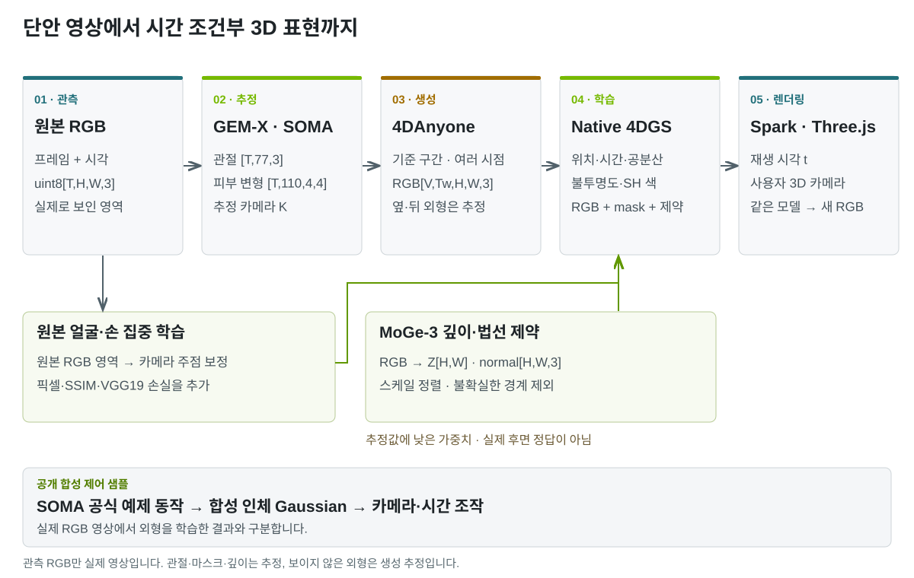

# 단안 영상으로 학습하는 인체 4D Gaussian 재구성

[English](../../en/labs/human-4d-gaussian.md) · [실습 코드](../../../labs/human-4d-gaussian/) · [NVIDIA GPU 환경 설정](../onboarding/nvidia-linux.md)

카메라 한 대로 찍은 동작 영상을 움직이는 3D 표현으로 만듭니다. 위에서 **31.9초 춤 동작**을 직접 돌려 보고, 자신의 영상으로 **RGB → 동작 추정 → 여러 시점 생성 → 4D Gaussian 학습 → 브라우저 재생**을 따라 해 보세요.

원본: **지숭이_Jisoong — [체포하겠어🚨🚨](https://www.youtube.com/shorts/rWS8uli1-m0)**. 원본은 YouTube에서, 3D 동작은 뷰어에서 각각 재생합니다.

## 동작 원리와 구현 흐름



### 1. 영상 픽셀에서 인체 동작으로

RGB 한 프레임은 빨강·초록·파랑 값으로 구성된 `uint8[H,W,3]` 배열입니다. 여기에 프레임 번호와 시각을 연결해 이미지와 자세를 맞춥니다.

**NVIDIA GEM-X**는 몸과 손의 동작을 추정합니다. **SOMA**는 그 동작을 인체 형상과 피부 변형으로 표현합니다. 주요 출력은 다음과 같습니다.

```text
rgb:          uint8[T, H, W, 3]    원본 색상
joints:       float[T, 77, 3]      추정 관절 XYZ
deformations: float[T, 110, 4, 4]  SOMA 피부 변형 행렬
K:            float[T, 3, 3]       카메라 내부 파라미터
```

`T`는 영상 프레임 수입니다. 관절 77개는 신체 부위의 위치를 나타내고, 피부 변형용 본 110개는 표면이 어떻게 움직일지 제어합니다. 용도가 다른 두 배열입니다.

### 2. 다른 시점의 외형 만들기

추정 동작을 가상 카메라에 투영해 skeleton 조건 영상을 만듭니다. **4DAnyone**은 이 조건과 원본 RGB를 함께 읽어 옆·뒷모습을 생성합니다. 시점별 인물 마스크로 배경을 분리합니다.

```text
원본 RGB + 추정 동작
  → 가상 카메라별 skeleton 영상
  → 4DAnyone
  → 여러 시점의 RGB + 인물 마스크
```

원본 카메라에서는 관측한 RGB를 학습 목표로 유지합니다. 옆·뒷면은 생성한 외형이므로, 학습 전에 옷·손·바라보는 방향이 서로 맞는지 확인하세요. 생성 프리셋은 [소스 README](../../../labs/human-4d-gaussian/README.ko.md)에 정리했습니다.

### 3. Gaussian을 움직이게 만들기

Gaussian은 위치, 부피, 불투명도와 색을 가진 입자입니다. 4D Gaussian은 시간도 저장하므로, 하나의 모델에서 원하는 시각의 움직이는 인체를 그릴 수 있습니다.

```text
위치 + 시간 + 공간/시간 공분산 + 불투명도 + 색
  → 시각 t에서의 상태 계산
  → 선택한 카메라로 투영
  → 입자를 합성해 RGB 화면 생성
```

학습 파일에는 `xyz[N,3]`, `time[N,1]`, `color_coefficients[N,16,3]` 등이 들어 있습니다. `N`은 입자 수입니다. 시간을 멈추면 한 자세를 여러 각도에서 볼 수 있고, 카메라를 고정하면 동작만 재생할 수 있습니다.

### 4. 전체 동작을 한 타임라인으로 연결하기


30Hz의 957프레임은 31.9초입니다. 121프레임씩 학습하되 시작점을 120프레임 간격으로 옮기고, 재생할 때는 중복과 마지막 패딩을 제외합니다. 모든 구간은 같은 월드 좌표계를 사용합니다. 전체 시각이 4.50초라면 두 번째 구간의 0.50초 상태를 조회합니다.

`extend`는 후속 구간마다 새 시점을 생성하고 4D 모델을 학습합니다. 브라우저는 현재 구간을 표시하면서 다음 구간을 준비합니다.

### 5. 얼굴·손과 표면 디테일 보완하기

얼굴·손은 **원본 해상도의 RGB 영역**을 잘라 추가 학습합니다. 잘라낸 이미지의 원점이 이동하면 카메라의 주점 `(cx,cy)`도 함께 바꿔 픽셀과 광선의 대응을 맞춥니다.

**MoGe-3**는 RGB에서 Z 깊이 `[H,W]`와 법선 `[H,W,3]`을 추정합니다. Z 깊이는 카메라 정면 축을 따라 잰 거리이고, 법선은 표면이 향하는 방향을 나타내는 단위 벡터입니다.

```text
RGB → MoGe-3 → 깊이·법선
                    ↓ 스케일·카메라 정렬
4D 모델 → 렌더링 깊이·법선 → 기하 손실
                    ↓
RGB 손실과 함께 사용 → Gaussian 파라미터 갱신
```

생성 시점의 제약은 원본 카메라보다 낮은 가중치로 사용합니다. Gaussian 렌더링은 gsplat, 브라우저 표시는 Spark/Three.js가 담당합니다.

## 실습 따라 하기

### 1. GPU 없이 먼저 둘러보기

위의 **3D 예제 불러오기**를 누르세요. 춤 동작을 멈추고 옆·뒤로 돌려 본 다음, 그 시점에서 다시 재생해 보세요. 원본 YouTube는 별도로 조작합니다. **SOMA 합성 리깅 예제**를 펼치면 다른 동작 샘플도 볼 수 있습니다.

자신의 결과는 **로컬 결과 폴더 열기**에서 `manifest.json`이 있는 폴더를 선택합니다. `source.mp4`를 함께 넣으면 원본과 모델이 같은 타임라인으로 움직입니다.

```text
my-result/
  manifest.json
  source.mp4
  browser/
    s00/meta.json + Gaussian 데이터
    s01/meta.json + Gaussian 데이터
```

### 2. NVIDIA GPU 머신 준비하기

Linux x86_64, NVIDIA 드라이버와 CUDA 도구, Git, Python, uv를 준비합니다. 검증한 GPU는 **RTX 5090 32GB 한 장**입니다. [Linux GPU 온보딩](../onboarding/nvidia-linux.md)을 먼저 따라 한 뒤, 저장소 최상위 폴더에서 실행하세요.

```bash
nvidia-smi
export HUMAN_4D_ROOT="$HOME/physical-ai-labs/human-4d"
python3 labs/human-4d-gaussian/pipeline.py --root "$HUMAN_4D_ROOT" setup
```

첫 `setup`은 `runtime.json`을 만들고 실행 환경 설정을 요청합니다. [실행 환경 설정 가이드](../../../labs/human-4d-gaussian/README.ko.md)에 따라 모델별 환경과 가중치를 설치하고 경로를 적은 뒤 `setup`을 다시 실행하세요. 모듈·버전·자산 경로 검사를 통과하면 다음 단계로 진행합니다.

### 3. 영상 준비하기

고정 카메라로 한 사람의 전신이 보이는 9:16 세로 영상부터 시작하세요. 가로·세로가 짝수인 해상도와 30Hz 기준 121프레임, 약 4.03초 이상이 필요합니다. 아래 경로를 자신의 파일로 바꿉니다.

```bash
python3 labs/human-4d-gaussian/pipeline.py --root "$HUMAN_4D_ROOT" \
  prepare --video "$HOME/Videos/my-motion.mp4"
```

`prepare`는 영상을 읽어 공통 30Hz 입력을 만듭니다. 미리보기의 시작·중간·끝에서 전신이 화면 안에 들어오는지 확인하세요.

### 4. 동작을 추정하고 생성 시점 확인하기

```bash
python3 labs/human-4d-gaussian/pipeline.py --root "$HUMAN_4D_ROOT" rig
```

먼저 관절을 겹쳐 그린 영상을 봅니다. 손목과 발목이 올바른 신체 부위를 따라가는지 확인하세요. `RECON_PY`는 `runtime.json`의 reconstruction Python 경로로 지정하고, 마스크 검사와 시점 생성을 진행합니다.

```bash
RECON_PY="$HUMAN_4D_ROOT/envs/reconstruction/bin/python"
"$RECON_PY" labs/human-4d-gaussian/inspect_masks.py --root "$HUMAN_4D_ROOT"
python3 labs/human-4d-gaussian/pipeline.py --root "$HUMAN_4D_ROOT" multiview
"$RECON_PY" labs/human-4d-gaussian/inspect_teachers.py --root "$HUMAN_4D_ROOT" \
  --name pilot --out "$HUMAN_4D_ROOT/diagnostics/pilot-views.jpg"
"$RECON_PY" labs/human-4d-gaussian/inspect_teachers.py --root "$HUMAN_4D_ROOT" \
  --name offset --out "$HUMAN_4D_ROOT/diagnostics/offset-views.jpg"
```

정면·측면·후면 비교 이미지를 확인하세요. 얼굴이 보이는데 마스크에서 빠져 있으면 학습 과정에서 배경으로 처리됩니다. 뒷모습으로 지정한 이미지가 정면 얼굴을 보여도 기하 조건이 충돌합니다. 이런 입력을 먼저 바로잡습니다.

### 5. 짧은 구간 학습하고 디테일 보완하기

```bash
python3 labs/human-4d-gaussian/pipeline.py --root "$HUMAN_4D_ROOT" train
python3 labs/human-4d-gaussian/pipeline.py --root "$HUMAN_4D_ROOT" refine --seed-only
```

`train`은 원본과 생성 시점을 함께 학습합니다. `refine`은 원본 얼굴·손과 MoGe-3 제약을 추가합니다. 먼저 121프레임의 짧은 구간을 확인한 뒤 전체 길이로 확장하세요.

### 6. 결과를 렌더링하고 브라우저에서 열기

```bash
python3 labs/human-4d-gaussian/pipeline.py --root "$HUMAN_4D_ROOT" render
python3 labs/human-4d-gaussian/pipeline.py --root "$HUMAN_4D_ROOT" package
python3 labs/human-4d-gaussian/pipeline.py --root "$HUMAN_4D_ROOT" --deep check
```

`render`는 고정 시점과 자유 시점 영상을, `package`는 브라우저 데이터를 만듭니다. 검사를 통과하면 [뷰어](#explore)의 **로컬 결과 폴더 열기**에서 `$HUMAN_4D_ROOT/package`를 선택하세요.

### 7. 전체 동작으로 확장하기

짧은 구간의 자세와 외형이 자연스럽게 이어지면 나머지 구간도 생성하고 학습합니다.

```bash
python3 labs/human-4d-gaussian/pipeline.py --root "$HUMAN_4D_ROOT" extend
python3 labs/human-4d-gaussian/pipeline.py --root "$HUMAN_4D_ROOT" render
python3 labs/human-4d-gaussian/pipeline.py --root "$HUMAN_4D_ROOT" \
  --package-dir "$HUMAN_4D_ROOT/package-full" package
python3 labs/human-4d-gaussian/pipeline.py --root "$HUMAN_4D_ROOT" \
  --package-dir "$HUMAN_4D_ROOT/package-full" --deep check
```

긴 영상은 한 GPU에서 수 시간이 걸릴 수 있습니다. 중단됐다면 같은 명령으로 검증된 단계부터 이어가고, 설정을 바꿀 때는 새 출력 폴더를 사용하세요. 완성된 전체 동작은 `package-full`로 엽니다.

## 결과 확인

### 영상과 3D 비교하기

| 결과 | 확인할 내용 |
| --- | --- |
| [전체 31.9초 4DGS 자유 시점 영상](../../../site/public/showcase/human-4d-dance/orbit.mp4) | 카메라를 돌렸을 때 동작과 외형이 이어지는지 확인 |
| [초기 3DGS 네 방향 비교](../../../site/public/showcase/human-4d-dance/rigged-3dgs.mp4) | 같은 동작을 네 방향에서 비교 |
| 위의 4DGS 뷰어 | 원하는 시각에 멈추고 돌려 본 뒤 다시 재생 |

빠르게 보려면 영상부터 재생하세요. 직접 조작하는 모델은 구간별로 내려받습니다. 자신의 결과는 시작·중간·끝의 자세와 구간 전환을 확인하고, 빠르게 움직이는 손과 머리카락을 살펴보면 좋습니다.

[패키지 검사 코드](../../../labs/human-4d-gaussian/check_published.py)는 파일·숫자 배열·시간 범위를 검사합니다. [세부 실험 수치](../../../labs/human-4d-gaussian/reconstruction-evaluation.json)는 소스와 함께 확인할 수 있습니다.

### 다음 학습으로 이어가기

- [GEM-X](https://github.com/NVlabs/GEM-X) · [SOMA-X](https://github.com/NVlabs/SOMA-X): 인체 동작과 변형 표현.
- [4DAnyone](https://github.com/ant-research/4DAnyone) · [MoGe-3](https://github.com/microsoft/MoGe): 시점 생성과 기하 제약.
- [RGB 공간 재구성](rgb-reality-view.md) · [fVDB Reality Capture](spatial-reconstruction.md): 정적 환경 복원.

[모델·자료 출처](../../../labs/human-4d-gaussian/SOURCES.md) · [SOMA 예제의 생성 과정](../../../labs/human-4d-gaussian/CONTROL-SOURCES.md).
