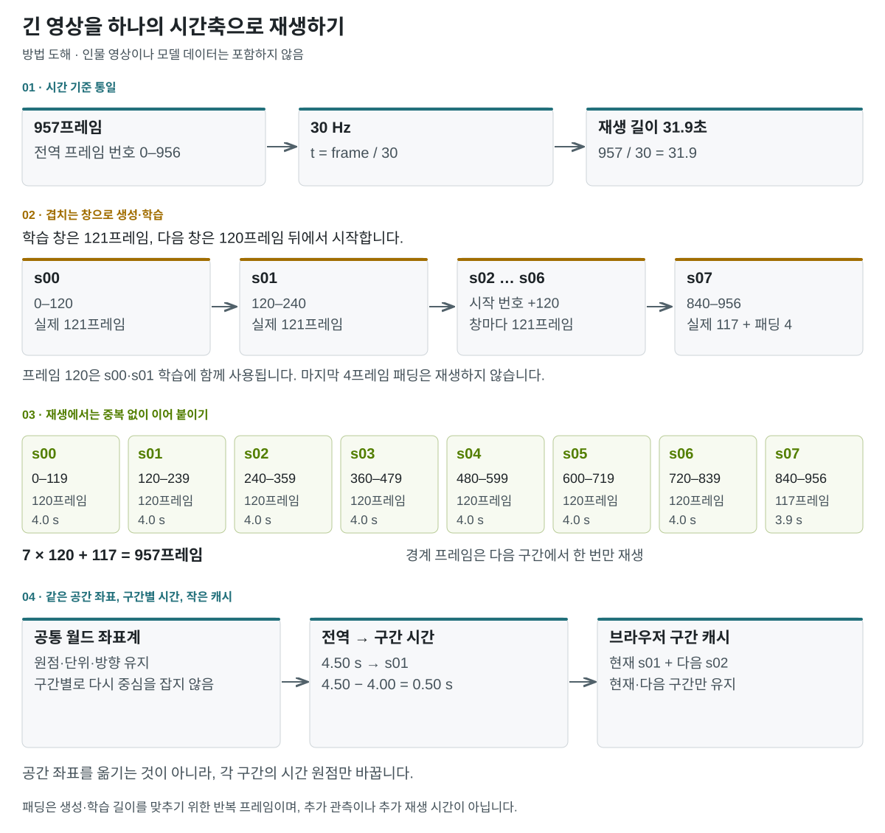

# 단안 영상으로 학습하는 인체 4D Gaussian 재구성

[English](../../en/labs/human-4d-gaussian.md) · [실습 코드](../../../labs/human-4d-gaussian/) · [NVIDIA GPU 환경 설정](../onboarding/nvidia-linux.md)

카메라 한 대의 영상에서 사람의 동작을 추정하고, 시간에 따라 움직이는 Gaussian 표현을 학습합니다. **RGB 프레임 → 인체 동작 → 생성 시점 → 4D 재구성 → 브라우저 렌더링**을 차례로 살펴보세요. 카메라를 돌리는 단계와 시간을 재생하는 단계를 구분하면, 2D 영상과 4D 모델이 어떻게 다른지 확인할 수 있습니다.

참조 영상은 **지숭이_Jisoong** 채널의 [「체포하겠어🚨🚨」 원본 YouTube Shorts](https://www.youtube.com/shorts/rWS8uli1-m0)입니다. 원본은 YouTube 공식 플레이어로 연결합니다. 공개 예제에는 각 자료의 출처와 이용 조건을 따로 표시합니다. 자신의 영상과 모델은 로컬 파일로 불러와 실습할 수 있습니다.

**실제 춤 영상의 31.9초 재구성 결과**를 이제 브라우저에서 직접 볼 수 있습니다. 공개 허락을 확인한 3D·4D 파생 결과이며, 원본 영상과 음원은 YouTube 공식 플레이어로만 표시합니다. 기존 **SOMA 합성 리깅 제어 샘플**은 별도 예제로 유지했습니다. 자신의 영상으로 따라 할 때는 아래 GPU 실습을 이용하세요.

## 동작 원리와 구현 흐름


### 1. 이번 실습에서 배우는 것

| 학습 단계 | 직접 확인할 내용 | 다음 단계에 넘기는 데이터 |
| --- | --- | --- |
| 영상과 시간 | 해상도·FPS·프레임 번호가 동작 재생에 미치는 영향 | RGB 프레임, 공통 30Hz 입력의 프레임 번호·시각 |
| 인체 동작 추정 | 관절, 피부 변형, 카메라 좌표계의 차이 | 3D 관절, SOMA 변형 행렬, 추정 카메라 |
| 여러 시점 생성 | 같은 동작의 옆·뒷모습을 모델이 추정하는 방법 | 가상 카메라별 RGB와 인물 마스크 |
| 4D 재구성 | 위치·시간·부피·색을 함께 최적화하는 방법 | 시간 조건부 Gaussian 모델 |
| 디테일과 표면 제약 | 원본 얼굴·손, 추정 깊이·법선이 학습에 들어가는 위치 | 추가 학습 모델과 비교 기록 |
| 결과 검사 | 원본·3D·생성 추정을 구분하며 비교하는 방법 | 동기화된 영상, 브라우저 모델, 검사 결과 |

NVIDIA 도구는 **GEM-X와 SOMA를 이용한 동작 추정·인체 표현**에 사용합니다. 다중 시점 생성은 Ant Research의 4DAnyone, 깊이·법선 추정은 Microsoft의 MoGe-3, Gaussian 렌더링은 gsplat, 브라우저 표시는 Spark/Three.js를 사용합니다. 이 전체 연결은 이 저장소의 구현이며 NVIDIA 공식 통합 제품이 아닙니다.

### 2. RGB 영상과 3D 관절은 어떤 데이터일까요?

RGB 한 프레임은 `uint8[높이, 너비, 3]` 배열입니다. 세 값은 빨강·초록·파랑을 나타냅니다. 동영상에서는 이 배열에 **프레임 번호와 시각**이 붙습니다. 같은 프레임을 비교해도 시각이 어긋나면, 손이 다른 위치에 있는 것을 재구성 오류로 잘못 판단할 수 있습니다.

GEM-X는 영상에서 몸과 손의 자세를 추정합니다. SOMA는 그 자세를 인체 형상과 피부 변형으로 표현합니다. 검증한 구성의 주요 배열은 아래와 같습니다. `T`는 처리한 프레임 수입니다.

```text
rgb:          uint8[T, H, W, 3]        카메라가 실제 관측한 색
times:        float[T]                 각 프레임의 시각(초)
joints:       float[T, 77, 3]          추정한 관절의 XYZ
deformations: float[T, 110, 4, 4]      SOMA 피부 변형에 쓰는 행렬
K:            float[T, 3, 3]          추정 카메라 내부 파라미터
```

**관절 77개와 피부 변형용 본 110개는 서로 다른 배열**입니다. 영상에서 추정한 관절은 모션 캡처 정답이 아니며, 카메라의 초점거리나 사람의 크기도 실제 측정값과 다를 수 있습니다. 이 실습은 관절을 추정한 뒤 전체 영상을 일반적인 뼈대 애니메이션 파일로 바꾸는 작업과도 다릅니다. 최종 표현은 다음 단계에서 학습하는 4D Gaussian입니다.

### 3. 보이지 않는 옆·뒷면은 어떻게 만들까요?

원본의 인물 영역을 마스크로 분리하고, 추정 동작을 각 가상 카메라에 투영해 skeleton 조건 영상을 만듭니다. 4DAnyone은 원본 RGB와 이 조건 영상을 읽어 다른 시점의 외형을 생성합니다.

```text
원본 RGB + 추정한 같은 동작
  → 가상 카메라별 skeleton 영상
  → 4DAnyone 다중 시점 생성
  → 시점별 RGB + 예측 인물 마스크
```

가상 카메라의 `K[3,3]`와 `camera_to_world[4,4]`는 **의도한 촬영 위치와 방향**을 기록합니다. 생성 모델이 그 카메라와 동작을 완벽히 따랐다는 보장은 없습니다. 생성 영상의 얼굴·옷·발 위치가 서로 다르면, 이를 동시에 맞추려는 3D 모델에 겹침이나 번짐이 생길 수 있습니다.

12방향 공동 생성 실험은 공유 참조 시점인 RCP와 시점 그룹을 연결하는 TCR을 사용합니다. 공식 구현은 6시점 그룹 두 개를 연결하므로, 12개의 영상을 서로 무관하게 호출해 이어 붙이는 것과 구분합니다. **생성된 정면으로 실제 RGB를 대체하지 않으며**, 관측하지 않은 의상 뒷면이나 머리카락은 생성 모델의 추정으로 표시합니다.

아래 실행기의 기본 재현 프리셋은 선택한 외형 prior와 맞춰 **Base24 6방향과 별도 Turbo4 중간 6방향**을 사용합니다. 12방향 공동 생성은 별도의 비교 실험이며, 두 생성 조건을 같은 실험으로 표기하지 않습니다.

### 4. 4D Gaussian은 어떻게 움직일까요?

Gaussian은 중심 위치, 크기와 방향, 불투명도, 색을 가진 부드러운 입자입니다. 정적인 3D Gaussian에 시간 정보를 더하면, **어느 시각에 어디에 나타나고 얼마나 보일지**를 표현할 수 있습니다.

```text
저장된 모델
  위치·시간 중심 + 공간/시간 공분산 + 불투명도 + SH 색 계수
       ↓ 재생 시각 t
  그 시각의 중심 위치·부피·불투명도 계산
       ↓ 사용자가 선택한 카메라
  입자를 투영하고 합성 → RGB 화면
```

학습 파일의 `xyz[N,3]`는 입자 중심, `time[N,1]`은 각 입자의 시간 중심입니다. degree-3 색 표현에서는 DC와 SH를 합해 `color_coefficients[N,16,3]`으로 볼 수 있습니다. **`N`은 입자 수이고 `T`는 영상 프레임 수**입니다. 모든 입자가 매 시각에 같은 정도로 보이는 것은 아닙니다.

이 구현은 공간과 시간의 결합 분포를 그 시각의 3D 분포로 바꿔 렌더링합니다. 각 입자의 조건부 공간 공분산은 고정이며, 중심 이동과 시간 가중치가 바뀌면서 전체 인체가 움직입니다. 따라서 **같은 동작 시각을 고정하고 카메라만 돌리거나**, 카메라를 고정하고 동작만 재생할 수 있습니다. 단, 학습한 동작 구간을 표현하는 모델이며, 원하는 새로운 동작을 입력해 재생하는 범용 캐릭터 리깅은 아닙니다.

긴 영상은 모델이 지원하는 길이의 구간으로 처리합니다. 각 구간의 시작 시각, 프레임 범위와 재생 전환 정보는 패키지에 기록합니다. 구간 경계에서는 자세·외형·색의 연속성을 별도로 검사해야 합니다.

### 5. 긴 영상은 어떻게 한 타임라인으로 연결할까요?

짧은 구간을 완성한 뒤 `extend`로 전체 동작을 처리합니다. 후속 구간에서도 **그 구간의 원본 RGB와 동작으로 12방향 영상을 새로 생성**하고, Gaussian을 다시 학습합니다. 첫 구간은 Base24 6방향과 Turbo4 중간 6방향, 후속 구간은 Turbo4 6방향씩 두 번을 사용합니다. 같은 방향 수라고 해서 생성 조건까지 같은 것은 아닙니다.



예를 들어 30Hz의 957프레임 영상은 31.9초입니다. 학습 창은 121프레임이고 시작점은 120프레임씩 옮깁니다. 이웃 구간이 경계 프레임 하나를 함께 학습하지만, 재생할 때는 한 번만 보여줍니다. 마지막 구간의 실제 117프레임에는 내부 처리용 4프레임을 덧붙이며, 이 패딩은 재생 길이에 넣지 않습니다.

모든 구간은 **같은 월드 좌표계·단위·원점**을 유지합니다. 전체 시각이 4.50초라면 두 번째 모델의 시각 0.50초를 조회합니다. 카메라는 유지하고 모델만 바꾸므로, 구간 전환 때문에 시점이 초기화되지 않습니다. 브라우저는 현재 모델과 다음 모델만 준비합니다.

원본 시점의 비교가 좋아져도 측면·후면의 실제 형태가 검증되는 것은 아닙니다. 각 구간의 경계에서 옷 색이나 몸의 두께가 달라지는지, 빠른 손과 머리카락이 번지는지 함께 확인합니다.

**비교 실험:** `refine --trajectory-experiment`는 첫 구간의 외형을 SOMA 피부 궤적에 연결한 뒤 원본 RGB로 맞춥니다. 매번 다중 시점을 생성하지 않아 별도의 연구 경로로 남겼지만, 후속 구간에서 번짐이 더 컸습니다. 권장 전체 길이 실습은 위의 `extend` 경로입니다.

### 6. 얼굴·손과 깊이·법선은 어디에 사용하나요?

원본 얼굴·손 학습에서는 **원본 해상도의 RGB 영역**을 잘라 사용합니다. 이미 축소한 영상을 키우는 것과는 다릅니다. 자른 이미지의 왼쪽 위가 새 원점이 되므로 카메라의 주점 `(cx, cy)`도 같은 만큼 옮깁니다. 이 보정 없이 작은 이미지만 학습하면 픽셀과 3D 광선의 대응이 틀어집니다.

MoGe-3는 RGB에서 **Z 깊이 `[H,W]`**와 **법선 `[H,W,3]`**을 추정합니다. Z 깊이는 카메라의 앞 방향 거리이며 광선을 따라 잰 거리와 다릅니다. 법선은 표면이 향하는 방향을 나타내는 단위 벡터입니다. 여기서는 카메라 좌표계의 X가 오른쪽, Y가 아래쪽, Z가 앞쪽입니다.

```text
RGB → MoGe-3 → 추정 깊이·법선
                    ↓ 스케일·카메라 보정, 경계·큰 불일치 제외
4D 모델 → 렌더링 깊이와 그 차분 법선 → 약한 일치 손실
                    ↓
원본 RGB 손실과 함께 역전파 → Gaussian 파라미터 갱신
```

생성 시점의 제약은 실제 RGB 카메라보다 낮게 가중합니다. 추정값을 추가해도 실제 뒷면을 관측한 것이 되지는 않습니다. 또 렌더링 깊이에서 구한 법선은 매끈한 메시의 표면 법선과 같지 않아 노이즈가 남을 수 있습니다.

## 실습 따라 하기

### 1. GPU 없이 원본과 3D의 차이부터 확인합니다

위의 **3D 예제 불러오기**를 누르면 실제 춤 영상에서 학습한 4D Gaussian 경량 모델을 내려받습니다. 왼쪽은 원본 YouTube 공식 플레이어, 오른쪽은 자유 시점3D입니다. 두 화면의 재생 위치는 각각 조절합니다. 전체 31.9초를8개 구간으로 나눠 필요한 구간과 다음 구간만 메모리에 준비합니다.

처음에는3D 재생을 멈추고 같은 자세를 여러 방향에서 보세요. **SOMA 합성 리깅 제어 예제도 보기**를 펼치면 알려진 형상과 변형을 쓰는 기존 예제도 따로 열 수 있습니다. 자신의 로컬 영상·모델을 함께 열었을 때는 원본과3D가 같은 타임라인을 사용합니다.

3D 뷰어에서는 다음 순서로 조작합니다.

1. 재생을 멈추고 한 시각을 고릅니다.
2. 정면에서 원본과 자세를 비교합니다. 가능한 경우 원본과 3D를 같은 크기로 나란히 표시합니다.
3. 시간을 고정한 채 드래그해 측면·후면을 봅니다. 이 방향은 생성 추정일 수 있습니다.
4. 카메라를 고정하고 재생합니다. 옷·머리카락·손이 프레임마다 갑자기 바뀌는지 봅니다.
5. 전체 구간에서는 시작·중간·끝과 처리 구간 경계를 확인합니다.

**로컬 결과 폴더 열기**를 누르면 직접 만든 패키지를 이 브라우저에서 읽습니다. 파일을 서버로 업로드하거나 새 GPU 재구성을 실행하는 기능은 아닙니다. `manifest.json`이 있는 최상위 결과 폴더를 선택하세요. 원본을 함께 비교하려면 `source.mp4`도 그 폴더에 포함돼 있어야 합니다.

```text
my-result/
  manifest.json
  source.mp4
  browser/
    s00/meta.json + Gaussian 데이터
    s01/meta.json + Gaussian 데이터
```

폴더 밖의 영상 경로만 적어서는 브라우저가 읽을 수 없습니다. 패키징 단계에서 자신이 사용할 수 있는 원본을 결과 폴더 안에 함께 준비합니다.

공개 제어 샘플은 **18,056개 정점에 놓은 Gaussian**, **110개 피부 변형용 본**, 입자당 최대 **8개 가중치**를 사용합니다. NVIDIA Warp로 계산한 SOMA 변형 행렬로 입자 중심을 움직입니다. 원본 RGB 대신 같은 합성 인체의 삼각형 메시를 고정 카메라로 렌더링한 영상을 비교합니다.

SOMA 공식 동작의 931프레임을 24Hz로 재생하므로 영상 길이는 약 **38.79초**입니다. 수평 루트 이동을 제거해 제자리 동작으로 보여주고, 높이와 회전은 유지했습니다. Gaussian은 고정된 등방성 크기를 사용하므로 변형되는 메시 표면을 완전히 재현하지는 않습니다. 이 제어 샘플은 RGB로 학습한 인체 외형이나 실제 YouTube 인물 모델이 아닙니다. [공개 샘플의 생성 과정·출처](../../../labs/human-4d-gaussian/CONTROL-SOURCES.md).

### 2. NVIDIA GPU 머신을 준비합니다

직접 학습할 때는 Linux x86_64, 호환 NVIDIA 드라이버와 CUDA 도구, Git, Python, uv가 필요합니다. 검증한 GPU는 **RTX 5090 32GB 한 장**입니다. [Linux GPU 온보딩](../onboarding/nvidia-linux.md)을 먼저 따라 한 뒤 저장소 최상위 폴더에서 아래 명령을 한 줄씩 실행하세요.

```bash
nvidia-smi
export HUMAN_4D_ROOT="$HOME/physical-ai-labs/human-4d"
python3 labs/human-4d-gaussian/pipeline.py --root "$HUMAN_4D_ROOT" setup
```

`nvidia-smi`에는 GPU 이름과 드라이버 정보가 나와야 합니다. **첫 `setup`은 출력 폴더에 `runtime.json` 템플릿을 쓴 뒤, 실제 실행 환경을 설정하라는 오류로 종료합니다.** 아직 라이브러리가 설치됐다는 뜻은 아닙니다.

[실행 환경 설정 설명](../../../labs/human-4d-gaussian/README.ko.md)과 공식 설치 링크를 따라 모델별 Python 환경·소스·가중치를 준비하고, `runtime.json`에 그 경로를 적으세요. Isaac Sim의 Python 환경에 설치하지 않습니다. 같은 `setup` 명령을 다시 실행해 실제 Python 모듈, 고정된 소스 버전과 자산 경로 검사를 통과한 뒤 진행합니다. 모델을 실제로 읽거나 CUDA 확장을 처음 빌드하는 데에는 추가 시간이 걸릴 수 있습니다. 소스·가중치·입력 자료의 조건은 [SOURCES.md](../../../labs/human-4d-gaussian/SOURCES.md)에서 확인합니다.

### 3. 자신이 사용할 수 있는 로컬 영상을 준비합니다

검증한 프리셋은 **고정 카메라의 9:16 세로 영상, 가로·세로가 짝수인 해상도, 30Hz 기준 121프레임(약 4.03초) 이상**을 사용합니다. 한 사람이 전신으로 보이고, 심한 가림이나 장면 전환이 적은 영상으로 시작하세요. 아래 경로를 **자신의 파일 경로**로 바꿉니다. 이 실습은 YouTube 영상을 자동으로 내려받지 않습니다.

```bash
python3 labs/human-4d-gaussian/pipeline.py --root "$HUMAN_4D_ROOT" \
  prepare --video "$HOME/Videos/my-motion.mp4"
```

`prepare`는 해상도·프레임 수·시각을 읽고, 추정에 사용할 RGB 프레임을 준비합니다. 생성된 입력 미리보기에서 처음·중간·끝의 인물이 잘리지 않았는지 확인하세요. 원본 파일은 따로 보존하고, 동작·작업용 RGB·ROI는 같은 30Hz 입력의 프레임 번호와 시각을 사용합니다. 가변 FPS 원본의 프레임 번호와 일대일로 같다고 표기하지 않습니다.

### 4. 동작을 추정하고 생성 조건을 검사합니다

```bash
python3 labs/human-4d-gaussian/pipeline.py --root "$HUMAN_4D_ROOT" rig
```

아래 `RECON_PY`는 `runtime.json`의 `python.reconstruction` 경로와 맞추세요. 검사 도구도 이 환경의 NumPy·Pillow·OpenCV를 사용합니다.

먼저 GEM-X/SOMA가 추정한 관절을 원본 위에서 확인하세요. 손목·발목이 다른 부위를 따라가면 입력이나 추정 결과를 점검합니다. 인물 마스크도 검사합니다. 아래 명령은 추정한 머리 영역의 마스크 포함 비율을 계산하고, 확인이 필요한 프레임의 RGB·마스크 비교 이미지를 만듭니다. 마스크를 자동으로 바꾸지는 않습니다.

```bash
RECON_PY="$HUMAN_4D_ROOT/envs/reconstruction/bin/python"
"$RECON_PY" labs/human-4d-gaussian/inspect_masks.py --root "$HUMAN_4D_ROOT"
python3 labs/human-4d-gaussian/pipeline.py --root "$HUMAN_4D_ROOT" multiview
```

`multiview`는 기준 구간의 같은 동작을 가상 카메라에 투영하고 생성 시점을 만듭니다. 전체 길이 실습에서는 구간마다 해당 시각의 RGB와 SOMA 동작으로 시점을 새로 생성합니다. 아래 명령으로 처음·중간·끝을 모은 비교 이미지를 열어 **정면·측면·후면이 실제로 그 방향인지**, 손의 위치와 옷의 모양이 서로 맞는지 확인하세요. 이 도구는 이미지를 모아줄 뿐, 앞뒤 방향이 맞는지 자동 판정하지 않습니다.

```bash
"$RECON_PY" labs/human-4d-gaussian/inspect_teachers.py --root "$HUMAN_4D_ROOT" \
  --name pilot --out "$HUMAN_4D_ROOT/diagnostics/pilot-views.jpg"
"$RECON_PY" labs/human-4d-gaussian/inspect_teachers.py --root "$HUMAN_4D_ROOT" \
  --name offset --out "$HUMAN_4D_ROOT/diagnostics/offset-views.jpg"
```

예를 들어 RGB에는 얼굴이 보이는데 해당 픽셀의 마스크 값이 `0`이면, 학습에는 얼굴 대신 배경을 맞추라는 신호가 들어갑니다. 또 `yaw=180°`로 기록된 생성 영상에 얼굴이 정면으로 보이면, 카메라 기록과 학습 이미지가 모순됩니다. 둘 다 학습 횟수를 늘리기 전에 입력부터 고쳐야 하는 문제입니다. 자세한 검사·분리 실험 방법은 [실습 코드 설명](../../../labs/human-4d-gaussian/README.ko.md)을 참고하세요.

### 5. 4D 모델을 학습하고 원본 디테일을 보강합니다

```bash
python3 labs/human-4d-gaussian/pipeline.py --root "$HUMAN_4D_ROOT" train
python3 labs/human-4d-gaussian/pipeline.py --root "$HUMAN_4D_ROOT" refine --seed-only
```

첫 실습은 **처음 121프레임(약 4.03초)**으로 진행합니다. `--seed-only`를 넣어 짧은 구간의 결과부터 확인하세요. `train`은 실제 RGB와 생성 시점을 함께 사용해 4D 모델을 학습합니다. `refine`은 원본 얼굴·손과 MoGe-3 제약을 추가하는 단계입니다. 이전 체크포인트는 보존합니다. 학습 로그가 줄어드는 것만으로 새 시점이 정확해졌다고 판단하지 말고, 아래 결과 검사를 함께 진행하세요.

### 6. 영상과 브라우저 패키지를 만들고 확인합니다

```bash
python3 labs/human-4d-gaussian/pipeline.py --root "$HUMAN_4D_ROOT" render
python3 labs/human-4d-gaussian/pipeline.py --root "$HUMAN_4D_ROOT" package
python3 labs/human-4d-gaussian/pipeline.py --root "$HUMAN_4D_ROOT" --deep check
```

`render`는 원본과 같은 시각의 렌더링·회전 영상을, `package`는 브라우저용 모델과 재생 정보를 만듭니다. `check`가 프레임 범위·배열·파일을 검사한 뒤 [이 페이지의 뷰어](#explore)에서 **로컬 결과 폴더 열기**로 `$HUMAN_4D_ROOT/package`를 선택하세요. 준비된 패키지를 재생하는 데 CUDA GPU는 필요하지 않습니다.

필요하면 아래 명령으로 패키지의 로컬 데이터 서버도 켤 수 있습니다. 안내되는 주소는 데이터 확인용이며 Pages의 3D 앱 전체를 대신 실행하지는 않습니다.

```bash
python3 labs/human-4d-gaussian/pipeline.py --root "$HUMAN_4D_ROOT" serve
```

결과 폴더는 Git 추적 대상과 분리합니다. 모델을 공개하려면 원본 영상, 인물 촬영 자료, 모델 가중치와 포함된 자산의 이용 조건을 함께 확인해야 합니다. 원본 영상의 링크를 적는 것과 영상·파생 모델을 재배포하는 것은 별개의 범위입니다.

### 7. 심화: 전체 동작을 새 시점으로 확장합니다

짧은 구간을 검사한 다음 같은 출력 폴더에서 실행하세요. `extend`는 후속 구간마다 생성·학습을 수행하므로 긴 영상은 GPU 한 장에서 수 시간이 걸릴 수 있습니다. 완료된 단계는 입력·실행 조건·파일 해시를 확인한 뒤 재사용합니다. 중단됐다면 같은 명령을 다시 실행하며, 조건을 바꾸는 비교 실험은 새 출력 폴더에서 시작합니다.

```bash
python3 labs/human-4d-gaussian/pipeline.py --root "$HUMAN_4D_ROOT" extend
python3 labs/human-4d-gaussian/pipeline.py --root "$HUMAN_4D_ROOT" render
python3 labs/human-4d-gaussian/pipeline.py --root "$HUMAN_4D_ROOT" \
  --package-dir "$HUMAN_4D_ROOT/package-full" package
python3 labs/human-4d-gaussian/pipeline.py --root "$HUMAN_4D_ROOT" \
  --package-dir "$HUMAN_4D_ROOT/package-full" --deep check
```

전체 구간을 모두 확인하기 전에는 전체 재생 목록을 완성된 것으로 쓰지 않습니다. 짧은 영상·패키지는 그대로 남고, 새 렌더링은 선택한 모델 목록에 따른 별도 폴더에 저장합니다. 뷰어에서 `package-full`을 열어 처음·중간·끝과 모든 구간 경계를 확인하세요.

## 결과 검사와 비교 실험

### 공개된 3DGS·4DGS 결과 살펴보기

| 결과 | 실제 구현 | 여기서 확인할 점 |
| --- | --- | --- |
| 초기 리깅3DGS | GEM-X/SOMA 동작 + 하나의 Gaussian 외형 + Warp 변형 +3DGUT 렌더링 | 정면·좌우·후면을 동시에 비교합니다. 뒤쪽 외형에는 몸·대칭 사전 정보가 쓰였습니다. |
| 전체 4DGS 고화질 영상 | 생성한 다중 시점과 원본 RGB로 학습한 conditional 4D Gaussian · 957프레임 | 전체 학습 모델의 자유 시점 렌더링입니다. 브라우저 경량 모델로 바꾼 영상이 아닙니다. |
| 브라우저 4DGS | 같은 8개 구간에서 최대 40만 Gaussian씩 선택 | 시간·몸 높이별 분포를 유지하고 선택한 입자의 수치는 보존했습니다. 입자를 줄였으므로 전체 모델과 픽셀 일치를 뜻하지 않습니다. |

[전체 31.9초 고화질 자유 시점 영상](../../../site/public/showcase/human-4d-dance/orbit.mp4) · [초기 3DGS 네 방향 비교](../../../site/public/showcase/human-4d-dance/rigged-3dgs.mp4)

브라우저 모델 전체 다운로드는 약 382MiB이며, 처음부터 전부 받지는 않습니다. 모바일에서는 우선 영상을 보고, 직접 돌려보려면 Wi-Fi에서 **3D 예제 불러오기**를 선택하세요. 재생 중 다음 구간을 준비하며, 네트워크가 느리면 잠시 대기할 수 있습니다.30Hz는 모델의 시간 샘플링 주기이고, 기기에서 보장되는 화면 FPS는 아닙니다.

원본 출처는 **지숭이_Jisoong — 체포하겠어🚨🚨**입니다. 옆·뒷면과 가려진 손은 생성 모델의 추정이며, 실제 다중 카메라로 촬영한 정답은 아닙니다. [출처·이용 범위](../../../labs/human-4d-gaussian/SOURCES.md) · [공개 패키지 검사 코드](../../../labs/human-4d-gaussian/check_published.py).


### 1. 전체 구간을 확인합니다

| 검사 항목 | 확인 방법 | 완료 기준 |
| --- | --- | --- |
| 시간 대응 | 원본·3D를 같은 시각에 멈춤 | 시작·중간·끝에서 자세가 대응하며 시간 범위가 기록됨 |
| 자유 시점 | 정면·양 측면·후면에서 같은 프레임 비교 | 같은 모델을 실제 3D 카메라로 렌더링하며 생성 추정이 표시됨 |
| 동작 연속성 | 카메라를 고정하고 재생 | 구간 경계와 빠른 손 동작의 튐을 확인할 수 있음 |
| 데이터 유효성 | 검사 파일과 모델 배열 확인 | 빈 구간, 누락 파일, NaN·무한대가 없음 |
| 비교 영상 | 원본과 조작 화면을 나란히 재생 | 작은 보조 화면에만 의존하지 않고 양쪽 동작을 읽을 수 있음 |

원본이 선명해도 가려진 손·머리카락·의상 뒷면을 정확히 알 수는 없습니다. 뒷면이 그럴듯하다는 것과 실제 모습이 맞다는 것은 다른 평가입니다. 움직이는 Gaussian이 곧 충돌 가능한 인체 메시나 로봇 제어 데이터가 되는 것도 아닙니다.

### 2. 짧은 구간에서 확인한 개선과 한계

아래는 **4.03초 실험 구간**의 비교입니다. 전체 영상의 성능 수치가 아닙니다. 같은 초기 모델에서 실험 조건을 바꿨으며, 숫자만 보고 모든 방향의 품질이 개선됐다고 해석하지 않습니다.

| 비교 | 확인한 결과 | 해석 |
| --- | --- | --- |
| 원본 얼굴·손 학습 vs 같은 3,000회 대조군 | VGG19 질감 오차 5.5% 감소, 평균 중심부 PSNR은 0.26dB 낮아짐 | 질감 지표와 픽셀 재현 지표 사이의 변화가 함께 나타남 |
| 12방향 공동 생성 | 생성과 3D 학습 완료, 일부 발·측면 겹침이 남음 | 방향 수 증가만으로 전체 품질 향상을 확인하지 못함 |
| 얼굴·손 부근 입자 세분화 | 얼굴 지표 악화 | 기본 모델로 채택하지 않고 별도 결과로 보존 |
| MoGe-3 vs 같은 1,500회 추가 학습 대조군 | 추정 깊이와의 평균 오차 약 10.5% 감소, RGB 지표 차이는 작음 | 추정 제약과의 일치도 개선이며 실측 3D 정확도 검증은 아님 |

얼굴·손 수치는 25시점 × 3개 영역, 총 75개 ROI의 평균입니다. 일부 프레임은 직접적인 고해상도 영역 학습에서 제외했지만 저해상도 조건·학습에는 사용됐습니다. 독립된 새 시점 시험 데이터가 아닙니다. MoGe 비교도 학습에 사용한 추정 깊이·법선과의 일치도를 검사한 것입니다.

[비교 수치 원문](../../../labs/human-4d-gaussian/reconstruction-evaluation.json)에는 원본 프레임이나 인물 모델을 배포하지 않고 집계한 검사 값을 담았습니다.

### 3. 공식 자료와 다음 학습

- [GEM-X](https://github.com/NVlabs/GEM-X): 영상에서 몸·손 자세와 동작을 추정합니다.
- [SOMA-X](https://github.com/NVlabs/SOMA-X): 인체 형상과 변형 표현을 확인합니다.
- [4DAnyone](https://github.com/ant-research/4DAnyone): 다중 시점 영상 생성과 4DGS 재구성을 살펴봅니다.
- [MoGe-3](https://github.com/microsoft/MoGe): RGB에서 깊이·법선을 추정하는 방식을 읽습니다.
- [RGB 기반 공간 재구성 실습](rgb-reality-view.md): 움직이는 사람과 정적 장면 재구성의 차이를 비교합니다.
- [fVDB Reality Capture 실습](spatial-reconstruction.md): 카메라가 알려진 장면에서 학습·검사 시점을 나누는 방법으로 이어갑니다.

참조 영상: [지숭이_Jisoong 채널](https://www.youtube.com/@%EC%A7%80%EC%88%AD%EC%9D%B4_Jisoo) · [원본 YouTube Shorts](https://www.youtube.com/shorts/rWS8uli1-m0). 참조 영상과 모델·공개 샘플의 이용 범위는 [자료·라이선스 안내](../../../labs/human-4d-gaussian/SOURCES.md)에서 각각 확인합니다.
