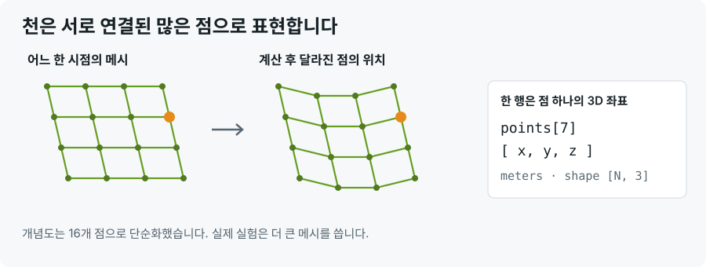

# Newton으로 천과 케이블 움직여 보기

## 어떻게 동작하나요?

### 잘 휘어지는 물체는 어떻게 표현할까요?

단단한 상자는 위치와 회전으로 움직임을 나타낼 수 있습니다. 천은 서로 연결된 많은 점이 각자 움직여야 합니다. Newton은 힘을 받아 변하는 점의 위치를 계산하고, 천이 늘어나거나 구부러지는 정도와 바닥 접촉 등을 반영합니다. XPBD와 VBD는 이를 푸는 방식이 다릅니다. 공식 예제의 재료 설정과 세부 계산 횟수도 달라서, 여기서는 움직임을 비교하고 솔버의 성능 순위를 매기지는 않습니다. [공식 천 예제](https://github.com/newton-physics/newton/blob/main/newton/examples/cloth/example_cloth_hanging.py) · [케이블 예제](https://github.com/newton-physics/newton/blob/main/newton/examples/cable/example_cable_twist.py)



| 데이터 | 이번 실험의 예 | 무엇을 뜻하나요? |
| --- | --- | --- |
| 천 격자 설정 | `--width 64 --height 32` | 공식 예제에 전달하는 격자 해상도 설정입니다. |
| 화면에 그릴 메시의 점 | `points.shape = [2145, 3]` | 점마다 미터 단위 XYZ 좌표가 3개씩 있습니다. |
| 움직이는 입자의 위치 | `positions.shape = [2112, 3]` | 내보낸 입자 배열입니다. 전체 렌더링 메시와 점의 수가 다릅니다. |
| 애니메이션 | `4초`에 걸친 `240개` 시점 | 시간별 계산 결과를 저장해 다시 볼 수 있습니다. |
| 케이블 몸체의 중심 위치 | `[192, 3]` | 케이블을 이루는 몸체들의 질량 중심 좌표입니다. |

가령 한 행이 `[0.2, 1.3, 0.8]`이면 X로 0.2m, Y로 1.3m 떨어져 있고 Z 원점보다 0.8m 높은 점이라는 뜻입니다. 다음 시점에서 이 좌표가 바뀌면 천의 해당 부분이 움직입니다. 색상이나 로봇 제어 명령을 나타내는 값은 아닙니다. 이 행은 좌표를 설명하기 위한 예이며, 실제 측정 결과는 [recorded.json](../../../labs/newton-materials/recorded.json)에서 볼 수 있습니다.

### 영상에서는 무엇을 보나요?

Newton이 GPU에서 천과 케이블의 움직임을 계산해 OpenUSD로 저장합니다. Isaac Sim에서 XPBD 천, VBD 천, 케이블 비틀림 순서로 재생합니다.

## 직접 실행하기

### 계산할 Python 환경 준비하기

NVIDIA GPU가 있는 Linux 머신에서 Newton 예제 의존성, NumPy, `usd-core`를 준비합니다. 촬영에 쓴 계산 환경은 Newton `1.9.0.dev0`, Warp `1.17.0`입니다. 버전에 따라 API가 바뀔 수 있으므로 먼저 `python -m newton.examples cloth_hanging --help`가 실행되는지 확인하세요. [Newton 공식 예제 안내](https://newton-physics.github.io/newton/latest/guide/examples.html)

터미널에서 이 저장소 폴더로 이동합니다. 아래 Python 경로를 내 Newton 가상환경의 Python으로 바꿔 넣으세요. 첫 명령은 환경을 검사하고, 두 번째 명령은 세 실험을 계산해 새 폴더에 저장합니다.

```sh
python3 labs/cli.py --json doctor newton-materials --python /path/to/newton-env/bin/python
python3 labs/cli.py --json run newton-materials \
  --python /path/to/newton-env/bin/python --output ./runs/newton-materials-001
python3 labs/cli.py --json verify ./runs/newton-materials-001
```

### Isaac Sim에서 움직임 보기

**File → Open**으로 결과 폴더의 `*-review.usda`를 엽니다. 참조하는 `.usd`도 같은 폴더에 두세요. 뷰포트에서 **FilmCamera**를 선택한 뒤 타임라인을 움직이면 천이 변형되는 과정을 볼 수 있습니다. Linux X11 데스크톱에서 아래 명령으로 실제 프로그램 창을 녹화할 수 있습니다. 이때 `python`은 Isaac Lab 환경의 Python이며, Newton을 실행한 환경과 달라도 됩니다.

```sh
python labs/physics/capture_gui.py ./runs/newton-materials-001 ./runs/newton-gui-001 \
  /path/to/ffmpeg --plan ./runs/newton-materials-001/takes.json --viz kit
```

녹화에 사용한 GUI는 Isaac Lab으로 실행한 Isaac Sim `6.1.0.0`입니다. [GUI 사용 준비](../onboarding/isaac-sim-tools.md) · [실습 CLI 안내](../../../labs/cli/README.ko.md)

## 결과 확인하기

천이 늘어나고 접히며 바닥에 놓이는 모습과 케이블 강성에 따른 변화를 비교하세요. `verify`는 움직이는 점과 저장 파일을 검사하고, `capture.json`은 GUI 촬영 정보를 담습니다.

[실행 상세](../../../labs/newton-materials/recorded.json) · [접촉·마찰·반발 실험](physics.md) · [Newton 동작 원리](../newton.md)
