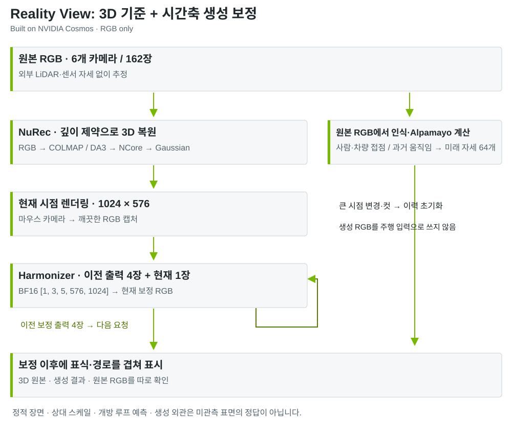
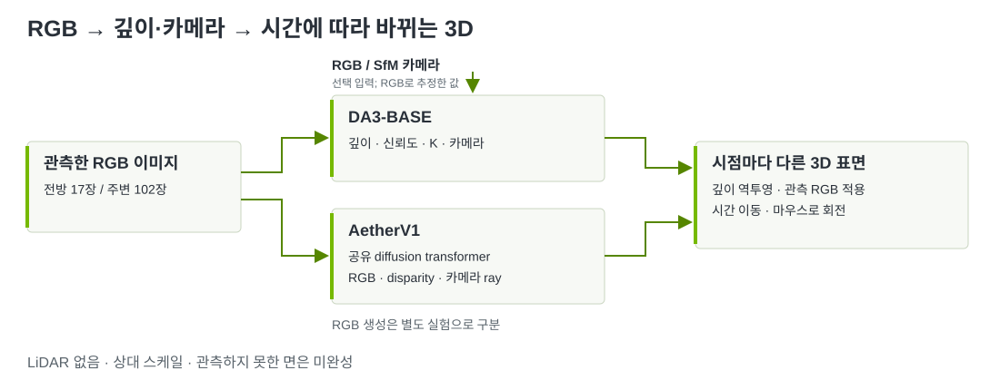
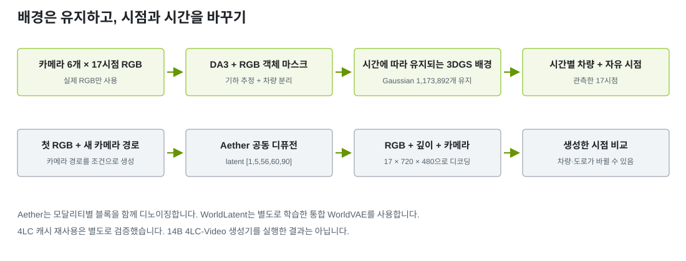
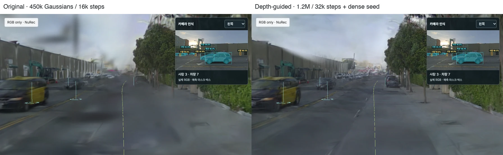
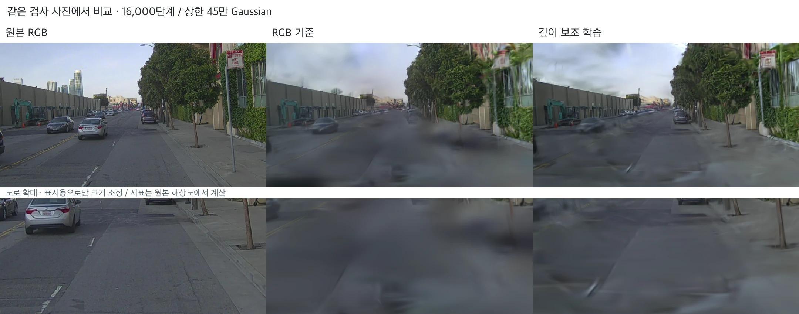

# RGB만으로 NuRec, Harmonizer, Alpamayo 연결하기

[실습 목록](../../../labs/README.ko.md) · [English](../../en/labs/nurec-rgb-reality.md)

카메라 RGB로 도로를 복원해 3D로 둘러보고, 화면 보정·주변 객체 인식·예측 경로를 연결합니다.

[기존 3DGS·객체 인식](#explore) · [Reality View 비교](#joint-geometry) · [실습 따라 하기](#따라-하기)

## 동작 원리


### 1. RGB 사진이 3D 도로가 되는 과정

픽셀에는 색이 담겨 있지만 거리는 없습니다. COLMAP은 겹쳐 찍은 사진의 특징점을 맞춰 카메라 내부 파라미터 `K[3,3]`, 자세 `[4,4]`, 희소 점 `XYZ[N,3]`을 추정합니다. Rig 보정으로 카메라 6개의 배치를 맞춘 뒤 NCore 형식으로 NuRec에 전달합니다.

NuRec은 사진과 렌더링이 비슷해지도록 Gaussian의 위치·크기·방향·불투명도·색을 학습합니다. 브라우저에서 카메라를 움직이면 같은 장면을 다른 방향에서 보게 됩니다.

| 도구 | 입력 → 출력 |
| --- | --- |
| COLMAP + rig 보정 | RGB 사진 → 카메라와 희소 3D 점 |
| NCore | RGB·추정 기하 → NuRec 시퀀스 |
| NuRec | 시퀀스 → 학습된 Gaussian과 새 시점 렌더링 |
| Harmonizer | 렌더링 RGB → 보정 RGB |
| Mask R-CNN | 원본 RGB → 객체 종류·박스·마스크 |
| Alpamayo 2 Edge | 원본 RGB·과거 이동·주행 지시 → 미래 자세 |

예제는 카메라 픽셀만 사용하며 기하와 스케일을 RGB에서 추정합니다. 뷰어 좌표는 상대 단위입니다. [독립 실행형 3DGUT 실습](rgb-reality-view.md)도 함께 볼 수 있습니다.

### 2. 주변 객체와 예측 경로 연결하기

Mask R-CNN이 원본 RGB에서 도로 사용자를 찾습니다. 차량은 청록색, 사람은 노란색, 자전거·이륜차는 보라색입니다. 마스크 아래쪽 픽셀을 지나는 광선을 추정 도로면과 교차시켜 대략적인 3D 접점을 표시합니다. [박스·마스크·좌표 예제](rgb-reality-view.md).

Alpamayo에는 RGB, 최근 이동 이력과 주행 지시를 넣습니다. 초록 점선은 가장 최근의 예측 경로입니다. 어댑터는 실제 RGB 스트림 4개에서 모델용 시점 6개를 만들고, 설정한 카메라 높이로 상대 이동량의 스케일을 바꿉니다.

```text
카메라 RGB:    uint8[22,1,3,576,1024]
과거 위치:     float[1,20,3]
과거 회전:     float[1,20,3,3]
주행 지시:     “Continue straight on the road and yield to pedestrians.”
예측 자세:     float[1,1,1,64,3] + float[1,1,1,64,3,3]
```

인식·경로 모델은 관측한 RGB를 사용하고 Harmonizer는 외관을 생성합니다. 경로는 차량 제어가 아닌 개방형 예측입니다. Volvo 메시는 자차 위치를 나타냅니다.

### 3. 깊이와 법선으로 Gaussian의 형상 다듬기


서로 다른 3D 배치도 비슷한 사진을 만들 수 있습니다. **깊이 prior**는 픽셀의 표면이 어느 거리쯤 있는지 알려주는 보조 추정치입니다. DA3-BASE가 학습 RGB에서 깊이를 얻고, RGB 특징점으로 삼각측량한 점에 맞춰 스케일과 오프셋을 조정합니다. 신뢰도가 낮은 영역과 차량·사람의 검출 박스는 기하 loss에서 제외합니다.


**Z-depth**는 카메라 정면 축의 거리입니다. **Ray distance**는 픽셀 광선을 따라 잰 거리이며 NuRec에 전달하는 값입니다. **법선(normal)**은 표면이 향하는 방향을 길이 1의 벡터로 나타냅니다. 이 예제에서는 이웃 깊이 점으로 구합니다.

실제 도로 픽셀 `(512,450)`의 값입니다.

```json
{
  "rgb_shape": [569, 1024, 3],
  "z_depth": 5.08896,
  "ray_distance": 5.15104,
  "world_normal": [-0.00348, -0.04803, 0.99884]
}
```

법선의 Z 성분이 약 1인 것은 도로가 위를 향한다는 뜻입니다. 거리는 상대 단위입니다. NuRec은 렌더링한 거리 `float[1,569,1024,1]`와 법선 `float[1,569,1024,3]`을 이 목표값과 비교하고, 오차를 역전파해 Gaussian의 형상을 조정합니다. [입출력 예제](../../../labs/nurec-rgb-reality/evidence/guidance/input-output-sample.json) · [Loss 구현](../../../labs/nurec-rgb-reality/guidance/train.py).

### 4. 카메라를 움직여도 외관이 이어지게 만들기



Harmonizer에 현재 NuRec 렌더링과 이전 보정 출력 네 장을 넣습니다. 과거 화면은 작은 카메라 이동 중에도 외관이 이어지도록 돕습니다. 시점이나 시간이 크게 바뀌면 이력을 비웁니다.

```text
입력:           [1,3,5,576,1024] — 현재 렌더링 + 이전 출력 4장
시간축 latent:  [1,16,2,72,128]
표시할 출력:    [1,3,1,576,1024]
```

최적화한 디코더는 시간축 입력을 유지하면서 화면에 쓰는 첫 RGB만 복원합니다. [Harmonizer 공식 구현](https://github.com/NVIDIA/harmonizer).


마우스로 움직이는 동안에는 512×288 AI 미리보기 또는 브라우저 3D 화면을 빠르게 보여줍니다. 멈추면 1024×576 렌더링을 새로 캡처해 고화질로 보정합니다.


[시간축 보정 비교](../../../labs/nurec-rgb-reality/evidence/temporal/comparison.ko.mp4) · [미리보기와 고화질 전환 영상](../../../labs/nurec-rgb-reality/evidence/adaptive/browser.ko.mp4).

### 5. RGB·깊이·카메라를 함께 복원하기



[비교 화면 열기](#joint-geometry). **DA3-BASE**는 깊이·신뢰도·카메라를 추정합니다. **AetherV1**은 RGB·disparity·카메라 ray를 함께 복원하며, RGB 생성은 별도 실험으로 볼 수 있습니다. 주변 복원은 같은 시점의 RGB-D 표면 6개를 배치하고, 전방 모드는 같은 관측 17장으로 비교합니다.

카메라 6개 예제의 입출력입니다.

```text
입력 RGB:       uint8[102,420,756,3] — 17시점 × 카메라 6개
깊이·신뢰도:    float[102,420,756]
내부 파라미터 K: float[102,3,3]
카메라 자세:    float[102,4,4]
```

실제 전방 픽셀 `(378,350)`의 RGB는 `[70,73,80]`, 상대 Z-depth는 `3.82502`입니다. `X=(u-cx)Z/fx`, `Y=(v-cy)Z/fy`로 카메라 좌표를 얻고 회전·위치를 적용하면 장면 좌표 `[-4.29220,0.03739,0.22340]`가 됩니다. 뷰어에서 RGB 픽셀을 눌러 이 대응을 확인하세요.

DA3·Aether 복원 모드는 프레임별 RGB-D 메시입니다. 생성 RGB는 관측 결과와 나눠 보여줍니다.

[3D 조작 영상](../../../labs/nurec-rgb-reality/evidence/unified/interaction.ko.mp4) · [관측 RGB와 생성 RGB 비교](../../../labs/nurec-rgb-reality/evidence/unified/generation.ko.mp4) · [전체 설치 절차와 모델 조건](../../../labs/nurec-rgb-reality/unified/README.ko.md).

### 6. 배경을 유지하고 차량·카메라·시간을 분리하기



[새 비교 화면](#joint-geometry)의 **3DGS 배경 + 시간별 차량**은 이전 고화질 NuRec 모델을 활용합니다. 실제 RGB에서 검출한 차량 마스크와 DA3 깊이가 두 번 이상 일치하는 Gaussian 26,108개를 배경에서 제외하고, 남은 1,173,892개는 그대로 유지했습니다. 차량 표면은 선택한 시간의 RGB-D 메시로 표시합니다. 배경을 매 프레임 새로 띄우지 않아 빈 화면을 줄이지만, 검출·깊이 오차와 일부 차량 잔상은 남을 수 있습니다.

**디퓨전 실험**에서는 첫 RGB와 좌·우로 이동하는 카메라 경로를 Aether에 넣었습니다. 모델이 함께 디노이징한 실제 상태는 `float16[1,5,56,60,90]`입니다. 시간 17장이 5개 latent 시간 슬롯으로 압축되고, 채널 56개는 RGB 16개·disparity 16개·카메라 24개로 구성됩니다. 이를 디코딩해 RGB·깊이·카메라가 함께 나온 17장을 뷰어에서 확인합니다. 생성한 차량·도로는 실제 관측과 달라질 수 있습니다.

[WorldLatent](https://worldlatent.github.io/)의 핵심은 RGB·깊이·카메라 ray를 **학습된 하나의 bottleneck**으로 합치는 WorldVAE입니다. 위 Aether 상태나 RGB-D 배열을 WorldVAE라고 부를 수는 없습니다. 또한 시간축 latent 자체가 사방에서 완성된 Gaussian 장면은 아닙니다. 생성한 기하를 여러 시점에서 검증하고 장면에 유지하는 단계가 필요합니다. 공개 추론 가중치는 2026-11-25 확인 기준으로 찾지 못해, 여기서는 공개된 Aether와 별도의 4LC 캐시를 실제 실행했습니다.

[실제 3D 비교 영상](../../../site/public/showcase/reality-dense.ko.mp4) · [구현·재현 절차와 측정 범위](../../../labs/nurec-rgb-reality/dense/README.ko.md).


### 7. 카메라 RGB로 노면을 고정하기

**RGB 노면 재투영 + 3D 장면**에서는 여러 시점에서 확인한 도로 픽셀을 하나의 3D 표면에 입힙니다. Mask2Former로 도로와 하늘을 나누고, LoMa와 BA로 카메라를 보정합니다. DA3와 Depth Pro 2로 노면 높이를 맞춘 다음, 두 시점 이상에서 도로로 확인된 곳만 텍스처에 넣습니다. 건물 외벽 일부는 LoMa와 깊이로 맞춘 수직면에 RGB를 입히고, 하늘은 촬영 방향에 맞춰 별도 배경으로 표시합니다.

[비교 화면](#joint-geometry)에서 재투영 전후를 같은 시점으로 전환하거나 **RGB 노면만 보기**로 차선과 텍스처 범위를 확인하세요. [입출력·실행 방법·측정값](../../../labs/nurec-rgb-reality/road/README.ko.md).

같은 검증점 1,887개에서 2차 LoMa·BA 후 전체 재투영 오차의 90백분위가 6.39px에서 5.97px로 줄었습니다. 벽면과 노면은 각각 검증 결과가 더 나았던 1차 결과를 사용합니다.

### 8. 프랑크푸르트에서 새 시점 렌더링

프랑크푸르트 구간을 골라 Volvo 추적 시점으로 재생하세요. 교차로에서 멈춘 뒤 **3D 카메라**와 **실사 RGB**를 바꾸면 같은 시간의 측·후방을 비교할 수 있습니다. **자유 시점**에서는 화면을 드래그하거나 카메라의 좌우 위치와 높이를 조절하세요. [복원 절차·데이터 후보·라이선스](../../../labs/nurec-rgb-reality/road/highres/README.ko.md).

## 따라 하기

### 1. CUDA GPU 없이 저장된 결과부터 보기

**3D 시작**을 누르고 도로를 드래그해 보세요. 재생을 누르거나 타임라인을 움직이면 선택한 시간의 차량을 볼 수 있습니다. **비교 모드**에서 깊이 복원과 생성 시점을 바꾸고, **RGB·깊이 데이터 살펴보기**를 펼친 뒤 RGB 픽셀을 누르면 좌표를 확인할 수 있습니다. 객체 인식과 Alpamayo 경로는 아래 **기존 3DGS** 데모에서 살펴봅니다.

브라우저 데모는 저장된 결과를 사용합니다. 저장소를 복제했다면 GPU 없이 파일 무결성도 검사할 수 있습니다.

```bash
python3 labs/nurec-rgb-reality/check.py
python3 labs/nurec-rgb-reality/dense/check.py
```

### 2. GPU 머신 준비하기

검증에 사용한 환경은 Linux x86_64, RTX 5090 32GB 한 장, 시스템 메모리 약 32GB입니다. 호환되는 NVIDIA 드라이버, NVIDIA Container Toolkit이 연결된 Docker, Python, Git, uv, Node.js/npm을 준비하세요. [NVIDIA Linux 온보딩](../onboarding/nvidia-linux.md)부터 확인하면 됩니다.

```bash
nvidia-smi
export NUREC_RGB_ROOT="$HOME/physical-ai-labs/nurec-rgb-road"
python3 labs/nurec-rgb-reality/pipeline.py --root "$NUREC_RGB_ROOT" setup
```

`setup`은 지정한 런타임과 모델을 받아 별도 환경을 만듭니다. 큰 실행 파일은 Git 밖에 저장하세요. [출처와 사용 조건](../../../labs/nurec-rgb-reality/SOURCES.md).

### 3. 한 단계씩 실행하기

저장소 폴더의 터미널에서 실행합니다. 앞 명령이 성공한 뒤 다음 명령을 넣으세요.

```bash
python3 labs/nurec-rgb-reality/pipeline.py --root "$NUREC_RGB_ROOT" rgb
python3 labs/nurec-rgb-reality/pipeline.py --root "$NUREC_RGB_ROOT" rig
python3 labs/nurec-rgb-reality/pipeline.py --root "$NUREC_RGB_ROOT" prepare
python3 labs/nurec-rgb-reality/pipeline.py --root "$NUREC_RGB_ROOT" train
python3 labs/nurec-rgb-reality/pipeline.py --root "$NUREC_RGB_ROOT" render
python3 labs/nurec-rgb-reality/pipeline.py --root "$NUREC_RGB_ROOT" enhance
python3 labs/nurec-rgb-reality/pipeline.py --root "$NUREC_RGB_ROOT" --assumed-camera-height-m 1.8 policy
python3 labs/nurec-rgb-reality/pipeline.py --root "$NUREC_RGB_ROOT" perceive
python3 labs/nurec-rgb-reality/pipeline.py --root "$NUREC_RGB_ROOT" export
python3 labs/nurec-rgb-reality/pipeline.py --root "$NUREC_RGB_ROOT" serve
```

`rgb`에서 카메라를 추정하고 `rig`에서 고정 배열로 조정합니다. `prepare`는 NCore 입력을 만들고 `train`은 NuRec을 학습해 Gaussian을 내보냅니다. `render`는 정면·사선·회전 시점의 NuRec 원본을 만들며, `enhance`는 회전 프레임에 Harmonizer를 실행합니다. `policy`와 `perceive`는 원본 RGB로 각 모델을 실행하고, `export`가 뷰어를 묶습니다.

### 4. 깊이·법선 보조 학습 비교하기

위 실습으로 `prepare`와 `perceive`까지 완료한 입력 폴더를 사용합니다. 첫 비교는 별도 폴더에서 학습 사진 138장과 검사 사진 24장을 나눠 실행합니다. 아래 명령은 저장소 폴더의 터미널에서 한 줄씩 실행하세요. 설치 단계는 DA3 전용 Python 환경을 만들며 기존 실습 환경을 바꾸지 않습니다.

```bash
export RGB_BASE="$HOME/physical-ai-labs/nurec-rgb-road"
export RGB_GUIDED="$HOME/physical-ai-labs/nurec-guidance-test"
python3 labs/nurec-rgb-reality/guidance/pipeline.py --base "$RGB_BASE" --root "$RGB_GUIDED" setup
python3 labs/nurec-rgb-reality/guidance/pipeline.py --base "$RGB_BASE" --root "$RGB_GUIDED" inputs
python3 labs/nurec-rgb-reality/guidance/pipeline.py --base "$RGB_BASE" --root "$RGB_GUIDED" prepare
python3 labs/nurec-rgb-reality/guidance/pipeline.py --base "$RGB_BASE" --root "$RGB_GUIDED" priors
python3 labs/nurec-rgb-reality/guidance/pipeline.py --base "$RGB_BASE" --root "$RGB_GUIDED" train
python3 labs/nurec-rgb-reality/guidance/pipeline.py --base "$RGB_BASE" --root "$RGB_GUIDED" evaluate
```

법선 제약을 약하게 시험하려면 `train`에 `--variant depth-normal-soft`를 넣고 `evaluate`를 다시 실행합니다.

더 세밀한 뷰어용 모델은 새 폴더에서 `--production --variant depth`를 사용합니다. `priors` 다음에 `dense`, `train`, `export`, `package`, `serve` 순서로 실행하세요. 기존 실습의 `export`가 먼저 끝나 있어야 합니다. [고급 학습 절차](../../../labs/nurec-rgb-reality/guidance/README.md).

### 5. GPU에서 시간축 보정 실행하기

복원과 렌더링을 마친 뒤 진행합니다. **Linux x86_64, Python 3.12 이상, NVIDIA Container Toolkit이 연결된 Docker, uv**를 준비하세요. Harmonizer는 별도 환경에 설치합니다.

```bash
export RV_TEMPORAL_ROOT="$HOME/physical-ai-labs/reality-temporal"
export RV_INPUT="$NUREC_RGB_ROOT/renders/orbit/front_camera"
python3 labs/nurec-rgb-reality/temporal/pipeline.py --root "$RV_TEMPORAL_ROOT" setup
python3 labs/nurec-rgb-reality/temporal/pipeline.py --root "$RV_TEMPORAL_ROOT" --input "$RV_INPUT" compare
python3 labs/nurec-rgb-reality/temporal/pipeline.py --root "$RV_TEMPORAL_ROOT" --input "$RV_INPUT" evaluate
python3 labs/nurec-rgb-reality/temporal/pipeline.py --root "$RV_TEMPORAL_ROOT" check
```

`compare`가 같은 렌더링을 V1·V5로 처리합니다. `evaluate`는 안정성과 윤곽을 비교하고 `check`는 저장된 출력을 검사합니다. [설치와 로컬 GPU 뷰어 연결](../../../labs/nurec-rgb-reality/temporal/README.ko.md).

**GPU나 가중치를 받지 않고 공개한 실행 기록을 검사**하려면 다음 한 줄만 실행하세요.

```bash
python3 labs/nurec-rgb-reality/temporal/check.py
```

로컬 GPU 보정도 연결할 수 있습니다. [GPU 서버와 SSH 터널 설정](../../../labs/nurec-rgb-reality/temporal/README.ko.md#실시간-뷰어-연결하기).

### 6. 최적화 비교를 직접 실행하기

기존과 같은 `RV_TEMPORAL_ROOT`·`RV_INPUT`을 사용합니다. GPU 서버를 켜뒀다면 해당 터미널에서 **Ctrl+C로 종료한 뒤** 실행하세요. GPU 잠금은 두 작업이 동시에 경쟁하지 않도록 합니다.

```bash
python3 labs/nurec-rgb-reality/temporal/pipeline.py --root "$RV_TEMPORAL_ROOT" --input "$RV_INPUT" benchmark
python3 labs/nurec-rgb-reality/temporal/check_speed.py
```

`benchmark`는 세 방식을 차례로 실행하고 `comparison/speed-benchmark/benchmark.json`에 모델 지연·FPS·RGB 해시·SSIM·PSNR을 남깁니다. 이미 결과가 있으면 새 `--comparison-dir`을 지정하세요. 빠른 실행 확인에는 `--max-frames 12`를 추가할 수 있습니다. 두 번째 명령은 GPU 없이 저장소에 공개된 비교 기록과 영상 해시를 확인합니다.

출력을 그대로 유지하려면 **화질 동일**, 속도를 더 높이려면 **추가 가속**을 선택하세요. [최적화 코드](../../../labs/nurec-rgb-reality/temporal/fast.py).

### 7. 이동 중 미리보기와 정지 후 보정 직접 해 보기

[시간축 보정 설치 안내](../../../labs/nurec-rgb-reality/temporal/README.ko.md#실시간-뷰어-연결하기)에 따라 GPU 서비스와 뷰어를 실행하세요. **http://127.0.0.1:8092/?lang=ko&execution=adaptive**는 AI 미리보기, **`execution=native`**는 브라우저3D 미리보기입니다. 장면을 열고 **자동 갱신**을 켠 뒤 드래그했다가 놓으면 고화질로 전환됩니다.

GPU 화질 검사를 재현하려면 먼저 서비스 터미널에서 Ctrl+C로 실행을 멈추세요. 시간축 보정 README의 안내대로 `RV_INPUT`은 개선 모델의 순서 있는 렌더링 폴더, `RGB_GUIDED_PROD`는 그 모델의 비공개 production 폴더로 지정합니다.

```bash
python3 labs/nurec-rgb-reality/temporal/pipeline.py --root "$RV_TEMPORAL_ROOT" --comparison-dir "$RV_TEMPORAL_ROOT/adaptive-check" --input "$RV_INPUT" --rig "$RGB_GUIDED_PROD/rig-orbit.json" --max-frames 12 adaptive-benchmark
python3 labs/nurec-rgb-reality/temporal/check_adaptive.py
```

## 결과 확인

같은 시점에서 복원 모델을 바꾼 뒤 시간을 재생하고 원본 카메라를 선택해 보세요. 도로 형상, 객체 경계와 외관이 어떻게 달라지는지 확인합니다.





모델을 다시 학습하지 않고 저장된 결과를 검사할 수 있습니다.

```bash
python3 labs/nurec-rgb-reality/check.py --decode-video
python3 labs/nurec-rgb-reality/guidance/check.py
python3 labs/nurec-rgb-reality/unified/check.py
python3 -m unittest discover -s labs/nurec-rgb-reality/guidance -p 'test_*.py'
python3 -m unittest discover -s labs/rgb-reality-view -p 'test_*.py'
```

[깊이 기반 학습 측정값](../../../labs/nurec-rgb-reality/evidence/guidance/comparison.json) · [시간축 보정 평가](../../../labs/nurec-rgb-reality/evidence/temporal/evaluation.json) · [지연 시간 측정](../../../labs/nurec-rgb-reality/evidence/speed/benchmark.json) · [미리보기 화질](../../../labs/nurec-rgb-reality/evidence/adaptive/validation.json) · [출처와 사용 조건](../../../labs/nurec-rgb-reality/SOURCES.md).

[독립 실행형 3DGUT](rgb-reality-view.md), [PandaSet으로 NuRec 익히기](pandaset-nurec.md), [가상 도로 실습](reality-view.md)으로 이어가세요.
