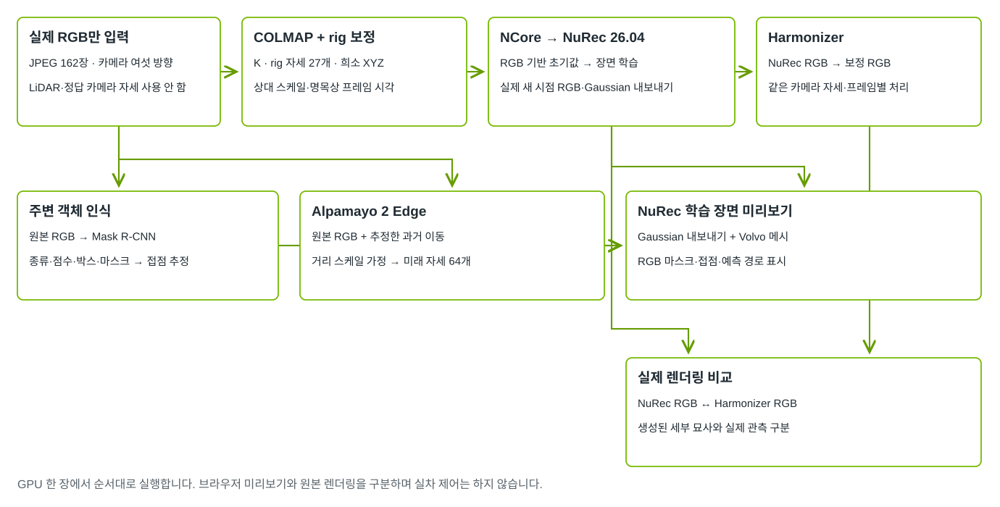
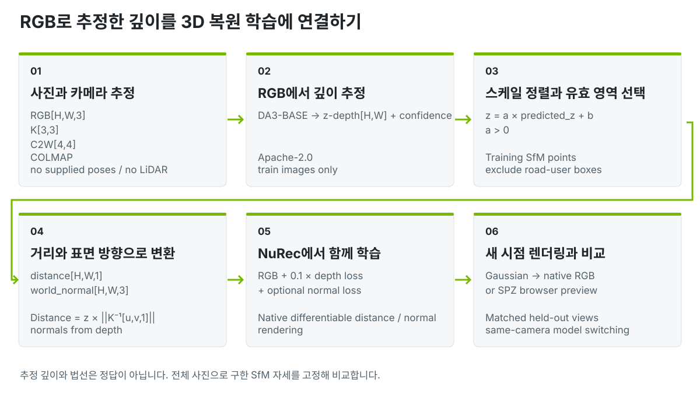
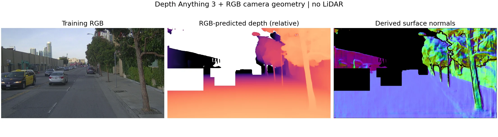
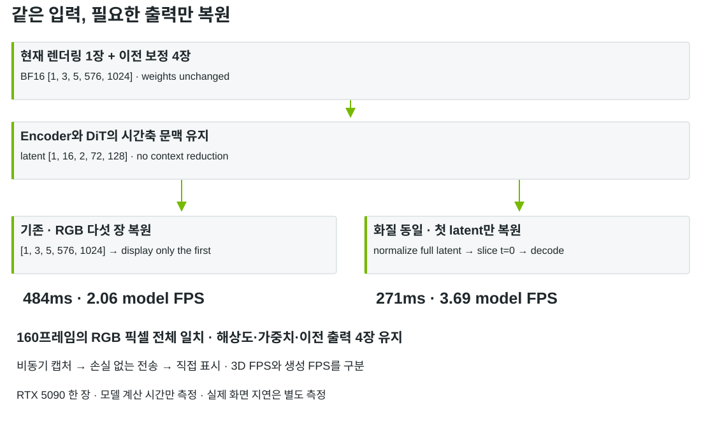
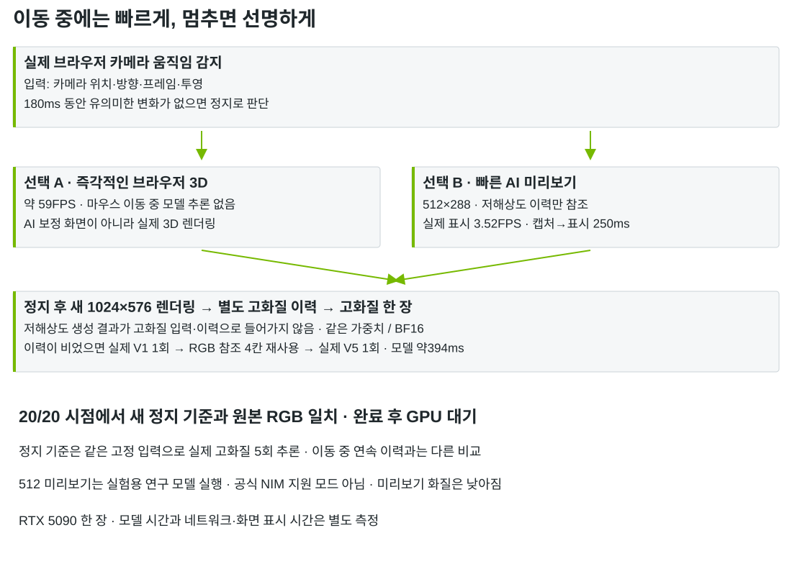

# RGB만으로 NuRec, Harmonizer, Alpamayo 연결하기

[실습 목록](../../../labs/README.ko.md) · [English](../../en/labs/nurec-rgb-reality.md)

실사 도로를 **NuRec**에서 복원하고, 같은 시점의 렌더링에 **Harmonizer**를 적용해 비교합니다. 여기에 **Alpamayo 2 Edge**의 예측 경로와 원본 카메라의 객체 인식 결과를 연결합니다. 복원 입력은 RGB 픽셀뿐입니다. 먼저 저장된 장면과 영상을 둘러보고 RTX 5090 한 장으로 각 단계를 따라 해 보세요.

**깊이 기반 복원 개선:** 아래 3D 뷰어에서 카메라 위치를 유지한 채 모델을 바꿔 보세요. [RGB로 추정한 깊이·법선의 역할](#동작-원리)과 [같은 조건의 비교 결과](#결과-확인)도 확인할 수 있습니다.

## 동작 원리



### 1. 이번 실습에서 실제로 실행하는 도구

| 단계 | 실제 입력 → 출력 | 담당하는 일 |
| --- | --- | --- |
| COLMAP | RGB 사진 162장 → 카메라 보정값·자세·희소 3D 점 | 사진의 특징점을 맞춰 카메라와 기하 구조를 추정합니다. |
| Rig bundle adjustment | 사진별 추정치 → 카메라 6대·촬영 시점 27개의 고정 배열 | NuRec 입력 형식에 맞춰 카메라의 상대 위치를 함께 보정합니다. |
| NCore | 추정 카메라·RGB·SfM 점 → NuRec 시퀀스와 Gaussian 초기값 | 데이터를 묶는 형식과 API입니다. 신경망 모델은 아닙니다. |
| NuRec 26.04 | NCore와 RGB 기반 초기값 → 학습 산출물·새 시점 RGB·Gaussian | 실제 NuRec 런타임의 3DGUT COLMAP 구성을 실행합니다. |
| Harmonizer | NuRec의 실제 렌더링 → 같은 시점의 보정 RGB | 기존 non-temporal 기준 영상과 아래의 V1·V5 시간축 비교를 제공합니다. 3D 형상 자체는 바꾸지 않습니다. |
| Alpamayo 2 Edge | 원본 RGB·추정한 과거 이동·주행 지시 → 시점마다 미래 자세 64개 | 실제 VLA 모델을 실행하고 예측을 표시합니다. 제어 명령은 적용하지 않습니다. |
| Mask R-CNN | 원본 RGB → 종류·점수·검출 박스·객체별 마스크 | Alpamayo나 보정 영상과 독립적으로 주변 차량과 사람을 인식합니다. |

[독립 실행형 3DGUT 실습](rgb-reality-view.md)은 비교 자료로 유지합니다. 여기서도 NuRec 내부의 3DGUT 구성을 쓰지만, **NuRec의 데이터 입력·학습·렌더링·내보내기를 실제 호출**한다는 점이 다릅니다. 독립 실행형 학습 결과를 NuRec 실행 결과로 바꿔 부르지 않습니다.

### 2. RGB-only로 어디까지 추정할까?

공개 예제에서 받는 파일은 카메라 JPEG와 원래 데이터 이용 조건뿐입니다. COLMAP은 겹쳐 찍힌 사진을 비교해 `K[3,3]`, 카메라 자세 `[4,4]`, 희소 점 `XYZ[N,3]`을 구합니다. LiDAR·외부 깊이·GPS·IMU·제공된 카메라 자세·보정값·센서 시각·객체 정답 라벨은 복원에 사용하지 않습니다.

카메라 폴더와 같은 프레임 번호를 기준으로 **명목상 같은 촬영 시점**을 묶습니다. 이후 카메라 상대 위치, rig의 이동, 3D 점을 함께 조정하고 왜곡 보정한 카메라의 내부 보정값은 고정합니다. 사진별 자유로운 카메라 모델의 재투영 오차는 약 0.875픽셀, 고정 배열 제약을 둔 모델은 약 1.150픽셀입니다. 배열을 고정했다고 이미지 오차가 더 작아지는 것은 아니며, 프레임 번호만으로 정밀한 센서 동기화를 입증하지도 않습니다.

NuRec에는 RGB 관측 162개와 사진에서 삼각측량한 점 약 2만 8,600개를 전달합니다. 이 점군은 **RGB로 추정한 결과**이며 거리 센서로 측정한 값이 아닙니다. NCore에는 rig의 이동, 고정된 카메라 상대 자세, 내부 보정값과 RGB를 저장합니다. LiDAR 데이터와 정답 객체 궤적은 없습니다.

RGB만으로는 실제 길이 단위를 확정할 수 없습니다. 카메라와 도로면 사이 높이의 중앙값을 화면 단위 1로 맞춥니다. 도로면 역시 사진의 특징점으로 추정합니다. 따라서 측량한 도로 지도나 미터 단위 좌표가 아닙니다. 모든 이미지가 SfM에 관여하므로 독립적인 새 시점 정확도 벤치마크로도 해석하지 않습니다.

### 3. NuRec과 Harmonizer는 무엇을 바꿀까?

NuRec은 Gaussian의 위치·회전·크기·불투명도·방향별 색을 조정합니다. 새 카메라에서 같은 Gaussian을 그리면 다른 시점의 RGB를 얻습니다. 저장된 실행은 16,000단계를 학습했습니다. 실제 시간과 모델 식별 값, Gaussian 개수는 [recorded.json](../../../labs/nurec-rgb-reality/recorded.json)에 있습니다.

Harmonizer에는 NuRec이 실제 렌더링한 프레임을 값 범위 `[-1,1]`의 `float[1,3,1,576,1024]`로 넣습니다. 비교 영상의 좌우는 **같은 카메라 자세와 프레임 번호**를 사용합니다. 공개된 non-temporal 모델은 각 프레임을 독립적으로 처리하므로 세부 묘사가 바뀌거나 깜박일 수 있습니다. 도로처럼 빈 공간을 채워도 그 부분을 실제로 관측했다는 뜻은 아닙니다. **Built on NVIDIA Cosmos.**

브라우저에서는 NuRec의 공식 `export-gaussian-plys` 출력물을 SPZ로 압축해 Spark/Three.js로 그립니다. Gaussian은 유지하고 방향별 색은 degree 1로 줄입니다. 따라서 **NuRec 학습 결과의 브라우저용 미리보기**이며, 압축과 렌더러 차이로 NuRec 원본 렌더링과 조금 다를 수 있습니다. 공개 Pages에서는 NuRec 원본과 Harmonizer의 실제 출력 영상을 확인합니다. 아래의 선택형 로컬 서버를 연결하면 마우스로 고른 실제 화면도 보정할 수 있습니다. 정적 Pages 자체에서 GPU 추론을 실행하지는 않습니다.

### 4. Alpamayo 경로는 어디서 나올까?

Alpamayo에는 보정 영상이 아닌 원본 카메라 픽셀을 넣습니다. 실제 RGB 스트림 네 개에서 모델용 여섯 뷰를 만듭니다. 왼쪽·정면·오른쪽은 원래 화면을 사용하고, 후면 사진에서 좌우 하위 뷰 두 개를, 정면에서 망원에 해당하는 뷰를 잘라 만듭니다. 모든 샘플링 광선은 실제 이미지 안에 머뭅니다.

이것은 **카메라 배열을 맞추기 위한 명시적인 어댑터**입니다. 모델이 원래 기대하는 화각보다 좁고, 실제 NVIDIA AV 카메라 보정과 같은 구성이 아닙니다. 관측하지 않은 후방 화면을 만들어서 실제 카메라로 표시하지 않습니다.

```text
선택한 RGB 뷰 22개:  uint8[22,1,3,576,1024]
카메라 ID / 명목 시각: int64[22]
과거 위치:           float[1,20,3], 현재의 -1.9초부터 0초까지
과거 회전:           float[1,20,3,3]
주행 지시:           “Continue straight on the road and yield to pedestrians.”
예측 위치:           float[1,1,1,64,3]
예측 회전:           float[1,1,1,64,3,3]
```

과거 자세 20개는 RGB에서 추정한 움직임을 도로면에 투영해 만듭니다. 평면 도로와 yaw 회전을 가정하고, 위치를 평활화한 뒤 10Hz로 보간합니다. 각 입력 이미지는 요청 시각 **이전 또는 같은 시각**에 있는 가장 최근 프레임을 고릅니다. 미래 궤적 정답은 사용하지 않습니다. 다만 카메라 자세는 전체 사진으로 오프라인 복원한 값이므로, 이 실습을 미래 영상에 전혀 접근하지 않는 온라인 인지·주행 시스템으로 해석하지 않습니다.

모델은 미터 단위 주행 이력을 기대합니다. 예제에서는 상대 좌표를 바꾸기 위해 **카메라 높이 1.8m를 가정**합니다. RGB로 실측한 높이가 아니며 이 값을 바꾸면 예측도 달라질 수 있습니다. `--assumed-camera-height-m`으로 가정이 드러나고 교체할 수 있게 했습니다.

2.1·3.9·5.7·7.8초의 네 시점에서 실제 추론합니다. 초록색 점선은 현재 시점에 이미 얻을 수 있는 가장 최근 예측이며 입력 시각과 스케일 가정을 함께 표시합니다. 2.1초 이전에는 미래 시점의 예측을 미리 보여주지 않습니다. 선은 잘 보이게 높이를 조금 올려 그리며 원본 좌표는 그대로 보존합니다. 모델이 생성한 설명도 틀릴 수 있으므로 장면의 검증된 사실로 취급하지 않습니다. 이는 **폐루프 주행이 아닌 개방형 경로 추론**이며 실제 주행 품질 시험은 아닙니다.

### 5. 주변 차량과 사람은 어떻게 보여줄까?

Mask R-CNN은 원본 RGB에서 객체 종류·박스·이진 마스크를 예측합니다. 점수 0.8 이상인 도로 사용자 여섯 종류를 남깁니다. 차량은 청록색, 사람은 노란색, 자전거·이륜차는 보라색입니다. 카메라 패널에서 실제 사진과 예측을 확인하고 표시를 꺼서 원본과 비교할 수 있습니다.

마스크 아래쪽 픽셀에서 나온 광선을 추정한 도로면과 교차시켜 3D 접점을 표시합니다. 화면 가장자리에서 잘렸거나 수평선 근처이거나 너무 먼 객체는 2D 결과만 남깁니다. 표식은 실측한 3D 박스나 물리적 가림 관계가 아닙니다. 임시 ID가 바뀔 수 있고 여러 프레임의 검출 수는 고유한 사람·차량 수와 다릅니다. [마스크와 좌표의 상세 설명](rgb-reality-view.md)도 함께 보세요.

Volvo S90은 출처를 표시한 실제 3D 메시로, 자차 위치를 보여주기 위해 전경에 추가합니다. 원래 촬영 차량이나 차량 동역학 모델은 아닙니다. 장면 복원·외관 보정·객체 인식·주행 예측은 각각 확인할 수 있게 유지합니다.

### 6. RGB에서 추정한 깊이로 번짐 줄이기



RGB만 맞추는 학습에서는 서로 다른 3D 배치가 비슷한 사진을 만들 수 있습니다. 도로가 울퉁불퉁하게 복원되거나 색이 허공에 번지는 이유 중 하나입니다. **깊이 prior**는 “이 픽셀의 표면이 대략 이 거리쯤에 있다”는 보조 추정치입니다. [Depth Anything 3](https://github.com/ByteDance-Seed/Depth-Anything-3)의 **DA3-BASE**에 학습용 사진과 RGB에서 추정한 카메라를 넣어 깊이를 얻습니다. 코드와 이 체크포인트는 Apache-2.0이며, 더 큰 DA3 모델 모두가 같은 조건인 것은 아닙니다.

깊이 지도의 값은 그대로 쓰지 않습니다. 학습 사진의 특징점으로 삼각측량한 SfM 점과 맞춰 **양수 스케일과 오프셋**을 추정합니다. 차량·사람의 검출 박스, 신뢰도가 낮은 픽셀과 깊이가 불연속적인 경계는 기하 제약에서 제외합니다. RGB 재현 loss에는 원래 사진을 계속 사용합니다.



깊이에는 서로 다른 두 정의가 있습니다. **z-depth**는 카메라 앞 방향의 거리이고 **ray distance**는 픽셀의 광선을 따라 잰 거리입니다. 화면 중앙에서 벗어나면 두 값이 달라집니다. NuRec의 거리 loss에 전달하는 것은 ray distance입니다. 법선(normal)은 표면이 향하는 방향을 길이 1의 벡터로 나타냅니다. 이번 법선은 별도 모델의 독립적인 예측이 아니라, 같은 깊이 지도에서 주변 3D 점의 기울기를 구한 것입니다.

실제 학습 프레임 `front_camera/39.jpg`의 도로 픽셀 `(512, 450)`은 다음처럼 변환됐습니다. 모두 **상대 단위**이며 미터로 측정한 값은 아닙니다.

```json
{
  "rgb_shape": [569, 1024, 3],
  "pixel_uv": [512, 450],
  "z_depth": 5.08896,
  "ray_distance": 5.15104,
  "world_normal": [-0.00348, -0.04803, 0.99884]
}
```

법선의 세 번째 성분이 약 1이라는 것은 이 좌표계에서 도로가 대체로 위를 향한다는 뜻입니다. NuRec에는 거리 `float[1,569,1024,1]`, 법선 `float[1,569,1024,3]`과 유효 영역을 전달합니다. 렌더러가 예측한 거리·방향을 이 값들과 비교하고, 그 오차를 역전파해 Gaussian의 위치·크기·방향을 조정합니다. 깊이 loss와 법선 loss가 실제 미분 가능한 렌더링에 연결됐는지도 실행 중 검사합니다. [실제 입출력 수치](../../../labs/nurec-rgb-reality/evidence/guidance/input-output-sample.json) · [구현 코드](../../../labs/nurec-rgb-reality/guidance/train.py).

이 방식은 [DN-Splatter의 연구](https://arxiv.org/abs/2403.17822)와 같은 깊이·법선 정규화 접근을 참고한 독립 구현입니다. DN-Splatter 자체를 실행한 결과가 아닙니다. RGB로 추정한 깊이도 틀릴 수 있고, 정적인 Gaussian 모델만으로 움직이는 차량의 잔상을 해결할 수는 없습니다.

### 7. Reality View에 이전 보정 화면을 넣으면 무엇이 달라질까?


사진을 한 장씩 보정하면 마우스를 조금만 움직여도 같은 나무의 모양이 달라질 수 있습니다. 이번에는 **NuRec의 3D 장면을 공간 기준으로 유지**하고, 보정 모델에 이전 출력 네 장을 함께 넣습니다. 현재 렌더링은 새 시점을 알려주고, 이전 출력은 외관이 이어지도록 돕습니다. 기존의 프레임별 보정에서 실제로 바꾼 부분입니다.

| 궁금한 점 | 기존 구현 | 이번 구현 |
| --- | --- | --- |
| 장면의 공간 기준은? | RGB로 복원한 NuRec Gaussian | 깊이 제약으로 개선한 NuRec Gaussian. 비교할 때 같은 카메라 사용 |
| 화면을 어떻게 보정하나? | non-temporal 가중치로 한 장씩 처리 | 공개된 temporal 가중치 하나로 V1·V5를 비교 |
| 마우스로 돌리면? | 브라우저에서 3D 렌더링, 보정은 저장 영상으로 확인 | 선택한 실제 화면을 로컬 GPU 서버로 보내 보정. 밀린 화면을 쌓아두지 않음 |
| 시점이 갑자기 바뀌면? | 보정 이력이 없음 | 큰 회전·이동, 시간 점프, 투영·복원 모델 변경 시 이력 초기화 |
| 인식 표식과 경로의 입력은? | 원본 RGB와 추정 움직임 | 같은 원본 입력 유지. 보정 **이후에** 표식과 경로를 겹쳐 표시 |
| RGB 근거가 약한 곳은? | 별도 표시 없음 | Gaussian 형상은 유지한 채 깊이 일치 추정치를 색으로 확인 |

**데이터를 살펴봅시다.** 현재 시점의 렌더링은 `[-1,1]` 범위의 `float[1,3,1,576,1024]`가 됩니다. 이전 보정 출력이 네 장 쌓이면 다음처럼 묶습니다.

```text
x[:, :, 0] = 현재 시점의 3D 렌더링
x[:, :, 1] = 직전 보정 출력, t−1
x[:, :, 2] = 두 번째 이전 보정 출력, t−2
x[:, :, 3] = 세 번째 이전 보정 출력, t−3
x[:, :, 4] = 네 번째 이전 보정 출력, t−4
x.shape    = [1, 3, 5, 576, 1024]
기존 y.shape = [1, 3, 5, 576, 1024] → 첫 프레임 표시
최적화 y.shape = [1, 3, 1, 576, 1024] → 같은 첫 프레임만 복원
```

처음 네 장은 V1으로 처리하고, 이력을 비우면 다시 네 장을 모읍니다. 여기서 과거 입력은 **모델이 앞서 생성한 출력**입니다. 미래 카메라 사진이나 앞으로의 여덟 프레임을 예측하는 구조와 다릅니다. 단일 단계 diffusion으로 외관을 보정하며, 3D 형상을 다시 학습하거나 채워 넣은 표면의 정확성을 보장하지는 않습니다. [공식 코드](https://github.com/NVIDIA/harmonizer)와 [모델 카드](https://huggingface.co/nvidia/Harmonizer)에서 원래 구현을 확인할 수 있습니다.

제공받은 Tesla 해설은 하나의 시각 인코더에서 주행 모델과 diffusion·mean-flow 표시 모델로 갈라지는 구조를 제안합니다. 설계에 참고할 가설이지만 모델 크기·36fps·여덟 프레임이라는 주장은 **이 실습에서 확인한 사실이 아닙니다.** 연결된 [원본 X 게시물](https://x.com/elonmusk/status/2124458557525397780)은 확인 과정에서 직접 열리지 않았습니다. 우리는 Tesla 가중치나 공유 UVE를 재현하지 않았습니다. 원본 RGB에서 복원·인식·Alpamayo를 각각 실행하고, 표시용 분기에서 실제 NuRec 렌더링과 공개 Harmonizer 가중치를 사용합니다.

**색은 정답이 아니라 보조 근거입니다.** 뷰어에서 **RGB 깊이 근거 살펴보기**를 고르세요. Gaussian 중심을 투영했을 때 깊이가 일치하는 카메라가 0개면 빨강, 1개면 노랑, 2개 이상이면 청록입니다. 여섯 카메라 이름을 구분하므로 같은 카메라의 여러 프레임을 별개 카메라로 세지 않습니다. RGB에서 추정한 카메라와 예측 깊이를 10% + 상대 단위 0.1의 오차 범위로 비교합니다. 가림·움직이는 객체 제외·깊이 오차 때문에 낮게 나올 수 있습니다. 실측 가시성, 픽셀별 신뢰도나 환각 판정으로 읽으면 안 됩니다.

[같은 160개 시점의 원본·V1·V5 비교 영상](../../../labs/nurec-rgb-reality/evidence/temporal/comparison.ko.mp4) · [마우스로 시점을 바꿔 GPU에서 보정한 실제 화면](../../../labs/nurec-rgb-reality/evidence/temporal/interaction.ko.mp4)

### 8. 화질을 그대로 유지하면서 시간을 줄이기



기존 코드는 현재 렌더링과 이전 출력 네 장을 넣고 RGB 다섯 장을 복원한 뒤, 화면에는 첫 장만 사용했습니다. 이번에는 **입력 다섯 장과 시간축 encoder·DiT는 유지**하면서, 정규화가 끝난 latent의 첫 프레임만 복원합니다. 이 VAE의 첫 출력은 뒤쪽 출력 복원에 의존하지 않습니다. 이미지용·영상용 정규화가 다를 수 있으므로 정규화를 생략하거나 먼저 잘라서 바꾸지 않습니다.

```text
입력:           [1, 3, 5, 576, 1024]  — 현재 1장 + 이전 출력 4장
Encoder → DiT:  [1, 16, 2, 72, 128]   — 시간축 문맥 유지
기존 Decoder:   [1, 3, 5, 576, 1024]  — 첫 RGB만 표시
최적화 Decoder: [1, 3, 1, 576, 1024]  — 같은 첫 RGB만 복원
```

PNG로 양자화한 RGB를 기준으로 **160프레임 모두 기존 출력과 픽셀 전체가 일치**했습니다. GPU 이력 캐시와 HTTP 전송까지 포함한 별도 8프레임 검사도 일치했습니다. 해상도·BF16·가중치·이전 출력 네 장·diffusion 단계 수는 바꾸지 않았습니다.

화면을 보낼 때는 비동기로 캡처하고, 돌아온 이미지는 캔버스에 바로 표시합니다. 이전 출력은 GPU에 캐시하고, 기록 파일은 제한된 백그라운드 작업으로 저장합니다. 큰 시점 변경 뒤 늦게 도착한 결과는 건너뛰고 최신 화면을 요청합니다. 전송에는 **손실 없는 WebP**를 쓰며, 지원되지 않으면 PNG로 돌아갑니다. WebP의 lossless 모드에서 `quality=0`은 압축 작업량을 뜻하며 픽셀 화질을 낮추는 설정이 아닙니다. [Pillow 공식 설명](https://pillow.readthedocs.io/en/stable/handbook/image-file-formats.html#webp).

[실제 마우스 조작 속도 비교](../../../labs/nurec-rgb-reality/evidence/speed/interaction.ko.mp4) · [같은 시점의 화질 확대 비교](../../../labs/nurec-rgb-reality/evidence/speed/quality.ko.mp4)

### 9. 움직일 때는 빠르게, 멈추면 선명하게



마우스로 둘러볼 때는 세밀한 묘사보다 화면이 바로 따라오는 것이 중요합니다. 시점을 정한 뒤에는 더 선명한 결과를 확인하면 됩니다. 로컬 뷰어에 다음 두 방식을 추가했습니다.

| 선택할 방식 | 시점을 움직이는 동안 | 카메라가 멈춘 뒤 |
| --- | --- | --- |
| **AI 미리보기 → 정지 후 고화질** | 같은 체크포인트를 512×288로 실행하고, 저해상도 전용 이력을 사용 | **1024×576 렌더링을 새로 캡처**해서 고화질 시간축 보정 |
| **브라우저 3D → 정지 후 고화질** | 브라우저의 실제 3D 화면을 바로 표시 · **AI 생성 없음** | 동일한 고화질 보정 실행 |

유의미한 카메라 변화가 **180ms** 동안 없으면 정지한 것으로 판단합니다. 그사이 다시 움직이면 이전 시점의 고화질 응답을 버립니다. 현재 시점의 고화질 화면이 도착하면 다음 움직임까지 GPU는 대기합니다. 저해상도 생성 이미지를 확대해서 고화질 입력으로 쓰거나, 고화질 이력에 섞지 않습니다. 원본 RGB 객체 인식과 Alpamayo 경로도 생성 과정과 분리합니다.

고화질 이력이 비어 있을 때는 정지 화면의 특성을 이용합니다. 고정한 모델의 V1에 똑같은 입력을 넣으면 같은 RGB가 나오므로, **V1을 한 번 실행한 RGB를 참조 네 칸에 재사용**한 뒤 **실제 V5를 한 번** 실행합니다. 모델 계산 약 394ms로 고화질 한 장을 반환하며, 기준 방식의 실제 다섯 번 추론은 약 767ms입니다. 참조 네 칸이 서로 다른 카메라 관측이나 화면 네 장을 뜻하는 것은 아닙니다. 유효한 고화질 이력이 이미 있으면 V5 한 번으로 처리합니다.

**512×288 실행은 이 실습에서 추가한 연구 모델의 실험용 어댑터**입니다. [공식 NIM 문서](https://docs.nvidia.com/nim/harmonizer/introduction)의 고정 1024×576 모드와는 다릅니다. 시간축 참조 방식은 [공식 추론 안내](https://github.com/NVIDIA/harmonizer/blob/main/skills/harmonizer/references/inference.md)에서 확인할 수 있습니다. 미리보기의 묘사는 더 부드러워지고, 정지 후 고화질을 기다리는 시간도 생깁니다. 아래 비교에서 두 차이를 함께 확인하세요.

[실제 AI 미리보기 속도 비교](../../../labs/nurec-rgb-reality/evidence/adaptive/interaction.ko.mp4) · [부드러운 브라우저 3D 미리보기 비교](../../../labs/nurec-rgb-reality/evidence/adaptive/browser.ko.mp4) · [같은 시점 화질 비교](../../../labs/nurec-rgb-reality/evidence/adaptive/quality.ko.mp4)

## 따라 하기

### 1. CUDA GPU 없이 저장된 결과부터 보기

이 페이지의 뷰어와 NuRec·Harmonizer 비교 영상을 열어보세요. 원본 RGB 인식, 카메라 선택, 예측 경로와 마우스 조작을 직접 확인할 수 있습니다. 브라우저는 미리 실행해 둔 모델 출력을 읽습니다.

```bash
python3 labs/nurec-rgb-reality/check.py
python3 labs/rgb-reality-view/serve.py --root site/public/showcase/nurec-rgb-reality --port 8092
```

**http://127.0.0.1:8092/**에 접속합니다. 뷰어의 지정된 JavaScript 모듈을 불러오려면 인터넷 연결이 필요합니다. 영상 재생과 증거 파일 검사에는 NVIDIA GPU가 필요하지 않습니다.

### 2. GPU 머신 준비하기

검증에 사용한 환경은 Linux x86_64, RTX 5090 32GB 한 장, 시스템 메모리 약 32GB입니다. 호환되는 NVIDIA 드라이버, NVIDIA Container Toolkit이 연결된 Docker, Python, Git, uv, Node.js/npm을 준비하세요. [NVIDIA Linux 온보딩](../onboarding/nvidia-linux.md)부터 확인하면 됩니다.

```bash
nvidia-smi
export NUREC_RGB_ROOT="$HOME/physical-ai-labs/nurec-rgb-road"
python3 labs/nurec-rgb-reality/pipeline.py --root "$NUREC_RGB_ROOT" setup
```

먼저 [SOURCES.md](../../../labs/nurec-rgb-reality/SOURCES.md)의 이용 조건을 확인하세요. NuRec 런타임, 모델 가중치, 데이터셋, 차량 모델의 조건은 각각 다릅니다. `setup`은 지정한 런타임을 받고 격리된 환경을 설치한 뒤 공개 모델 체크포인트와 NuRec 지표 계산용 의존 파일을 받습니다. 다운로드와 첫 컴파일 시간은 예제의 실제 학습 시간보다 길 수 있습니다. 가중치·원본 로그·입력 캐시는 Git 밖에 저장합니다.

### 3. 한 단계씩 실행하기

저장소 폴더의 터미널에서 실행합니다. 앞 명령이 성공한 뒤 다음 명령을 넣으세요.

```bash
python3 labs/nurec-rgb-reality/pipeline.py --root "$NUREC_RGB_ROOT" rgb
python3 labs/nurec-rgb-reality/pipeline.py --root "$NUREC_RGB_ROOT" rig
python3 labs/nurec-rgb-reality/pipeline.py --root "$NUREC_RGB_ROOT" prepare
python3 labs/nurec-rgb-reality/pipeline.py --root "$NUREC_RGB_ROOT" train
python3 labs/nurec-rgb-reality/pipeline.py --root "$NUREC_RGB_ROOT" render
python3 labs/nurec-rgb-reality/pipeline.py --root "$NUREC_RGB_ROOT" enhance
python3 labs/nurec-rgb-reality/pipeline.py --root "$NUREC_RGB_ROOT" --assumed-camera-height-m 1.8 policy
python3 labs/nurec-rgb-reality/pipeline.py --root "$NUREC_RGB_ROOT" perceive
python3 labs/nurec-rgb-reality/pipeline.py --root "$NUREC_RGB_ROOT" export
python3 labs/nurec-rgb-reality/pipeline.py --root "$NUREC_RGB_ROOT" serve
```

`rgb`에서 카메라를 추정하고 `rig`에서 고정 배열로 조정합니다. `prepare`는 NCore 입력을 만들고 `train`은 NuRec을 학습해 Gaussian을 내보냅니다. `render`는 정면·사선·회전 시점의 NuRec 원본을 만들며, `enhance`는 회전 프레임에 Harmonizer를 실행합니다. `policy`와 `perceive`는 원본 RGB로 각 모델을 실행하고, `export`가 뷰어를 묶습니다.

새 출력 폴더에서는 `pipeline.py --root "$NUREC_RGB_ROOT" all`로 전체 과정을 이어 실행할 수 있습니다. GPU 단계는 같은 잠금과 GPU 한 장을 사용합니다. 이 예제는 문서에 나온 PandaSet 방식의 카메라 폴더 여섯 개를 기대합니다. 정면 카메라 하나로는 후방 관측을 얻을 수 없으므로, 다른 카메라 배열은 입력을 명시적으로 맞춰야 합니다.

### 4. 깊이·법선 보조 학습 비교하기

위 실습으로 `prepare`와 `perceive`까지 완료한 입력 폴더를 사용합니다. 첫 비교는 별도 폴더에서 학습 사진 138장과 검사 사진 24장을 나눠 실행합니다. 아래 명령은 저장소 폴더의 터미널에서 한 줄씩 실행하세요. 설치 단계는 DA3 전용 Python 환경을 만들며 기존 실습 환경을 바꾸지 않습니다.

```bash
export RGB_BASE="$HOME/physical-ai-labs/nurec-rgb-road"
export RGB_GUIDED="$HOME/physical-ai-labs/nurec-guidance-test"
python3 labs/nurec-rgb-reality/guidance/pipeline.py --base "$RGB_BASE" --root "$RGB_GUIDED" setup
python3 labs/nurec-rgb-reality/guidance/pipeline.py --base "$RGB_BASE" --root "$RGB_GUIDED" inputs
python3 labs/nurec-rgb-reality/guidance/pipeline.py --base "$RGB_BASE" --root "$RGB_GUIDED" prepare
python3 labs/nurec-rgb-reality/guidance/pipeline.py --base "$RGB_BASE" --root "$RGB_GUIDED" priors
python3 labs/nurec-rgb-reality/guidance/pipeline.py --base "$RGB_BASE" --root "$RGB_GUIDED" train
python3 labs/nurec-rgb-reality/guidance/pipeline.py --base "$RGB_BASE" --root "$RGB_GUIDED" evaluate
```

`inputs`는 검사 사진을 먼저 분리하고, 학습 사진의 관측만으로 초기 점의 위치와 색을 다시 구합니다. `priors`는 **학습 사진만** DA3에 넣습니다. `train`은 동일한 초기값·난수 seed·16,000단계·Gaussian 상한 45만 개로 RGB 기준 모델, 깊이 모델, 깊이+법선 모델을 차례로 학습합니다. `evaluate`는 같은 카메라의 원본 해상도에서 검사 사진 24장과 비교해 `comparison.json`을 만듭니다. Harmonizer나 이미지 보정은 이 점수에 사용하지 않습니다.

약한 법선 제약도 시험하려면 `train` 명령에 `--variant depth-normal-soft`를 넣고 `evaluate`를 다시 실행합니다. 이 설정은 첫 비교 결과를 본 뒤 조정한 후속 실험이므로 별도의 독립 테스트 결과로 해석하지 않습니다.

뷰어용 고해상도 모델은 **새 출력 폴더**에서 각 명령에 `--production --variant depth`를 추가해 만듭니다. 이 모드에서는 전체 RGB 162장을 사용합니다. `priors` 다음에 `dense`를 실행하고 `train`, `export` 순서로 진행하세요. 인접한 학습 뷰에서 깊이·색·방향이 함께 일치하는 점을 모아 초기 점군을 조밀하게 만들고, 32,000단계·Gaussian 상한 120만 개로 학습합니다. 이 모델은 검사 사진도 포함한 표시용 모델이며, 아래의 loss 비교 점수와 구분합니다. `package`로 기존 실습의 카메라·인식·경로 결과와 묶고 `serve`를 실행하면 **http://127.0.0.1:8093/**에서 직접 둘러볼 수 있습니다. 기존 실습의 `export` 단계가 먼저 끝나 있어야 합니다. `export`는 NuRec 원본을 PLY로 내보내 SPZ로 압축합니다. 선택형 서버를 연결하지 않은 마우스 조작은 Spark의 브라우저 렌더링입니다. [단계별 실행 코드](../../../labs/nurec-rgb-reality/guidance/pipeline.py) · [모델 내보내기](../../../labs/nurec-rgb-reality/guidance/export_model.py).

### 5. GPU에서 시간축 보정 실행하기

앞에서 복원과 렌더링까지 마친 뒤 진행하세요. NuRec 컨테이너는 그대로 두고 공식 Harmonizer 환경을 따로 만듭니다. **Python 3.12 이상, Linux x86_64, NVIDIA Container Toolkit이 연결된 Docker, uv**가 필요합니다. 공개 가중치는 약 5GB이며 NVIDIA Open Model License가 적용됩니다. 공식 코드의 Apache-2.0과 이 저장소 어댑터의 MIT 라이선스는 별개입니다.

```bash
export RV_TEMPORAL_ROOT="$HOME/physical-ai-labs/reality-temporal"
export RV_INPUT="$NUREC_RGB_ROOT/renders/orbit/front_camera"
python3 labs/nurec-rgb-reality/temporal/pipeline.py --root "$RV_TEMPORAL_ROOT" setup
python3 labs/nurec-rgb-reality/temporal/pipeline.py --root "$RV_TEMPORAL_ROOT" --input "$RV_INPUT" compare
python3 labs/nurec-rgb-reality/temporal/pipeline.py --root "$RV_TEMPORAL_ROOT" --input "$RV_INPUT" evaluate
python3 labs/nurec-rgb-reality/temporal/pipeline.py --root "$RV_TEMPORAL_ROOT" check
```

`setup`은 고정한 공식 코드와 가중치 해시를 확인합니다. `compare`는 같은 순서의 렌더링을 V1·V5로 처리해 따로 저장합니다. 기존 실험을 보존하려면 새 결과 폴더를 쓰세요. `evaluate`는 영상의 시간적 안정성과 윤곽을 비교하고, `check`는 출력 파일 해시와 실제 네 장 문맥 사용을 확인합니다. 공개한 160프레임 비교는 개선 모델의 NuRec 원본 렌더링을 사용했습니다. [같은 시점 경로 재현과 선택형 실시간 뷰어 설정](../../../labs/nurec-rgb-reality/temporal/README.ko.md).

**GPU나 가중치를 받지 않고 공개한 실행 기록을 검사**하려면 다음 한 줄만 실행하세요.

```bash
python3 labs/nurec-rgb-reality/temporal/check.py
```

GPU 서버는 필요할 때만 켭니다. 마우스로 선택한 실제 3D 화면의 중앙 16:9 영역을 깨끗하게 캡처해 보내고, 보정이 끝난 뒤 양쪽 화면에 원본 RGB의 인식 표식과 Alpamayo 경로를 덧그립니다. 공개 Pages에서는 3D 장면과 실제 녹화 영상을 볼 수 있으며, 방문자의 컴퓨터에 연결을 시도하지 않습니다. [GPU 서버와 SSH 터널 설정](../../../labs/nurec-rgb-reality/temporal/README.ko.md#실시간-뷰어-연결하기).

### 6. 최적화 비교를 직접 실행하기

기존과 같은 `RV_TEMPORAL_ROOT`·`RV_INPUT`을 사용합니다. GPU 서버를 켜뒀다면 해당 터미널에서 **Ctrl+C로 종료한 뒤** 실행하세요. GPU 잠금은 두 작업이 동시에 경쟁하지 않도록 합니다.

```bash
python3 labs/nurec-rgb-reality/temporal/pipeline.py --root "$RV_TEMPORAL_ROOT" --input "$RV_INPUT" benchmark
python3 labs/nurec-rgb-reality/temporal/check_speed.py
```

`benchmark`는 세 방식을 차례로 실행하고 `comparison/speed-benchmark/benchmark.json`에 모델 지연·FPS·RGB 해시·SSIM·PSNR을 남깁니다. 이미 결과가 있으면 새 `--comparison-dir`을 지정하세요. 빠른 실행 확인에는 `--max-frames 12`를 추가할 수 있습니다. 두 번째 명령은 GPU 없이 저장소에 공개된 비교 기록과 영상 해시를 확인합니다.

로컬 뷰어에서는 **화질 동일 · 기본**, **기존 방식**, **추가 가속**을 선택할 수 있습니다. 추가 가속은 합성곱의 메모리 배치와 커널 선택을 바꿉니다. 더 빠르지만 작은 수치 차이가 있으므로 픽셀 일치를 원하는 경우 기본 모드를 사용하세요. [실행 코드](../../../labs/nurec-rgb-reality/temporal/fast.py) · [한 GPU로 실제 조작을 녹화하는 코드](../../../labs/nurec-rgb-reality/temporal/record_speed.mjs).

### 7. 이동 중 미리보기와 정지 후 보정 직접 해 보기

[시간축 보정 설치 안내](../../../labs/nurec-rgb-reality/temporal/README.ko.md#실시간-뷰어-연결하기)에 따라 GPU 서비스와 노트북의 로컬 뷰어를 실행하세요. 노트북에서 **http://127.0.0.1:8092/?lang=ko&execution=adaptive**를 열면 AI 미리보기를 선택할 수 있습니다. 더 부드러운 브라우저 3D 미리보기는 주소 끝을 **`execution=native`**로 바꾸면 됩니다. 장면을 불러온 뒤 **자동 갱신**을 켜고 드래그했다가 놓아 보세요. 오른쪽 캡션에 **512×288 AI 미리보기**, **브라우저 3D · AI 생성 아님**, **1024×576 고화질**이 구분되어 표시됩니다. 고화질 보정이 끝나면 다시 움직일 때까지 새 요청을 보내지 않습니다. 기존 **화질 동일 · 연속 고화질** 방식도 그대로 선택할 수 있습니다.

GPU 화질 검사를 재현하려면 먼저 서비스 터미널에서 Ctrl+C로 실행을 멈추세요. 시간축 보정 README의 안내대로 `RV_INPUT`은 개선 모델의 순서 있는 렌더링 폴더, `RGB_GUIDED_PROD`는 그 모델의 비공개 production 폴더로 지정합니다.

```bash
python3 labs/nurec-rgb-reality/temporal/pipeline.py --root "$RV_TEMPORAL_ROOT" --comparison-dir "$RV_TEMPORAL_ROOT/adaptive-check" --input "$RV_INPUT" --rig "$RGB_GUIDED_PROD/rig-orbit.json" --max-frames 12 adaptive-benchmark
python3 labs/nurec-rgb-reality/temporal/check_adaptive.py
```

첫 명령은 한 GPU에서 연속 고화질 기준, 저해상도 미리보기, 정지 후 고화질을 실제로 실행합니다. 기존 결과 폴더가 있으면 덮어쓰지 않고 중단합니다. 전체 160개 시점을 확인하려면 `--max-frames 12`를 빼세요. 160개는 렌더링한 카메라 시점 수이며 새로 촬영한 사진 수가 아닙니다. 두 번째 명령은 GPU 없이 공개 측정 기록과 영상 파일을 검사합니다. [GPU 비교 코드](../../../labs/nurec-rgb-reality/temporal/benchmark_adaptive.py) · [움직임 판단 코드](../../../labs/rgb-reality-view/motion-policy.mjs) · [실제 이동·정지 녹화 코드](../../../labs/nurec-rgb-reality/temporal/record_adaptive.mjs).

## 결과 확인

### 이동 중 FPS와 정지 후 고화질은 얼마나 달라졌을까?

방식마다 **6초 드래그 + 4초 정지**를 세 번 반복했습니다. 영어·한국어 화면을 각각 녹화했고, RTX 5090 한 장에서 순서대로 실행했습니다. 브라우저는 Mac Chrome이며 SSH로 연결한 로컬 GPU 서비스를 사용했습니다. 이번 기준은 이미 최적화한 **연속 1024×576 고화질**입니다. 아래는 한국어 녹화의 측정값입니다. 영어 녹화에서는 이동 중 AI 표시가 1.82 → 3.75FPS, 브라우저 미리보기가 59.49FPS였습니다.

| 실제 브라우저 측정 | 연속 고화질 | AI 미리보기 → 고화질 | 브라우저 3D → 고화질 |
| --- | --- | --- | --- |
| **이동 중 실제 표시한 AI 화면** | 1.60FPS | **3.52FPS** | 0 · 이동 중 AI 요청 없음 |
| 이동 중 브라우저 3D 미리보기 | 별도 3D 뷰포트 | 첫 AI 응답 전 잠깐 표시 | **59.41FPS** |
| 이동 중 캡처 → 표시 중앙값 / p95 | 568 / 727ms | **250 / 333ms** | AI 지연에 해당하지 않음 |
| 이동 중 V5 모델 계산 중앙값 | 270ms | **69ms** | 이동 중 모델 실행 없음 |
| 마지막 유의미한 카메라 변화 → 현재 시점 고화질, 중앙값 | 838ms | 1476ms | 1317ms |
| 마우스를 놓은 뒤 → 현재 시점 고화질, 중앙값 | 1465ms | 2054ms | 1964ms |

마우스를 놓아도 카메라의 관성 이동이 잠시 이어져, 마지막 두 행은 시작 시각이 다릅니다. 미리보기 방식은 움직일 때의 묘사를 낮추거나 원본 3D를 보여주는 대신 반응을 빠르게 하고, **최종 고화질을 기다리는 시간은 더 길어집니다.** 오프라인 모델 계산 약 67ms가 브라우저의 AI 15FPS로 이어지지 않는 이유는 네트워크·캡처·표시 작업이 더해지기 때문입니다. 브라우저 3D 프레임은 AI 생성 프레임으로 세지 않았습니다. 현재 시점의 고화질이 도착한 뒤, 남은 정지 구간에서 두 미리보기 방식 모두 **불필요한 추가 요청은 0건**이었습니다.

같은 입력 160프레임에서 512 미리보기를 확대해 연속 고화질 생성 결과와 비교했습니다. 참조 초기화 네 프레임을 제외한 평균은 **PSNR 24.61dB / SSIM 0.8761**입니다. 실측 정답과의 정확도가 아니라 생성 기준을 얼마나 보존하는지 나타냅니다. 별도로 **정지 시점 20곳**에서는 새 고화질 이력으로 같은 고정 입력을 실제 다섯 번 추론한 기준과 복원된 1024 출력이 **20/20 원본 RGB 픽셀 전체 일치**했습니다. 이동 중 연속 고화질과는 이력이 달라 같은 비교가 아닙니다. 이력이 비어 있는 고화질 보정은 실제 두 번 추론에 중앙값 394ms가 들었고, 저해상도 생성 픽셀은 고화질 이력에 들어가지 않았습니다. 재현용 명령도 별도 12프레임 GPU 실행으로 확인했습니다.

[미리보기 160프레임·정지 시점 20곳 측정](../../../labs/nurec-rgb-reality/evidence/adaptive/validation.json) · [실제 이동·정지 녹화 6회 기록](../../../labs/nurec-rgb-reality/evidence/adaptive/interaction.json) · [재현 명령 12프레임 검사](../../../labs/nurec-rgb-reality/evidence/adaptive/portable-smoke.json)


### 최적화 뒤의 FPS·지연·화질

같은 160개 렌더링, 같은 공개 가중치, 1024×576·BF16·이전 출력 네 장을 사용했습니다. **모델 계산만의 수치**와 **실제 화면 표시까지의 수치**를 나눠 읽으세요.

| GPU 실행 방식 | 모델 중앙값 / p95 | 모델 처리량 | 최대 할당 VRAM | 기존 RGB와의 화질 비교 |
| --- | --- | --- | --- | --- |
| 기존 전체 복원 | 483.6 / 485.2ms | 2.06FPS | 6.99GiB | 기준 |
| 화질 동일 최적화 · 기본 | 271.3 / 271.4ms | 3.69FPS | 5.67GiB | 160/160 픽셀 전체 일치 · SSIM 1.0000 |
| 추가 가속 · 선택 | 238.0 / 238.3ms | 4.12FPS | 6.41GiB | 평균 PSNR 52.76dB · SSIM 0.99736 |

PSNR·SSIM은 **기존 생성 결과와 얼마나 같은지**를 측정하며, 실제 미관측 표면의 정확도는 아닙니다. 추가 가속은 평균 절대 차이 0.291/255, 최대 차이 28/255로 드문 큰 차이도 남아 있습니다. 기본 모드는 그 차이 없이 모델 지연을 약 44% 줄입니다. CUDA Graph도 시험했지만 추가 이득이 작아 기본 실행에는 적용하지 않았습니다.

아래는 Mac의 브라우저에서 같은 마우스 동작을 약 30초씩 **한 GPU에서 순서대로** 실행한 결과입니다. 양쪽을 동시에 실행해 GPU가 경쟁하도록 하지 않았고 영상 속도를 올리지 않았습니다. 보정 화면은 GPU를 거쳐 도착하므로 네트워크와 브라우저의 영향도 포함합니다.

| 실제 표시 측정 | 기존 | 화질 동일 최적화 |
| --- | --- | --- |
| 표시된 AI 보정 화면 | 0.89FPS | 1.75FPS |
| 캡처 → 표시 중앙값 · 시간축 4장 사용 시 | 1121ms | 546ms |
| 캡처 → 표시 p95 · 전체 구간 | 1266ms | 668ms |
| 별도로 움직이는 3D 뷰어 | 59.8FPS | 60.0FPS |

3D 탐색은 약 60Hz를 유지하면서 보정 화면 갱신이 빨라졌습니다. 큰 시점 전환에서는 오래된 응답 2개를 표시하지 않았습니다. 네트워크 조건에 따라 전체 지연은 달라지며, 이 데모가 60FPS로 diffusion을 실행한다는 뜻은 아닙니다. 화질 영상은 살펴보기 위한 재생이고, 픽셀 일치 검사는 MP4 인코딩 전 RGB 기준입니다.

[160프레임 원본 측정값](../../../labs/nurec-rgb-reality/evidence/speed/benchmark.json) · [실제 입력·응답·표시 시각](../../../labs/nurec-rgb-reality/evidence/speed/interaction.json) · [HTTP·GPU 캐시 픽셀 일치 검사](../../../labs/nurec-rgb-reality/evidence/speed/service-parity.json)


### 시간축 보정 결과는 어떻게 읽어야 할까?

RTX 5090 한 장, 1024×576, BF16, 같은 공개 temporal 가중치와 NuRec 원본 렌더링 160장을 사용했습니다. 이번 V1·V5는 **같은 가중치**로 비교했으며, 이전 TorchScript non-temporal 데모와 구분합니다. 지연은 처음 네 프레임을 제외하고 GPU 모델 계산만 동기화해 측정했습니다.

| 방식 | 중앙값 / p95 | 최대 할당 VRAM | 같은 flow의 warp L1 ↓ | 윤곽 크기 |
| --- | --- | --- | --- | --- |
| 원본 렌더링 | — | — | 0.02898 | 0.02609 |
| V1: 프레임별 보정 | 124 / 124ms | 3.61GiB | 0.02550 | 0.02240 |
| V5: 이전 출력 네 장 | 484 / 485ms | 7.01GiB | 0.01722 | 0.01973 |

V5의 시간적 흔들림 지표는 V1보다 약 **32% 낮고**, 윤곽 크기도 약 **12% 낮습니다.** 화면을 부드럽게 만드는 것만으로 지표가 좋아질 수 있으므로, 관측하지 않은 시점의 정확도가 32% 올랐다는 뜻은 아닙니다. 모델 계산만 환산하면 약 8.1장/초와 2.1장/초이며 캡처·인코딩·전송 시간은 빠져 있습니다. 비교 영상은 살펴보기 편하게 빠르게 재생합니다. 브라우저가 약 60Hz로 움직여도 diffusion이 60fps로 실행되는 것은 아닙니다. 첫 초기화·컴파일에도 시간이 더 걸립니다.

처음에는 시점을 크게 바꾸면 앞선 차량 외관이 잔상으로 남았습니다. 지금은 회전 12도·상대 거리 0.75를 넘는 이동, 투영·모델 변경과 시간 점프에서 이력을 비웁니다. 데모용 보수적 기준이며 학습된 보장 조건은 아닙니다. 실제 브라우저에서 작은 마우스 이동 시 V5 유지, 운전자 시점 전환 시 이력 초기화, 모드 전환과 두 언어의 390px 화면을 확인했습니다.

[프레임별 계산 시간·해시](../../../labs/nurec-rgb-reality/evidence/temporal/temporal.json) · [동일 입력 비교 결과와 계산 방식](../../../labs/nurec-rgb-reality/evidence/temporal/evaluation.json) · [실제 브라우저 조작 기록](../../../labs/nurec-rgb-reality/evidence/temporal/browser.json)

여전히 미리 복원한 정적 장면이므로 움직이는 주변 차량이 겹칠 수 있고 스케일도 모호합니다. 보이지 않던 면은 추정이며 차량을 제어하지 않습니다. 원본 RGB·복원 형상·생성 보정·인식 추정·예측 경로를 구분해 살펴보세요.


### 깊이·법선 loss를 넣으면 얼마나 달라질까?


[기존 모델과 고해상도 모델의 같은 새 시점 영상](../../../labs/nurec-rgb-reality/evidence/guidance/native-comparison.ko.mp4)에서 도로의 빈틈과 번짐을 비교해 보세요. 이 영상은 초기 점군과 학습 예산도 달라지는 별도 비교입니다. 뷰어의 기본 추적 시점도 원래 촬영 높이에 가까운 위치로 낮췄으며, 비교 모델 모두 같은 시점을 사용합니다.


학습에 쓰지 않은 **6개 카메라 × 4개 시점, 총 24장**의 평균입니다. 두 지표 모두 높을수록 원본 RGB와 가깝습니다.

| 같은 조건의 실험 | PSNR (dB) | SSIM | 깊이 / 법선 / 평탄화 가중치 |
| --- | ---: | ---: | --- |
| RGB 기준 | 21.974 | 0.7113 | 0 / 0 / 0 |
| 깊이 | 22.249 | 0.7171 | 0.1 / 0 / 0 |
| 깊이 + 법선 | 21.924 | 0.7168 | 0.1 / 0.03 / 0.0005 |
| 약한 법선 제약 · 후속 조정 | 22.249 | 0.7175 | 0.1 / 0.005 / 0.00005 |

깊이 보조 학습은 이 비교에서 개선됐지만, 강한 법선 제약은 PSNR을 낮췄습니다. 법선 제약을 약하게 조정하면 깊이 모델과 거의 같은 결과가 나왔습니다. 뷰어용 모델에는 깊이 loss를 사용하고, 법선은 조밀한 초기 점군의 방향과 일관성 검사에 활용했습니다. “loss를 더하면 무조건 좋아진다”는 결과가 아닙니다. 카메라 자세는 전체 RGB로 미리 구한 값을 고정했으므로, **카메라 추정까지 완전히 분리한 독립 검증은 아닙니다.** 사진별 수치와 해시, 학습 완료 시간, 실제 loss 연결 기록은 [비교 결과](../../../labs/nurec-rgb-reality/evidence/guidance/comparison.json)와 [실행 기록 요약](../../../labs/nurec-rgb-reality/evidence/guidance/matched-runs.json)에 있습니다.

표시용 모델은 RTX 5090 한 장에서 **723.07초** 학습했습니다. DA3 추론·카메라 복원·내보내기 시간은 제외한 값입니다. Gaussian 120만 개 뷰어는 M2 Max의 Chrome에서 정지·회전·경로 재생 모두 약 **60FPS**를 유지했습니다. 렌더링 버퍼는 896×504와 1344×756이며, 브라우저의 약 60Hz 루프를 측정한 것입니다. GPU의 최대 FPS나 전체 파이프라인의 실시간 처리 속도로 해석하지 않습니다. [클라이언트 측정 기록](../../../labs/nurec-rgb-reality/evidence/guidance/browser-fps.json) · [학습·초기화·내보내기 기록](../../../labs/nurec-rgb-reality/evidence/guidance/production-model.json).

```bash
python3 labs/nurec-rgb-reality/check.py --decode-video
python3 labs/nurec-rgb-reality/guidance/check.py
python3 -m unittest discover -s labs/nurec-rgb-reality/guidance -p 'test_*.py'
python3 -m unittest discover -s labs/rgb-reality-view -p 'test_*.py'
```

검사기는 입력 출처, 카메라·rig 기하 구조, NuRec 실제 완료 기록, 원본과 Harmonizer 프레임 짝, 예측 텐서의 형태와 회전·유한값, 원본 RGB 인식 결과, 압축 모델 개수, 파일 해시와 실제 조작 기록을 확인합니다. 영상 전체 디코딩에는 FFmpeg가 필요합니다. **구현과 파일 일관성 검사이며 주행 안전·검출 정확도·가려진 면의 정답을 검증하는 시험은 아닙니다.**

[독립 실행형 3DGUT](rgb-reality-view.md), [앞서 만든 RGB + LiDAR NuRec 비교 실험](pandaset-nurec.md), [직접 만든 합성 도로의 인터페이스 실험](reality-view.md)과 입력 조건을 비교해 보세요. 각 실행 경로를 구분해 표시합니다. 자차 중심 표현을 참고한 공개 실습이며 Tesla의 비공개 모델이나 실차 Reality View 시스템을 재현한 결과로 설명하지 않습니다.
