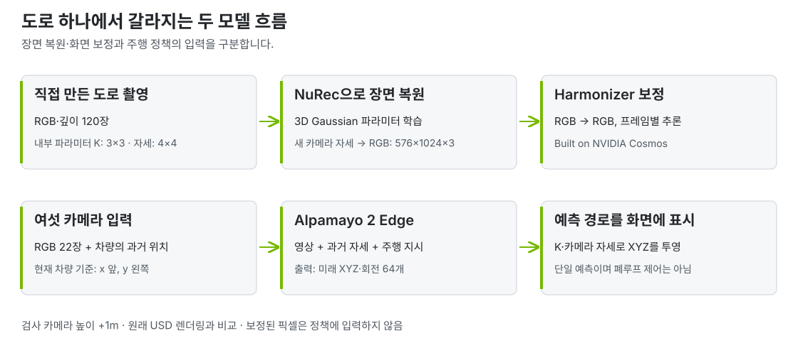

# 합성 도로로 NuRec·Harmonizer·Alpamayo 연결 확인하기

[전체 실습](../../../labs/README.md) · [English](../../en/labs/reality-view.md)

직접 만든 도로 위로 카메라를 올려 봅니다. NuRec으로 그 시점의 화면을 복원하고, Harmonizer 적용 전후를 비교한 뒤, Alpamayo 2 Edge가 예측한 경로를 표시합니다. 먼저 GPU 없이 저장된 결과를 확인하고, GPU 실습에서 같은 과정을 직접 실행해 보세요. 정적인 장면 복원과 주행 모델의 단일 예측을 연결하는 실습입니다.

## 동작 원리



### 1. 사진뿐 아니라 깊이와 카메라 위치도 필요한 이유

사진에는 색이 담겨 있지만, 그것만으로 카메라나 도로의 정확한 3D 위치를 알 수는 없습니다. 이 실습에서는 기본 도형으로 만든 [USD 도로 장면](../../../labs/world-driving/evidence/synthetic-intersection/synthetic-intersection.usda)을 사용합니다. 시뮬레이터가 정확한 기하 정보를 알고 있으므로, 세 개의 나란한 촬영 경로에서 **RGB와 z-depth를 120장씩** 얻습니다.

RGB 한 장은 `576 × 1024 × 3` 크기의 `uint8` 배열입니다. 각 채널의 값은 0~255입니다. 깊이는 `576 × 1024` 크기의 실수 배열이며, 카메라의 광축 방향 거리를 미터로 나타냅니다. 카메라 내부 파라미터는 다음과 같습니다.

```text
K = [[512,   0, 512],
     [  0, 512, 288],
     [  0,   0,   1]]
```

앞의 `512`는 픽셀 단위 초점거리이고, `(512, 288)`은 주점입니다. `4 × 4` 카메라 자세 행렬은 이 카메라가 장면의 어디에 있고 어느 쪽을 보는지 나타냅니다. OpenCV·NCore 카메라는 오른쪽·아래·앞을 각각 `+X·+Y·+Z`로 씁니다. USD 카메라는 `-Z` 방향을 바라보고 `+Y`가 위쪽이므로, 촬영 코드에서 좌표축을 바꿉니다.

깊이가 `Z`인 픽셀 `(u,v)`는 `X = (u-cx)·Z/fx`, `Y = (v-cy)·Z/fy`로 카메라 기준 3D 점이 됩니다. 이를 카메라 자세로 변환하면 세계 좌표의 점을 얻습니다. **학습용 촬영의 깊이만** 사용해 Gaussian 90,028개를 초기화합니다. 시뮬레이터의 정답 깊이를 쓰는 조건이므로, 일반 영상만으로 깊이를 알아내는 실험과는 조건이 다릅니다.

변환 코드는 RGB·카메라 정보·자세·촬영 시각을 **NCore V4**로 묶습니다. 움직이는 물체는 없는 정적 장면이어서 물체 트랙은 비워 둡니다. [NCore 좌표계 설명](https://nvidia.github.io/ncore/data/conventions.html)

### 2. NuRec은 무엇을 학습하고, 새 시점은 어떻게 그릴까?

NuRec은 촬영된 모습에 맞춰 Gaussian의 위치·크기·회전·불투명도·색을 조정합니다. 학습한 장면에 다른 카메라 위치와 내부 파라미터를 넣으면 그 시점의 RGB를 렌더링할 수 있습니다.

이번 실행은 **NuRec 26.04, 학습 2,400스텝, gsplat 렌더러**를 사용했습니다. 검사용 카메라는 촬영 경로 사이에서 **높이를 1m 올린 위치 40곳**을 지나갑니다. 이 시점의 RGB와 깊이는 학습이나 초기화에 넣지 않았습니다. 원래 USD도 똑같은 카메라에서 렌더링해 비교할 정답 영상을 확보했습니다.

Gaussian 장면이 표현하는 것은 카메라에서 본 모습입니다. 차량의 물리 움직임·충돌체·제어기는 따로 필요합니다. [NuRec 소스와 배포 구분](https://github.com/NVIDIA/NuRec#source-containers-and-models)

### 3. Harmonizer는 화면을 어떻게 바꿀까?

공개된 `harmonizer_nontemporal.pt`에 `float[1,3,1,576,1024]` 형태의 RGB를 넣습니다. 픽셀 값은 `[-1,1]`로 정규화합니다. Cosmos 기반의 단일 스텝 모델이 같은 크기의 이미지를 출력하면 다시 RGB PNG로 저장합니다. 이번 코드에는 별도의 색 전이 처리를 더하지 않았습니다.

이 예제는 이미지를 한 장씩 독립적으로 처리하는 **프레임별 보정**을 사용합니다. [Harmonizer 모델 카드](https://huggingface.co/nvidia/Harmonizer) · [공식 연결 방법](https://docs.nvidia.com/nurec/nurec/harmonizer.html)

**Built on NVIDIA Cosmos.** 화면이 매끈해져도 차선이나 물체의 경계가 달라질 수 있습니다. 원래 USD와 비교해서 바뀐 픽셀이 실제 정답에 가까워졌는지 확인합니다.

### 4. 초록색 경로는 누가 계산했을까?

Alpamayo에는 Harmonizer의 출력 대신 **Isaac Sim에서 촬영한 원본 영상**을 넣습니다. 여섯 카메라의 이미지 22장과 카메라 ID·촬영 시각, 차량의 과거 위치·회전 20개, `Continue straight through the intersection.`이라는 주행 지시를 전달합니다. 화면을 만드는 흐름과 경로를 예측하는 흐름이 같은 도로 장면을 공유하는 구성입니다.

```text
image_frames:    uint8[22,1,3,360,640]
ego_history_xyz: float[1,20,3]
ego_history_rot: float[1,20,3,3]
          ↓ Alpamayo 2 Edge
pred_xyz:        float[1,1,1,64,3]
pred_rot:        float[1,1,1,64,3,3]
```

출력은 0.1초 간격의 미래 자세 64개, 즉 6.4초 구간입니다. 실제 첫 예측 위치는 약 `[0.5010, 0.000064, 0.0]`m이고, 마지막은 `[30.2868, -0.08339, 0.0]`m였습니다. 추론 시점의 차량을 기준으로 `x`는 앞, `y`는 왼쪽, `z`는 위를 뜻합니다.

영상 합성 코드는 차량의 원점을 USD의 `[0,-1.8,0]`에 놓고, 예측 위치를 표시용 카메라 좌표로 바꾼 뒤 `K`로 화면에 투영합니다. 카메라 밖에 있는 점도 볼 수 있도록 작은 BEV를 함께 표시합니다.

영상은 **한 번 예측한 경로를 재생**합니다. 차량을 제어하고 다시 판단하는 폐루프 주행은 [AlpaSim 실습](../workflows/alpasim-closed-loop.md)에서 다룹니다. [Alpamayo 2 Edge 공식 소스](https://github.com/NVlabs/alpamayo2-edge)

## 실행하기

### 1. GPU 없이 저장된 결과부터 확인하기

[한국어 비교 영상](../../../labs/reality-view/evidence/reality-view.ko.mp4)을 열어 보세요. [NuRec 단독 영상](../../../labs/reality-view/evidence/nurec-novel.mp4), [Harmonizer 단독 영상](../../../labs/reality-view/evidence/harmonizer-novel.mp4), [경로 표시 영상](../../../labs/reality-view/evidence/alpamayo-overlay.mp4)도 따로 준비했습니다. [evidence 폴더](../../../labs/reality-view/evidence)에는 손실 없이 저장한 이미지 세 묶음과 예측 경로 JSON이 있습니다.

수치도 확인하려면 저장소 폴더에서 터미널을 엽니다. 아래 명령은 검사에 필요한 작은 Python 환경을 만들고, NumPy와 Pillow를 설치한 뒤 저장된 결과를 검사합니다.

```bash
python3 -m venv .venv-reality-check
source .venv-reality-check/bin/activate
python -m pip install numpy Pillow
python labs/reality-view/check.py
```

파일 해시, 미래 자세 64개의 유한값과 회전 행렬, 저장된 비교 이미지의 PSNR을 확인합니다. FFmpeg를 설치한 환경에서는 마지막 명령에 `--decode-video`를 붙이면 모든 MP4를 실제 디코딩해 손상된 프레임도 검사합니다.

### 2. GPU 머신과 모델 환경 준비하기

직접 생성할 때는 NVIDIA GPU가 있는 Linux 머신, GPU를 사용할 수 있는 Docker, Isaac Lab의 Python 실행 환경, 여유 디스크 40GB 이상이 필요합니다. 이번 작은 예제는 **RTX 5090 32GB, 시스템 메모리 약 32GB**, Isaac Sim **6.1.0.0 / Isaac Lab 17.0.2**에서 실행했습니다. NuRec의 일반적인 재구성 작업에는 더 많은 시스템 메모리가 권장됩니다. 여기서는 작은 정적 장면과 적은 데이터 로더 프로세스를 사용했습니다. 기존 환경을 바로 업그레이드하지 말고, 검증된 버전을 별도로 유지하세요.

[Linux GPU 환경 준비](../onboarding/nvidia-linux.md) · [Isaac Sim 설치·사용 안내](../onboarding/isaac-sim-tools.md) · [NuRec 공식 하드웨어 요구사항](https://docs.nvidia.com/nurec/basics/hardware.html)

GPU 머신에서 저장소 폴더의 터미널을 열고 아래 변수를 설정합니다. Python 경로는 **자신이 설치한 Isaac Lab 환경의 실행 파일**로 바꿔 주세요.

```bash
export REALITY_VIEW_ROOT="$HOME/physical-ai-labs/road-view"
export ALPAMAYO_ROOT="$HOME/physical-ai-labs/road-models"
export ISAAC_PYTHON="/absolute/path/to/isaaclab/.venv/bin/python"
mkdir -p "$REALITY_VIEW_ROOT" "$ALPAMAYO_ROOT"
nvidia-smi
```

앞의 변수는 결과·모델 저장 폴더를 정합니다. `uv`와 필요한 Hugging Face 인증을 준비한 뒤 실행하세요.

```bash
bash labs/reality-view/setup_models.sh
docker pull nvcr.io/nvidia/nre/nre-ga:26.04
```

소스와 모델 버전은 [run.sh](../../../labs/reality-view/run.sh)에 고정했습니다. [모델 버전과 사용 조건](../../../labs/reality-view/model-pins.json)

### 3. 도로를 촬영하고 NCore로 변환하기

[Omniverse 약관](https://docs.omniverse.nvidia.com/platform/latest/common/NVIDIA_Omniverse_License_Agreement.html)을 확인한 후 동의 변수를 설정합니다. `capture`는 자체 제작 USD를 열어 이미지와 카메라 정보를 저장합니다. `prepare`는 이를 NCore와 Gaussian 초기값으로 변환합니다.

```bash
export OMNI_KIT_ACCEPT_EULA=YES
bash labs/reality-view/run.sh capture
bash labs/reality-view/run.sh prepare
```

`CAPTURE complete: 120 training, 40 held-out, 22 policy frames`가 출력되는지 확인하세요. 변환 후에는 `prepared.json`과 `ncore/own-road.json`이 생깁니다. 다시 시도할 때는 새 결과 폴더를 사용하세요. NCore 작성기는 기존 데이터 그룹에 같은 항목을 덧쓰지 않습니다.

카메라는 수평 화각 90°의 pinhole 모델을 사용합니다.

### 4. NuRec 학습 → 새 시점 렌더링 → Harmonizer 실행

```bash
bash labs/reality-view/run.sh train
bash labs/reality-view/run.sh render
bash labs/reality-view/run.sh enhance
```

학습 후 `train/<run-id>/artifacts/last.usdz`가 생깁니다. `render`는 `novel-rig.json`에 지정한 카메라로 장면을 그립니다.

`novel/`에 **PNG 40장**, `enhanced/`에 **보정 PNG 40장**, 그리고 `harmonizer-result.json`이 생기는지 확인하세요.

### 5. 주행 모델을 실행하고 영상 만들기

```bash
bash labs/reality-view/run.sh policy
```

`alpamayo/output.safetensors`와 `alpamayo/receipt.json`이 만들어질 때까지 기다립니다. 실행기는 모델 가중치 파일 두 개의 SHA-256을 확인합니다. 실제 추론은 기존 [Alpamayo 실행 코드](../../../labs/world-driving/run_alpamayo_synthetic.py)를 재사용합니다.

NumPy·Pillow·FFmpeg가 있는 CPU 환경에서 한글 글꼴 경로를 지정하면 영상을 만들 수 있습니다.

```bash
python labs/reality-view/package.py \
  --input "$REALITY_VIEW_ROOT" \
  --output "$REALITY_VIEW_ROOT/published" \
  --font /absolute/path/to/NotoSansKR.ttf
```

영문·한국어 비교 영상, NuRec·Harmonizer·경로 표시 영상과 샘플 이미지를 만듭니다.

## 결과 확인

원래 USD, NuRec 복원, Harmonizer 보정에서 차선과 물체 경계를 비교하세요. 이 예제의 검사 시점 PSNR은 **NuRec 29.21dB, 보정 후 27.09dB**였습니다. 화면이 매끄러워지는 것과 원본을 더 가깝게 재현하는 것은 다를 수 있습니다.

예측 경로에는 미래 자세 64개가 들어 있습니다. 방향과 차량 기준 좌표를 살펴보고 [결과 검사 코드](../../../labs/reality-view/check.py)로 파일을 확인하세요. [실행 상세](../../../labs/reality-view/recorded.json).

[NuRec 원리](../nurec.md) · [Alpamayo 원리](../alpamayo.md) · [AlpaSim 폐루프 실습](../workflows/alpasim-closed-loop.md)
