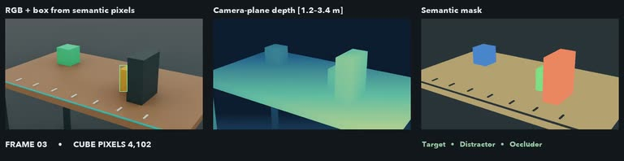

# Replicator 심화 · 12프레임에서 RGB·깊이·분할 얻기

**별도 심화 실습** · Isaac Sim 6.1과 Isaac Lab에서 예제 USD와 전용 검사 코드로 960 × 540 데이터를 생성합니다. 처음 카메라 데이터를 만든다면 [Isaac Sim 6.2 작업대 완주 과제](workbench-capstone.md)부터 시작하세요.

## 동작 원리

### 같은 화면을 색·깊이·라벨로 읽기

Replicator의 **렌더 프로덕트**는 촬영할 USD 카메라와 해상도를 묶습니다. 스크립트는 여기에 색상, 카메라 평면 기준 깊이, 의미 분할을 읽는 **어노테이터** 세 개를 연결합니다. 프레임마다 큐브의 위치·조명·카메라 설정이나 가림 조건을 바꾸고, 같은 렌더 결과에서 세 데이터를 저장합니다. 분할 번호는 USD에 붙인 클래스 라벨에서 나옵니다. [Isaac Sim 공식 캡처 예제](https://docs.isaacsim.omniverse.nvidia.com/latest/replicator_tutorials/tutorial_replicator_isaac_snippets.html) · [이 실습의 촬영 코드](../../../labs/replicator-outputs/capture.py)

### 프레임 폴더에서 같은 픽셀 찾기

| 파일 | 이 실습에서 읽는 모양 | 값의 뜻 |
| --- | --- | --- |
| `rgb.png` | `[540, 960, 3]`, `uint8` | 한 픽셀의 빨강·초록·파랑 값. 각 값은 0~255입니다. |
| `depth_m.npy` | `[540, 960]`, `float32` | 카메라 앞 방향으로 잰 깊이(m). 카메라 중심에서 픽셀 표면까지의 직선거리와는 값이 다를 수 있습니다. |
| `semantic_ids.npy` | `[540, 960]`, `uint32` | 각 픽셀에 해당하는 클래스 번호입니다. |
| `semantic_labels.json` | 번호 → 라벨 | 예를 들어 `target`에 해당하는 번호를 찾아 큐브 픽셀만 골라냅니다. |

이미지 좌표 `(u, v)`는 왼쪽 위가 원점이며 오른쪽과 아래로 증가합니다. NumPy에서는 행을 먼저 쓰므로 같은 점을 `rgb[v, u]`, `depth[v, u]`, `ids[v, u]`로 읽습니다. 같은 클래스가 여러 물체에 붙어 있다면 의미 분할은 같은 이름으로 묶습니다. 개별 물체를 구분해야 한다면 인스턴스 분할을 사용합니다.

### 마스크에서 상자가 어떻게 나올까요?

`target`인 픽셀만 남기고 왼쪽·위·오른쪽·아래 끝을 읽으면 경계 상자를 계산할 수 있습니다. [실행 기록](../../../labs/replicator-outputs/recorded.json)의 프레임 0에서 실제 상자는 `[264, 159, 401, 292]`이고, 큐브로 분류된 픽셀은 `15121`개입니다. 이 예제의 끝 좌표는 포함됩니다. 상자의 크기는 138 × 134픽셀이지만 안에 배경도 들어가므로, 실제로 보이는 면적을 구할 때는 마스크의 픽셀 수를 사용합니다.

가림 조건의 프레임 3에서는 `target_pixels`가 `4102`입니다. 프레임 설정에서 위치도 달라지므로 두 프레임의 차이를 가림의 효과만으로 해석할 수는 없습니다. 가림만 비교하고 싶다면 카메라와 큐브 위치를 고정한 뒤 가림막 유무만 바꿔 보세요.



프레임 3에서 경계 상자는 화면에 드러난 큐브 픽셀만 감쌉니다. 큐브의 나머지 부분은 가림막 뒤에 있습니다. [미리보기 생성 코드](../../../labs/replicator-outputs/preview_dataset.py)

## 따라 하기

**준비물** · RTX 머신에서 Isaac Sim 6.1과 연결된 Isaac Lab Python 환경을 활성화합니다. [설치 방식과 실행 환경](../onboarding/isaac-sim-tools.md)을 먼저 확인하세요. 이 예제는 Isaac Lab의 앱 실행기를 사용하므로 일반 Python에 NumPy만 설치한 환경으로는 캡처할 수 없습니다.

### 1. 장면을 열고 캡처하기

시뮬레이터를 실행할 머신의 터미널에서 이 레포 폴더로 이동합니다. 첫 경로는 읽을 USD이고, 두 번째는 결과를 저장할 폴더입니다. `--viz kit`를 붙이면 창에서 장면을 볼 수 있습니다. 같은 실습을 다시 할 때는 출력 폴더를 새 이름으로 바꾸세요.

```sh
python labs/replicator-outputs/capture.py \
  labs/replicator-outputs/replicator-live.usda ./runs/replicator --viz kit
```

### 2. 프레임 하나의 파일을 나란히 보기

실행이 끝나면 같은 터미널에서 아래 명령을 실행합니다. `rgb.png`는 이미지 뷰어로, `semantic_labels.json`은 텍스트 편집기로 열어 보세요. `.npy` 두 개는 숫자 배열이므로 검사 코드가 읽습니다. 검사 코드는 색·깊이·분할이 같은 크기인지, 큐브 픽셀의 깊이값이 정상인지 확인합니다.

```sh
ls ./runs/replicator/frames/00
python labs/replicator-outputs/check_capture.py ./runs/replicator
```

FFmpeg가 설치돼 있다면 `python labs/replicator-outputs/preview_dataset.py ./runs/replicator`로 세 채널을 나란히 보는 미리보기도 만들 수 있습니다. [NVIDIA Replicator 튜토리얼](https://docs.isaacsim.omniverse.nvidia.com/6.1.0/replicator_tutorials/tutorial_replicator_getting_started.html)

## 테스트 결과

960 × 540 데이터 12세트가 생성됐습니다. 검사 코드는 배열 크기, RGB 해시, 분할 마스크의 큐브 픽셀 수를 기록과 비교하고, 큐브 위치의 깊이값이 유한한 양수인지 확인합니다. 가림판을 둔 03, 07, 11번 프레임에서는 큐브가 차지하는 픽셀 수가 줄었습니다. [촬영 당시 프레임 기록](../../../labs/replicator-outputs/recorded.json)
