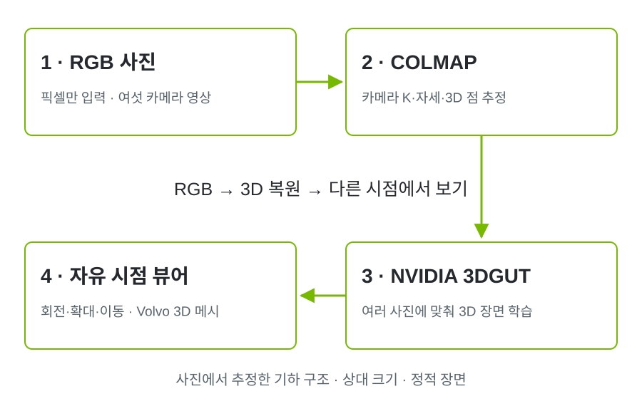
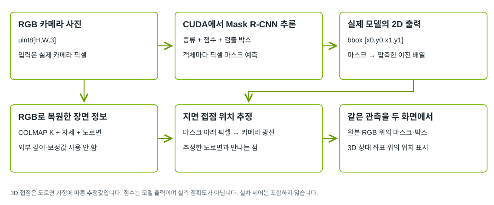

# RGB 카메라만으로 도로를 복원하고 자유 시점으로 보기

[실습 목록](../../../labs/README.ko.md) · [English](../../en/labs/rgb-reality-view.md)

NVIDIA 3DGUT으로 카메라 RGB를 3D 도로로 복원합니다. Volvo 주변을 돌려보고 객체 인식 결과를 확인한 뒤 RTX 5090 한 장으로 같은 과정을 실행해 보세요.

## 동작 원리



### 1. 사진에서 어떻게 3D 위치를 찾을까?

사진 한 장의 픽셀은 색을 알려주지만, 그 물체까지의 거리는 바로 알려주지 않습니다. COLMAP은 겹쳐 찍힌 사진에서 같은 무늬나 모서리 같은 **특징점**을 찾습니다. 여러 사진의 특징점이 같은 공간의 점을 가리키도록 카메라 위치와 3D 점을 함께 추정합니다. 그 점을 다시 사진에 투영했을 때 관측한 위치와 가까워지도록 다듬는 과정이 bundle adjustment입니다.

예제는 여섯 방향 카메라의 RGB 사진 162장을 사용합니다. COLMAP이 사진에서 카메라와 기하를 추정합니다.

```text
RGB 사진:             uint8[높이,너비,3]
사진 사이 특징점:      같은 점으로 추정한 픽셀 좌표 쌍
추정한 카메라 K:       float[3,3]
추정한 카메라 자세:    float[4,4]
삼각측량한 희소 점군:  float[N,3] + RGB
```

K에는 픽셀 단위 초점거리와 광학 중심이 들어 있습니다. 자세 행렬은 카메라의 위치와 방향을 표현합니다. 카메라는 오른쪽·아래·앞을 기준으로 하고, 뷰어는 복원한 도로가 위쪽 Z축을 향하도록 정렬합니다. 실제 값은 [cameras.json](../../../labs/rgb-reality-view/evidence/cameras.json)에서 볼 수 있습니다.

예제에서는 이미지 162장을 연결하고 약 2만9천 개의 3D 점을 찾았습니다.

실제로 추정한 전방 카메라 한 프레임입니다. `K`는 픽셀 단위, `camera_position`은 뷰어의 상대 단위입니다.

```json
{
  "image": "front_camera/39.jpg",
  "time_seconds": 3.9,
  "K": [[1055.495, 0.0, 512.0], [0.0, 1056.31, 284.5], [0.0, 0.0, 1.0]],
  "image_size": [1024, 569],
  "camera_position": [-0.0, 0.0, 0.9482]
}
```

### 2. NVIDIA 3DGUT은 무엇을 학습할까?

NVIDIA가 공개한 [3DGRUT](https://github.com/nv-tlabs/3dgrut)에서 3DGUT 렌더러와 학습 코드를 사용합니다. COLMAP 점군을 초기값으로 삼아 색과 불투명도를 가진 작은 3D 타원체, **Gaussian**을 배치합니다. 이 타원체를 카메라에서 보았을 때 원래 사진과 비슷해지도록 위치·크기·회전·색을 조정합니다.

기본 설정은 16,000단계를 학습하고 Gaussian 400,000개를 유지합니다. SPZ로 압축한 장면은 브라우저에서 카메라를 바꿀 때마다 새로 렌더링됩니다.

움직이는 차량을 정적인 Gaussian에 학습하면 잔상이 남을 수 있고, 관측하지 못한 면은 불완전할 수 있습니다.

### 3. 마우스를 움직이면 무엇이 바뀔까?

[Spark](https://github.com/sparkjsdev/spark)가 같은 Gaussian 장면을 현재 브라우저 카메라에서 투영해 그립니다. 드래그하면 카메라가 회전하고, 확대하면 대상과의 거리가 달라집니다. 옆으로 이동하면 가까운 물체와 먼 물체의 움직임 차이인 시차도 나타납니다. 화면은 매번 같은 3D 데이터에서 렌더링됩니다.

[lazercar의 Volvo S90 메시](https://sketchfab.com/3d-models/volvo-s90-recharge-free-9462b07c10244fd4a28d86846dc9e3a9)는 자차 위치를 나타냅니다. 경로 슬라이더는 COLMAP이 추정한 카메라 이동을 따라가고, ‘운전자’는 전방 카메라의 자세로 전환합니다.

카메라와 도로 사이 높이를 화면 단위 1로 맞춥니다. 좌표는 실측 미터가 아닌 상대 단위입니다.

### 4. 실사 RGB에서 주변 차량과 사람 인식하기



추가한 인식 단계는 **TorchVision Mask R-CNN ResNet50 FPN v2, COCO_V1**을 왜곡 보정한 실제 카메라 사진에 실행합니다. 먼저 이미지의 특징을 추출하고 객체가 있을 법한 영역을 찾습니다. 각 영역에서 객체 종류·점수·검출 박스를 예측하고, 해당 객체에 속하는 픽셀을 마스크로 구분합니다. 데이터셋의 정답 라벨은 읽지 않습니다.

```text
RGB uint8[H,W,3] → float32[3,H,W], 값 범위 [0,1] → CUDA 추론
boxes:  float[N,4]       왜곡 보정한 원본 이미지의 픽셀 좌표
labels: int64[N]         사람·차량 등의 클래스 번호
scores: float[N]         모델 점수이며 실측 정확도를 뜻하지 않음
masks:  float[N,1,H,W] → 0.5 기준 이진화 → 객체 영역만 자르기 → RLE
```

화면에는 점수 **0.8 이상**인 사람·차량·트럭·버스·자전거·이륜차를 표시합니다. 다음은 왼쪽 카메라에서 실제로 예측한 보행자 한 명의 출력입니다.

```json
{
  "image": "left_camera/39.jpg",
  "class": "person",
  "score": 0.9982,
  "bbox_xyxy": [274.1, 316.64, 294.92, 364.5],
  "cropped_mask_size": [21, 49],
  "contact_pixel": [280.0, 363.0],
  "estimated_ground_xyz": [-5.95426, 11.1151, 0.0]
}
```

박스 크기는 약 21×48픽셀입니다. 객체 영역만 자른 21×49 이진 마스크를 0과1의 연속 길이를 기록하는 RLE로 압축합니다.

**어떻게 3D 표식을 놓을까요?** 마스크 아래쪽 픽셀에서 추정한 `K`와 카메라 자세로 광선을 만듭니다. 이 광선이 추정 도로면과 만나는 곳을 대략적인 접점으로 삼습니다. 별도 3D 검출기 없이 표식을 놓는 방법입니다.

**인식 표시**를 껐다 켜고 카메라를 바꾸며 원본 RGB와 예측을 비교하세요. 차량은 청록색, 사람은 노란색, 자전거·이륜차는 보라색입니다. RGB 패널과 3D 표식은 선택한 시간에 맞춰 함께 움직입니다.

## 따라 하기

### 1. NVIDIA GPU 없이 저장된 결과 보기

이 페이지의 3D 뷰어나 [한국어 조작 영상](../../../labs/rgb-reality-view/evidence/rgb-reality-view.ko.mp4)을 열어보세요. 회전·확대·이동, 운전자 시점, 경로 재생을 확인할 수 있습니다. 3D에는 WebGL2를 지원하는 브라우저가 필요합니다. MP4 재생과 결과 파일 검사에는 NVIDIA GPU가 필요하지 않습니다.

```bash
python3 labs/rgb-reality-view/check.py
```

RGB 전용 입력 기록, Gaussian 개수, 좌표 변환, 실제 마우스 조작 기록과 파일 해시를 검사합니다. FFmpeg가 있으면 `--decode-video`를 붙여 두 영상의 전체 프레임도 읽어볼 수 있습니다.

학습 없이 저장된 3D 장면부터 열 수도 있습니다. 저장소 폴더에서 아래 명령을 실행하고 **http://127.0.0.1:8090/**에 접속하세요. 뷰어가 지정된 버전의 공개 JavaScript 모듈을 불러오므로 인터넷 연결이 필요합니다.

```bash
python3 labs/rgb-reality-view/serve.py --root site/public/showcase/rgb-reality-view
```

### 2. GPU 머신 준비하기

검증한 환경은 **Linux x86_64, RTX 5090 32GB 한 장, 시스템 RAM 약 32GB**입니다. NVIDIA 드라이버, CUDA **12.8 또는 12.9** 개발 도구, Python, C++ 컴파일러, `uv`, Git, Node.js/npm을 준비합니다. 설치 스크립트는 별도 Python 환경을 만들고 compute capability 12.0용 확장을 빌드합니다. 시스템 CUDA나 다른 서비스를 교체하지 않습니다.

처음이라면 [NVIDIA 머신 환경 설정](../onboarding/nvidia-linux.md)과 [uv 공식 설치 안내](https://docs.astral.sh/uv/getting-started/installation/)부터 확인하세요. 레포 폴더에서 터미널을 열고 각 줄이 끝나면 다음 줄을 입력합니다.

```bash
nvidia-smi
export RGB_VIEW_ROOT="$HOME/physical-ai-labs/rgb-road"
python3 labs/rgb-reality-view/pipeline.py --root "$RGB_VIEW_ROOT" setup
```

처음에는 몇 GB의 패키지를 받고 C++·CUDA 확장을 컴파일합니다. 핵심 패키지 버전과 소스 커밋은 고정했습니다. CUDA가 여러 개 있으면 호환되는 12.8/12.9 폴더를 고릅니다. 직접 지정하려면 명령에 `--cuda-home /path/to/cuda-12.9`를 추가하세요. 터미널에서 먼저 잡히는 오래된 `nvcc`와 실제 사용할 개발 도구가 다를 수 있습니다.

### 3. 공개 RGB 예제 복원하기

예제는 PandaSet 001번 장면입니다. [데이터·차량 모델 출처](../../../labs/rgb-reality-view/SOURCES.md).

전체 과정을 이어서 실행하려면 다음 한 줄을 사용합니다.

```bash
python3 labs/rgb-reality-view/pipeline.py --root "$RGB_VIEW_ROOT" all
```

각 단계의 출력을 먼저 확인하려면 나눠서 실행할 수도 있습니다.

```bash
python3 labs/rgb-reality-view/pipeline.py --root "$RGB_VIEW_ROOT" example
python3 labs/rgb-reality-view/pipeline.py --root "$RGB_VIEW_ROOT" sfm
python3 labs/rgb-reality-view/pipeline.py --root "$RGB_VIEW_ROOT" train
python3 labs/rgb-reality-view/pipeline.py --root "$RGB_VIEW_ROOT" export
python3 labs/rgb-reality-view/pipeline.py --root "$RGB_VIEW_ROOT" perceive
python3 labs/rgb-reality-view/pipeline.py --root "$RGB_VIEW_ROOT" serve
```

실행한 머신에서 **http://127.0.0.1:8090/** 를 엽니다. 원격 GPU 머신을 쓴다면 내 컴퓨터에서 `ssh -L 8090:127.0.0.1:8090 your-gpu-host`로 포트를 연결한 뒤 같은 주소를 여세요. `your-gpu-host`는 자신이 사용하는 SSH 별칭으로 바꿉니다.

| 단계 | 생성되는 파일 | 확인할 내용 |
| --- | --- | --- |
| RGB 예제 받기 / 내 영상 준비 | `work/images/`, `input-manifest.json` | JPEG만 있는지, 제공된 카메라 정보나 센서 데이터가 없는지 |
| COLMAP 복원 | `sfm-result.json`, `sfm-selected/`, `undistorted/sparse/0/` | 선택한 장면과 왜곡 보정 후의 연결 이미지 수가 같은지 |
| 3DGUT 학습 | `training-result.json`, `train/.../export_last.ply` | 완료 단계 수, 실제 시간, 측정한 GPU 메모리 |
| 뷰어 내보내기 | `viewer/road.spz`, `cameras.json`, `volvo-s90.glb` | 하나의 3D 장면, RGB에서 추정한 카메라 경로, 별도 차량 메시 |

다른 촬영본은 새 출력 폴더에서 시작합니다.

### 4. 내가 찍은 RGB 영상으로 실행하기

RGB 영상 하나를 넣으면 FFmpeg로 프레임을 추출하고 같은 복원 과정을 진행합니다. 서로 겹치는 장면과 카메라의 이동이 있어야 합니다. 제자리 회전만 있거나 무늬가 거의 없는 표면은 3D 위치를 찾기 어렵습니다.

```bash
python3 labs/rgb-reality-view/pipeline.py \
  --root "$HOME/physical-ai-labs/my-road" \
  --video "/absolute/path/to/road.mp4" --sample-fps 3 all
```

주변을 보는 여러 RGB 카메라가 있다면 카메라별 폴더로 이미지를 나눠 `--input /path/to/rgb-folders --front-folder front_camera all`을 사용합니다. 폴더 이름으로 같은 렌즈의 이미지를 묶으며 외부 보정값은 요구하지 않습니다. 전방 카메라 하나로는 실제로 본 영역을 복원할 수 있습니다. 뒤쪽이나 가려진 면을 보려면 그 부분을 담은 관측이 더 필요합니다.

## 결과 확인

저장된 예제는 RTX 5090 한 장으로 RGB 162장을 복원했습니다. [실행 기록](../../../labs/rgb-reality-view/recorded.json).

```bash
python3 labs/rgb-reality-view/check.py --decode-video
```

드래그하면 카메라가 바뀌고 경로를 재생하면 시간이 이동하는지 확인하세요. 복원과 학습은 NVIDIA GPU에서, 화면 렌더링은 보고 있는 브라우저에서 실행합니다.

다음에는 [RGB 전용 NuRec·Harmonizer·Alpamayo 실습](nurec-rgb-reality.md)으로 이어가세요.