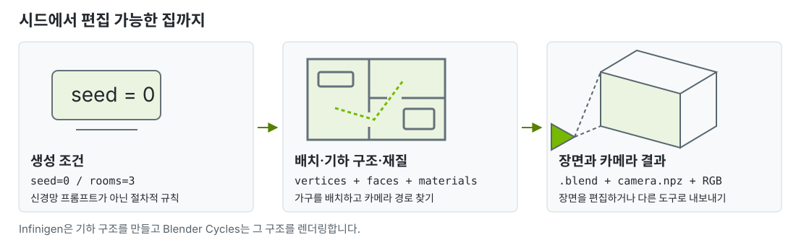

# 가구가 있는 집을 생성하고 안으로 들어가 보기

[English](../../en/labs/scene-generation.md) · [실습 코드](../../../labs/scene-generation/)

## 장면 생성기는 무엇을 만들까요?

Isaac Sim 대신 **Infinigen**으로 방·가구·재질·조명이 있는 집을 만듭니다. 시드에 따라 수치와 배치 규칙을 고르고 Blender에 실제 기하 구조를 저장합니다. **절차적 장면 생성**이며 프롬프트로 세계를 만드는 신경망은 아닙니다. [생성형 3D 세계 도구](../spatial-worlds.md), [촬영한 공간의 3DGS 복원](spatial-reconstruction.md)과 함께 비교해 볼 수 있습니다.



### 입력부터 화면까지 따라가 봅시다

`seed=0`, `room_count=3`으로 연결된 방을 만들고 소파·수납장·작은 물체를 배치합니다. 공식 집 둘러보기 예제는 RRT로 카메라 이동 경로를 구합니다. 로봇 제어 정책을 학습하는 예제가 아니라 공간 안을 이동하는 카메라를 계획하는 예제입니다. [Infinigen 공식 예제 소스](https://github.com/princeton-vl/infinigen/blob/53033dd55c7191cbc436be6ffbb63c026935a509/examples/house_tour/render.py)

```text
시드 + 방 생성 규칙
    → 평면 배치와 메시
    → 가구 + 재질 + 조명
    → 충돌을 고려한 RRT 카메라 경로
    → .blend + 카메라 변환 행렬
    → Cycles RGB 프레임
```

메시는 꼭짓점 좌표와 점들을 잇는 면 정보입니다. 재질은 표면이 빛을 어떻게 반사할지 정하고, 카메라 행렬은 프레임마다 어디에서 바라볼지 정합니다. `.blend`에는 이런 요소를 편집할 수 있는 상태로 저장합니다. 화면만 남는 MP4와 다른 점입니다. `camera.npz`에는 카메라 정보가 들어 있어 검사하거나 복원 입력으로 이어 쓸 수 있습니다. 로봇 정책의 체크포인트는 아닙니다.

### 영상은 어떤 조건으로 만들었나요?

서로 다른 시점 48개를 `640 × 360`, 픽셀당 Cycles 16샘플로 렌더링하고 OpenImageDenoise를 적용했습니다. 이를 8 FPS로 재생해 6초 영상으로 만들었습니다. **원래 24 FPS 타임라인보다 3배 느리게** 카메라 경로를 보여줍니다. 방과 가구는 정지해 있고 카메라만 이동합니다. 적은 샘플에 노이즈 제거를 적용한 미리보기이므로 세부 무늬가 부드럽게 보일 수 있습니다. 원본 프레임과 `.blend`는 OMEN에 보관합니다.

## 직접 집을 생성하고 렌더링하기

### 1. 별도 실행 환경 준비하기

[공식 설치 문서](https://github.com/princeton-vl/infinigen/blob/53033dd55c7191cbc436be6ffbb63c026935a509/docs/source/Installation.md)를 기준으로 준비합니다. 이번 소스는 Python **3.11**, Blender의 `bpy==4.2.0`을 사용합니다. Isaac Sim의 Python 환경에 섞어 설치하지 마세요. `uv`가 있는 환경에서 실행합니다.

```bash
git clone https://github.com/princeton-vl/infinigen.git runs/infinigen-source
git -C runs/infinigen-source checkout 53033dd55c7191cbc436be6ffbb63c026935a509
cd runs/infinigen-source
uv venv --python 3.11
INFINIGEN_MINIMAL_INSTALL=True uv pip install -e .
cd ../..
```

Linux에서는 프로젝트가 안내하는 시스템 빌드 패키지도 필요할 수 있습니다. 고정된 커밋의 Infinigen 2 미리보기 API를 사용하며, 예전 `infinigen_examples.generate_indoors`와는 실행 경로가 다릅니다. 이번 도우미는 Blackwell에서 Blender 4.2의 GPU 호환성 문제를 피하도록 CPU와 Cycles 12스레드를 명시했습니다. fVDB·CARLA 실험은 별도로 RTX GPU에서 실행했습니다.

### 2. 집을 생성해 장면 파일로 저장하기

이 저장소 폴더에서 새 Infinigen 환경의 Python으로 실행하세요.

```bash
runs/infinigen-source/.venv/bin/python labs/scene-generation/run.py \
  --source runs/infinigen-source --seed 0 --frames 1 48 \
  --room_count 3 --resolution 640 360 --samples 16 \
  --save_blend runs/house.blend --output runs/house-build
```

`Saved ...house.blend`가 나오면 생성이 끝났습니다. 공식 예제의 `--save_blend`는 **저장하고 종료하는 옵션**이므로 아직 영상은 생기지 않습니다. 다른 집을 만들려면 시드를 바꿔 보세요. 모든 랜덤 배치에서 카메라 경로를 찾는 것은 아닙니다. 배치가 거부되었다면 메시지를 확인하고 다른 시드로 시도합니다.

### 3. 저장한 기하 구조를 렌더링하기

```bash
runs/infinigen-source/.venv/bin/python labs/scene-generation/run.py \
  --source runs/infinigen-source --seed 0 --frames 1 48 \
  --resolution 640 360 --samples 16 \
  --load_blend runs/house.blend --output runs/house-render
ffmpeg -framerate 8 -start_number 1 -i runs/house-render/Camera/%04d.png \
  -c:v libx264 -crf 23 -pix_fmt yuv420p -movflags +faststart runs/house-tour.mp4
```

저장된 카메라 경로의 각 위치에서 광선을 추적해 화면을 그립니다. 도우미는 RGB 출력을 노이즈 제거 출력으로 바꾸며 생성·경로 계획 로직은 바꾸지 않습니다. 렌더링 시간은 영상 재생 시간보다 깁니다. 먼저 몇 프레임을 확인한 뒤 더 선명하게 만들고 싶을 때 해상도와 샘플 수를 높이세요.

## 저장된 결과 확인하기

GPU 없이 영상을 보거나 동봉한 해시와 카메라 경로 요약을 검사할 수 있습니다.

```bash
python3 labs/scene-generation/check.py
```

[실행 기록](../../../labs/scene-generation/recorded.json)에는 소스 커밋, Blender 버전, 프레임 수, 카메라 이동과 편집 조건을 적었습니다. 메시가 생성되었다고 바로 로봇 실습 환경이 완성되는 것은 아닙니다. 다른 시뮬레이터로 가져갈 때 크기·충돌체·관절·재질을 확인하세요. [공식 시뮬레이터 내보내기 문서](https://github.com/princeton-vl/infinigen/blob/53033dd55c7191cbc436be6ffbb63c026935a509/docs/source/ExportingToSimulators.md) · [미디어 출처](../../../site/public/showcase/SPATIAL-CREDITS.md) · [3DGS 광장 둘러보기](spatial-reconstruction.md).
