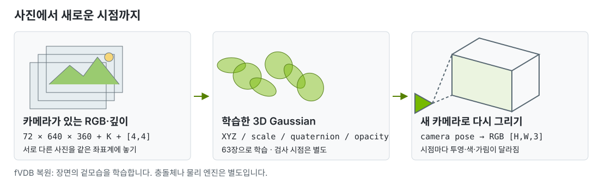
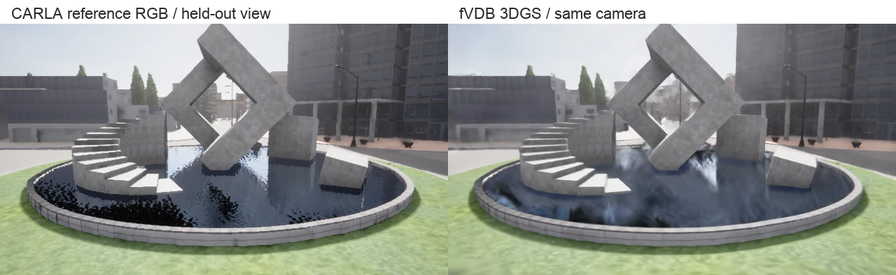

# 직접 둘러볼 수 있는 3DGS 광장 복원하기

[English](../../en/labs/spatial-reconstruction.md) · [실습 코드](../../../labs/spatial-reconstruction/)

## 카메라 사진이 어떻게 탐색할 수 있는 공간이 될까요?

아래 3D 화면은 CARLA의 분수 광장을 **fVDB Gaussian Splatting으로 실제 복원한 결과**입니다. 구에 파노라마를 붙이거나 동영상을 틀어 둔 것이 아닙니다. 내가 선택한 시점에서 3차원 Gaussian을 투영해 새 화면을 그립니다. 버튼을 눌러 회전·이동·확대를 해 보세요. 3D를 지원하지 않는 브라우저에서는 아래 영상을 볼 수 있습니다.



### 사진, 카메라 정보, 깊이의 역할

`640 × 360` RGB 이미지 72장과 카메라 내부 파라미터 `K`, 월드→카메라 변환 행렬, 미터 단위 깊이를 촬영했습니다. 수평 화각은 80°이며 `fx = fy ≈ 381.36px`입니다. 픽셀의 `(u-cx)/fx`, `(v-cy)/fy`와 깊이로 카메라 기준의 3D 점을 구합니다. 여기에 카메라→월드 행렬을 적용하면 서로 다른 사진의 점들을 같은 공간에 놓을 수 있습니다. 시뮬레이터에서 **정확한 카메라 자세를 알고 있으므로** COLMAP으로 자세를 추정하는 단계는 없습니다.

```json
{
  "image_path": "view_000.png",
  "width": 640,
  "height": 360,
  "camera_intrinsics": [[381.361, 0, 320], [0, 381.361, 180], [0, 0, 1]],
  "world_to_camera": "4 x 4 matrix; see evidence/cameras.json"
}
```

읽기 쉽게 반올림한 예시입니다. [실제 카메라 파일](../../../labs/spatial-reconstruction/evidence/cameras.json)에는 전체 값이 들어 있습니다. CARLA의 왼손 좌표계를 오른손 좌표계로 바꾸기 위해 월드 Y축을 반전하고, 카메라 축을 OpenCV의 오른쪽·아래쪽·전방 기준으로 맞췄습니다. 이 부호를 잘못 바꾸면 공간이 거울처럼 뒤집힙니다.

`view_000.png`의 중앙 픽셀 `(320,180)`을 직접 읽으면 깊이는 **21.237m**입니다. 카메라 기준으로 약 `[0,0,21.237]m`이고, 저장한 카메라 자세를 적용하면 월드 좌표 `[0.958,0,2.131]m`가 됩니다. [실제 샘플](../../../labs/spatial-reconstruction/evidence/point-sample.json)에 전체 값을 넣었으며 `check.py`가 이 변환을 다시 계산합니다.

### Gaussian 하나에는 무엇이 들어 있을까요?

중심 좌표 `[x,y,z]`, 세 축의 크기, 회전 쿼터니언, 불투명도, 색 계수를 저장합니다. 공간에 놓인 부드러운 타원체라고 생각하면 됩니다. fVDB가 이 타원체들을 화면에 투영하고 겹쳐 그린 뒤 학습 사진과 비교합니다. 오차가 줄어드는 방향으로 값을 조정하고, 필요한 곳에는 Gaussian을 늘리거나 지웁니다. 이번 전체 모델에는 **345,318개**가 들어 있습니다. [fVDB Reality Capture](https://github.com/openvdb/fvdb-reality-capture)

브라우저용 SPZ에는 Gaussian 345,318개를 모두 유지하고 값을 양자화했습니다. 색 계수는 1차까지만 담아 용량을 6.15MB로 줄였습니다. 녹화 영상은 시선 방향에 따른 색을 표현하는 3차 spherical harmonics 계수까지 포함한 전체 모델로 렌더링했습니다. 따라서 브라우저 미리보기와 영상의 색·밀도에는 차이가 있을 수 있습니다. 이 표현은 장면의 겉모습을 담습니다. 충돌 면, 질량, 로봇 제어는 별도로 구성해야 합니다.

### 새로운 세계를 생성한 것과는 무엇이 다를까요?

이 실습은 **주어진 장면을 복원**합니다. 프롬프트로 보이지 않던 골목을 만들어 내지는 않습니다. World Labs Marble과 NVIDIA Lyra는 생성형 3D 세계를, Infinigen은 규칙으로 조합한 실제 기하 구조를 다룹니다. [3D 세계 도구 비교](../spatial-worlds.md)에서 출력 형식과 실행 조건을 나누어 볼 수 있습니다.

아래의 추가 영상 두 개는 CARLA 사진 한 장씩을 **Apple SHARP**에 넣은 결과입니다. EXIF 추측 대신 실제 90° 카메라의 내부 파라미터를 사용했습니다. 이미지마다 Gaussian 1,179,648개를 예측하고 fVDB로 주변 시점을 그렸습니다. 물체 뒷면까지 복원하거나 완전한 360° 세계를 만든 결과는 아닙니다. 모델 가중치는 비상업적 연구용이며 코드 라이선스와 다릅니다.

## 새로운 장면을 촬영하고 복원하기

### 1. 여러 시점 촬영하기

[CARLA 실습의 설치 순서](carla-ego.md)를 따라 터미널 A에 0.9.16 서버를 띄웁니다. 터미널 B에서는 CARLA용 Python 환경을 활성화하고 저장소 폴더에서 실행하세요.

```bash
python labs/spatial-reconstruction/capture.py --output runs/plaza-input
```

RGB와 깊이 센서가 Town03 광장 주변을 이동합니다. `Saved view 72/72`가 나오면 촬영이 끝납니다. `images/`에는 색 PNG, `depth/`에는 미터 단위 NumPy 배열, `cameras.json`에는 촬영 당시의 정확한 카메라 자세가 저장됩니다. `prepare_seed.py`는 초기 점군을 만들 때 **검사용으로 남겨 둔 이미지와 그 깊이·색을 사용하지 않습니다.** `0,8,16,…`번이 검사 대상입니다.

다음 GPU 작업을 시작하기 전에 직접 띄운 CARLA 컨테이너를 종료하세요. CARLA와 fVDB의 Python 환경은 별도로 준비합니다.

### 2. Gaussian 학습하기

GPU에 맞는 PyTorch·CUDA 조합으로 [공식 설치 가이드](https://fvdb-reality-capture.readthedocs.io/stable/installation.html)를 따라 fVDB와 fVDB Reality Capture를 설치합니다. 해당 환경에서 `plyfile`, Pillow, SciPy도 준비하세요. 검증한 환경은 RTX 5090, fVDB 0.6.0, PyTorch 2.13.0+cu130입니다. 정확한 실행 정보는 `recorded.json`에 남겼습니다.

```bash
python labs/spatial-reconstruction/reconstruct.py \
  --input runs/plaza-input --output runs/plaza-3dgs --ffmpeg ffmpeg
```

카메라 자세를 고정한 채 RGB 63장으로 40에포크를 학습합니다. 전체 PLY와 가벼운 `.splat`을 저장하고, 새 카메라 경로의 영상과 검사 지표를 만듭니다. OMEN에서는 cuDNN 라이브러리 버전 충돌이 있어 cuDNN을 끄고 PyTorch의 기본 CUDA 합성곱을 사용했습니다. fVDB 학습·렌더링은 계속 GPU에서 수행합니다. 코드와 실행 기록에도 이 우회 설정을 명시했습니다.

브라우저용 모델은 Gaussian을 버리지 않고 전체 PLY를 PlayCanvas CLI로 압축합니다.

```bash
python3 labs/spatial-reconstruction/compress_web.py runs/plaza-3dgs/town03.ply runs/plaza-3dgs/town03.spz
```

### 3. 사진 한 장으로도 비교하기

선택 실습입니다. [SHARP](https://github.com/apple-aiml-research/ml-sharp)와 의존성을 fVDB도 불러올 수 있는 환경에 설치합니다. 연구용 모델 라이선스를 확인한 뒤 [공식 체크포인트](https://ml-site.cdn-apple.com/models/sharp/sharp_2572gikvuh.pt)를 받으세요. 앞서 찍은 CARLA 운전자 JPEG들을 `runs/sharp-input/`에 넣고 실행합니다.

```bash
python labs/spatial-reconstruction/reconstruct_single.py \
  --input runs/sharp-input --output runs/sharp-output \
  --checkpoint /path/to/sharp_2572gikvuh.pt --ffmpeg ffmpeg
```

이 코드는 이번 CARLA의 90° 카메라를 가정합니다. 다른 사진에는 해당 초점거리를 사용해야 합니다. 좌우 ±0.35m 범위로 시점을 움직입니다. 크게 이동하면 입력에서 보지 못한 빈 공간이 드러납니다.

## GPU 없이 결과 검사하기



```bash
python3 labs/spatial-reconstruction/check.py
```

검사용으로 남긴 시점, 카메라 회전, 모델 값의 유효성, 미리보기 용량과 영상 해시를 확인합니다. [이번 실행 기록](../../../labs/spatial-reconstruction/recorded.json)의 검사 이미지 9장은 평균 **PSNR 23.434dB**입니다. 학습에 이 RGB들을 넣지 않았고 초기 점군에도 해당 깊이·색을 넣지 않았습니다. 작은 합성 장면에서 측정한 값이며, 여러 데이터셋을 비교한 성능 순위는 아닙니다. 물결, 먼 배경, 촬영 범위 바깥은 여전히 번지거나 비어 보일 수 있습니다.

원본 촬영 전체와 전체 PLY는 OMEN 실행 폴더에 보관합니다. 저장소에는 코드·카메라 정보·지표·압축 영상·브라우저용 모델을 넣었습니다. [미디어 출처와 이용 조건](../../../site/public/showcase/SPATIAL-CREDITS.md) · [실내 장면 생성하기](scene-generation.md) · [fVDB 동작 원리](../fvdb-reality-capture.md).
