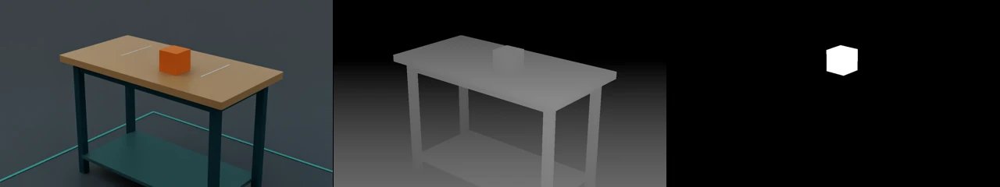
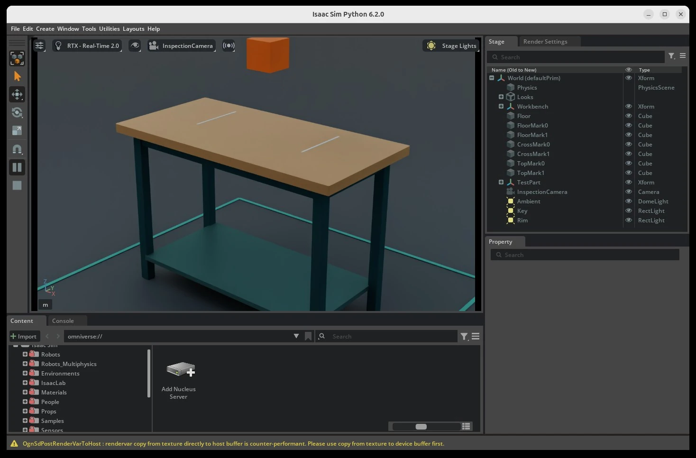

# CAD 작업대부터 카메라 데이터셋까지

STEP 작업대를 OpenUSD 장면으로 변환하고, Isaac Sim에서 큐브를 떨어뜨린 뒤 Replicator로 RGB·깊이·분할 데이터 네 세트를 만듭니다. 마지막에 작업대 치수, 큐브가 멈춘 높이, 프레임 사이 이동량을 검사합니다.

## 작업대 모델은 어떻게 카메라 데이터가 될까요?

### STEP의 치수를 USD 장면에 옮기기

STEP에는 작업대 부품의 CAD 형상이 있습니다. CadQuery 스크립트는 부품 표면을 삼각형으로 나누고, 밀리미터를 미터로 바꾼 꼭짓점과 면을 `cad_meshes.json`에 저장합니다. 시뮬레이션 스크립트는 이 좌표를 사용해 USD 장면을 만듭니다. 예를 들어 상판 길이 1,200mm는 미터 단위의 USD 장면에서 `1.2`입니다. 화면상 크기가 적당해 보여도 단위와 실제 치수는 따로 확인합니다. [CAD 생성 코드](../../../labs/scene-to-data/make_step.py) · [OpenUSD 선형 단위](https://openusd.org/release/api/group___usd_geom_linear_units__group.html)

| 구성 요소 | 입력 → 출력 | 이 예제에서 확인할 항목 |
| --- | --- | --- |
| 장면 표현 | 삼각형 메시 → USD 프림과 좌표 | 상판 치수 1.2 × 0.6 × 0.04m |
| PhysX | 강체·충돌체·중력 → 큐브 위치 | 상판 Z가 0.8m, 큐브 반 높이가 0.0615m이므로 중심은 약 0.8615m에 멈춥니다. |
| Replicator | 장면·카메라 → 같은 프레임의 색·깊이·클래스 ID | RGB는 `[720, 1280, 3]`, 깊이와 분할은 각각 `[720, 1280]`입니다. |
| CPU 검사 코드 | USD와 캡처 파일 → `check/report.json` | 좌표 단위, 채널 정렬, 큐브 픽셀, X축 상대 이동량을 확인합니다. |

### 같은 픽셀에서 세 값 읽기

[저장된 첫 프레임](../../../labs/scene-to-data/replicator-data.zip)의 `u=613, v=231`에서 RGB는 `[155, 63, 14]`, 깊이는 반올림해 `3.164 m`, 라벨은 `2`입니다. 왼쪽 픽셀 `u=612, v=231`을 읽으면 RGB는 `[153, 103, 61]`, 깊이는 `3.376 m`, 라벨은 `3`입니다. 이 프레임의 라벨 JSON에서 `2 → part`, `3 → workbench`이므로 두 픽셀을 가르는 경계가 큐브와 작업대 사이임을 알 수 있습니다.

## GPU 없이 저장된 결과 확인하기

먼저 동봉한 프레임을 열어 어떤 파일을 만들게 될지 살펴봅니다. 이 단계는 지금 쓰는 컴퓨터에서 할 수 있습니다. 터미널을 열고 아래 두 줄을 실행하면 실습 파일을 내려받아 그 폴더로 이동합니다. 이미 받았다면 `cd`만 실행하세요. Ubuntu 24.04에 Git이나 가상환경 도구가 없다면 `sudo apt install git python3.12-venv`로 준비합니다.

```sh
git clone https://github.com/james-joobs/awesome-nvidia-physical-ai.git
cd awesome-nvidia-physical-ai
```

같은 터미널에서 Python 3.12 가상환경을 만듭니다. `source`로 이 환경을 활성화하면 다음 명령으로 설치하는 패키지는 이 실습 폴더 안에만 들어갑니다.

```sh
python3.12 -m venv .venv-workbench
source .venv-workbench/bin/activate
python -m pip install -r labs/scene-to-data/requirements-check.txt
```

이제 검사 코드를 실행합니다. `--recorded`는 압축 파일에 담긴 프레임을 쓰라는 뜻이고, 그 앞의 경로는 이 명령이 파일을 풀고 결과를 저장할 폴더입니다.

```sh
python labs/scene-to-data/check_workbench.py runs/workbench-replay --recorded
```

파일 탐색기에서 `runs/workbench-replay/check/frame-00.png`를 엽니다. 왼쪽부터 사진, 깊이, 큐브 마스크입니다. 오른쪽 흰 부분은 큐브 픽셀만 남긴 것입니다. 깊이를 숫자로 확인할 때는 가운데 이미지 대신 원본 `.npy` 배열을 읽습니다.



**같은 픽셀, 서로 다른 정보.** 원본 프레임의 가로 715, 세로 231번 픽셀은 RGB `[155, 66, 14]`의 주황색입니다. 같은 자리의 깊이는 약 **3.15m**, 분할 번호는 **2**입니다. 라벨 JSON에서 2번은 `part`, 즉 큐브입니다. 파일 세 개를 함께 쓰면 사진 속 어느 픽셀이 큐브이며 얼마나 떨어져 있는지 알 수 있습니다. [카메라 데이터 압축 파일](../../../labs/scene-to-data/replicator-data.zip)

터미널에 `PASS` 두 줄이 나오면 저장된 데이터 검사를 마친 겁니다. RTX 머신이 있다면 [Isaac Sim 6.2에서 새 데이터 만들기](#cad와-usd-장면-만들기)로 이어가세요. 다음 단계에서도 마지막에 같은 검사 코드를 사용합니다.

## CAD와 USD 장면 만들기

이제 내 작업대를 만듭니다. 여기서 만드는 STEP은 CAD가 읽는 설계 파일이고, 메시 JSON은 시뮬레이터로 옮길 삼각형 목록입니다. RTX 머신에서 [GPU를 확인](../onboarding/nvidia-linux.md)하고 [Isaac Sim 6.2](../onboarding/isaac-sim-tools.md)를 준비하세요. 그 머신의 터미널에서 이 레포 폴더로 이동해 아래를 실행합니다. CadQuery에 쓸 Python 환경은 데이터 검사 환경과 따로 만듭니다.

```sh
python3.12 -m venv .venv-workbench-cad
.venv-workbench-cad/bin/python -m pip install 'cadquery==2.8.0'
.venv-workbench-cad/bin/python labs/scene-to-data/make_step.py runs/workbench-live
```

스크립트가 `workbench.step`을 만든 뒤 다시 읽어 부품 10개와 상판 치수 **1,200 × 600 × 40mm**를 확인합니다. 이어 미터 단위의 `cad_meshes.json`을 저장합니다. 다음 단계에서 이 메시로 `workbench_scene.usda`를 만들기 때문에 CAD에서 만든 형상이 USD 장면에도 그대로 반영됩니다. [CadQuery 코드](../../../labs/scene-to-data/make_step.py)

## Isaac Sim에서 RGB·깊이·분할 캡처하기

앞에서 만든 메시를 Isaac Sim으로 가져옵니다. Workstation으로 설치했다면 RTX 머신의 같은 터미널에서 첫 줄의 경로를 실제 설치 폴더로 바꾼 뒤 명령을 붙여 넣습니다. `python.sh`는 Isaac Sim에 필요한 모듈을 불러옵니다. pip로 설치했다면 해당 가상환경을 켜고 `"$ISAAC_SIM_DIR/python.sh"` 자리의 명령을 `python`으로 바꿉니다.

```sh
ISAAC_SIM_DIR="$HOME/isaacsim-6.2.0"
"$ISAAC_SIM_DIR/python.sh" labs/scene-to-data/workbench_final_take.py \
  runs/workbench-live/cad_meshes.json runs/workbench-live
```

뷰포트가 `/World/InspectionCamera` 시점으로 열립니다. PhysX가 큐브를 상판에 떨어뜨린 뒤 Replicator가 큐브의 X 위치와 조명 밝기를 네 번 바꿉니다. 한 카메라의 같은 렌더링 결과에서 `rgb_####.png`, `distance_to_image_plane_####.npy`, `semantic_segmentation_####.npy`, 클래스 번호를 담은 JSON을 저장합니다. 캡처가 끝나면 **File → Open**에서 `runs/workbench-live/workbench_scene.usda`를 다시 열고 뷰포트 카메라를 **InspectionCamera**로 바꿔 볼 수 있습니다. [캡처 코드](../../../labs/scene-to-data/workbench_final_take.py) · [NVIDIA Replicator 예제](https://docs.isaacsim.omniverse.nvidia.com/6.2.0/replicator_tutorials/tutorial_replicator_getting_started.html)



충돌체가 있으면 큐브가 상판 위에 멈춥니다. [캡처 후 Isaac Sim 화면](../../../assets/lessons/workbench/workbench-viewport.webp)

화면이 없는 서버에서는 지원되는 Isaac Sim GPU 환경에서 같은 명령 뒤에 `--headless`를 붙입니다. 렌더링에는 RTX가 필요합니다. 설정을 바꿔 다시 실행할 때는 출력 폴더도 새로 지정하세요.

## 실행 결과 검사하고 제출물 남기기

Isaac Sim이 닫히고 터미널에 다시 입력할 수 있게 되면, 같은 폴더에서 아래 명령을 실행합니다. CPU 환경을 다른 컴퓨터에만 만들었다면 여기에도 첫 단계의 가상환경을 만들거나, 새 캡처 폴더를 그 컴퓨터로 복사합니다. 이번에는 `--recorded` 없이 내가 생성한 파일을 검사합니다.

```sh
.venv-workbench/bin/python labs/scene-to-data/check_workbench.py runs/workbench-live
```

| 검사 항목 | 통과 기준 |
| --- | --- |
| USD 장면 | 상판 치수가 1,200 × 600 × 40mm이고, USD 단위가 미터이며, 상판에 충돌체가 있습니다. |
| 큐브가 멈춘 높이 | 실행 로그에서 큐브가 상판 위에서 떨어져 예상 중심 높이인 0.8615m의 ±2cm 안에 멈춥니다. |
| 카메라 데이터 | 네 프레임의 RGB·깊이·분할 크기가 모두 1,280 × 720입니다. 각 프레임에서 `part` 픽셀이 1,000개 이상이고 해당 픽셀의 깊이값이 유한한 양수입니다. |
| 상대 이동량 | 카메라에 보이는 큐브 표면으로 계산한 X축 이동량이 설정한 이동량과 10mm 이내로 일치합니다. |

`workbench.step`, `workbench_scene.usda`, `replicator/` 폴더, `check/report.json`을 결과물로 남깁니다. 검사 코드는 3채널 미리보기와 샘플링한 점군 배열도 저장합니다. 점군 계산은 카메라 중심을 기준으로 정사각형 픽셀을 가정하며, 0번 프레임 대비 이동량을 비교합니다. [실습 소스 코드 보기](scene-to-data.md#code) · [GitHub 검사 코드](../../../labs/scene-to-data/check_workbench.py) · [촬영 당시 측정값](../../../labs/scene-to-data/recorded.json)

**촬영 당시 비교 기준** · 네 프레임을 검사했을 때 X축 상대 이동량의 최대 오차는 **5.27mm**였습니다. 저장된 프레임만 재현하는 경로는 물리를 다시 돌리지 않으므로 보고서에 `checked_physics_log: false`가 표시됩니다.

두 번째 실행에서는 카메라와 큐브 위치는 그대로 두고 조명 밝기만 바꿔 보세요. 이미지가 어떻게 달라지는지 확인한 뒤 같은 검사를 실행합니다.

**별도 심화 실습** · [Replicator 12프레임 촬영](replicator-outputs.md)은 Isaac Sim 6.1과 Isaac Lab에서 별도 USD 장면과 검사 코드로 카메라·조명·가림을 비교합니다.
