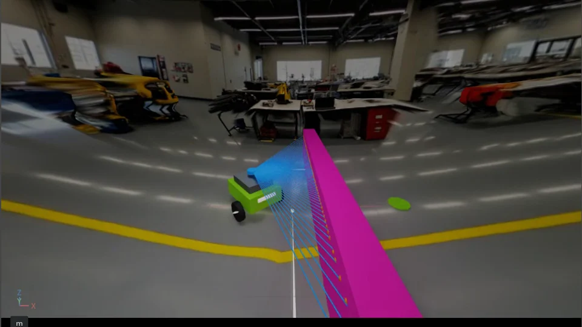
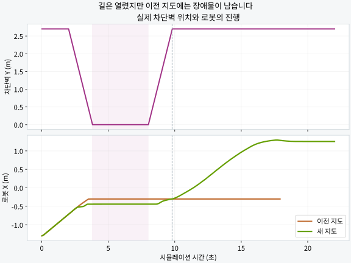
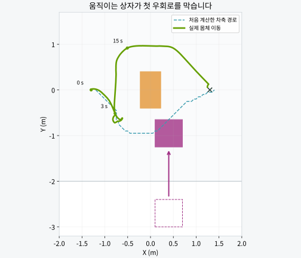

# 움직이는 장애물을 보고 멈추고 다시 우회하기

[English](../../en/labs/worldgen-dynamic-navigation.md) · [정적인 장애물부터 시작하기](worldgen-navigation.md) · [실습 코드](../../../labs/worldgen-dynamic-navigation/)

## 센서가 있어도 지도가 오래되면 길을 못 찾습니다

앞선 제어기는 센서가 감지한 지점을 지도에 계속 추가했지만, **한번 넣은 지점을 지우지는 않았습니다.** 장애물이 움직이고 나면 그 자리에 관측이 남습니다. 실제 통로는 열려 있어도 A*에는 벽이 남아 있는 셈입니다.

이번에는 Isaac Sim 6.2의 실제 Physics Raycast Sensor와 바퀴로 움직이는 로봇을 유지하면서, 새 관측으로 지도를 갱신합니다. 필요하면 멈춰 기다리고, 통로가 달라지면 경로를 다시 계산합니다. 로봇 제어기에 장애물의 좌표나 이동 일정은 전달하지 않습니다.


### 1. 지금 보이는 표면과 예전에 본 지점을 구분합니다

입력은 여전히 수평 광선 **180개의 거리**입니다. 최대 2.5m까지 측정한 결과를 초당 10번 읽습니다. 지도에는 지점의 위치와 마지막으로 본 시각을 함께 저장합니다.

```text
ranges:        float[180]       이번 프레임의 거리, 단위 m
hit_positions: float[180,3]     광선이 닿은 지점의 월드 XYZ
sensor_time:   float            측정한 시뮬레이션 시각
observed[(i,j)] = (x, y, 마지막으로_본_시각)
```

예전에 본 지점이 지금 센서에서 어느 방향에 있는지 구하고, 가장 가까운 방향의 현재 광선과 비교합니다. 광선이 예전 지점보다 **10cm 이상 더 멀리까지 뻗었다면**, 그 지점은 더 이상 광선을 막지 않습니다. 해당 관측을 지도에서 지웁니다. 같은 프레임에서 실제로 감지한 지점은 우선해서 유지합니다.

아무것도 만나지 않은 광선은 거리 `2.5`를 돌려주지만, SDK의 해당 `hit_position`은 `[0,0,0]`입니다. 이 영벡터를 월드 원점에 있는 장애물로 취급하면 안 됩니다. 예전 지점의 방향과 현재 거리를 맞춰 비교해야 합니다.

**2초 동안 다시 관측하지 못한 지점**도 다음 유효 프레임을 처리할 때 지도에서 제거합니다. 작은 시험 환경에서 관측을 무한히 쌓지 않기 위한 설정입니다. 가려진 공간이 비었다는 증거는 아닙니다. 시험 바닥 안의 미관측 칸은 통행 가능으로 취급하며, 센서 데이터 자체가 오래되면 로봇을 멈춥니다.

### 2. 경로 계획과 정지 판단을 나눕니다

새 지도에 로봇 크기만큼 여유를 두고 A*를 실행합니다. 작은 격자 변화만으로 좌우 우회로가 계속 뒤집히지 않도록 **직전 스캔에서 계산한 경로**에서 멀어지는 후보에는 작은 비용을 더합니다. 실행 전에 경로를 입력하는 방식은 아닙니다. 기존 통로가 실제로 막히면 다른 경로를 찾아야 합니다.

그 다음에는 다음 조건으로 움직임을 제한합니다.

| 조건 | 바퀴에 내리는 명령 |
|---|---|
| 마지막 측정이 0.25초보다 오래됨 | 좌우 바퀴 정지 |
| 가장 가까운 측정 표면이 0.39m 미만 | 좌우 바퀴 정지 |
| 정면 장애물이 0.75m 안으로 들어옴 | 0.6초간 제동 |
| 통과 가능한 경로가 없음 | 전진·회전 명령을 모두 0으로 두고 대기 |
| 경로는 있지만 정면 거리가 0.58m 미만 | 전진 없이 회전 |
| 새 측정과 통과할 경로가 있음 | 계산한 경로 추종 |

정면은 ±25° 범위입니다. 정면 거리가 다시 0.95m보다 커지면 다음 제동을 감지할 수 있도록 조건을 초기화합니다. 이 로봇과 통제된 배치에서 정한 수치이며, 실제 로봇의 안전 인증이나 정지거리 보장값은 아닙니다.

### 3. 로봇이 실제로 회전하는 중심을 기준으로 제어합니다

구동 바퀴의 차축은 **몸체 중심보다 0.10m 앞**에 있습니다. 제자리 회전도 이 차축을 중심으로 일어나므로 몸체 중심은 조금 움직입니다. 새 제어기는 차축 중앙을 추종하고, 그 지점에서 본 로봇의 외접 반경 약 0.425m와 추종 여유를 합쳐 **0.52m만큼 장애물을 넓힙니다**. 이전 제어기는 몸체 중심과 기존의 0.43m 설정을 그대로 사용합니다.

물리적인 목적지는 여전히 몸체 XY `[1.3,0]`입니다. 새 제어기는 차축 XY `[1.4,0]`으로 접근한 뒤 +X 방향을 바라보게 맞춥니다. 차축 위치 허용 오차는 8cm, 최종 방향 허용 오차는 0.08rad입니다. 격자 경계에서 빠져나올 수 있도록 현재 시작 칸 하나는 확장 영역에서 해제할 수 있지만, 실제로 감지한 장애물 칸은 유지합니다.

```text
거리 프레임 + 현재 로봇 위치 + 측정 시각
  → 관측 지점 갱신·삭제·만료
  → 로봇 크기 고려 → 경로가 불필요하게 바뀌지 않도록 A* 계산
  → 정지 / 대기 / 회전 / 주행 / 도착 방향 맞추기
  → 바퀴 드라이브 → PhysX가 계산한 위치 → 다음 스캔
```

### 4. 장애물은 어떻게 움직일까요?

자주색 물체는 **키네마틱 PhysX 강체**입니다. `actors.py`가 물리 스텝마다 `set_kinematic_targets()`로 연속적인 목표 위치를 전달합니다. 센서는 그렇게 움직인 실제 충돌체를 읽고, 저장한 강체 위치로 목표를 따라 움직였는지 검사합니다. 로봇 몸체의 위치를 직접 바꾸지는 않으며, 로봇은 바퀴 드라이브로 움직입니다.

6.2 호환 렌더링 경로에서는 별도의 표시용 메시를 **매 스텝 실제 PhysX 위치에 맞춰** 갱신합니다. 이 표시용 메시에는 충돌체를 붙이지 않습니다. 요청한 목표 좌표나 녹화된 궤적을 재생하는 방식이 아닙니다. 검사기는 `render_position_xyz`와 실제 충돌체 위치가 같은지 확인합니다. 경로가 없을 때는 선을 숨겨, 대기 중인데 예전 청록색 경로가 남아 있지 않게 했습니다.



장면을 구동하는 코드는 이동 일정을 알지만, `navigation.py`는 그 코드를 가져오거나 장애물 좌표를 입력받지 않습니다. 주황색 점은 지도에 저장한 관측, 청록색 선은 현재 계산한 차축 경로입니다. [NVIDIA 물리 텐서 API](https://docs.omniverse.nvidia.com/kit/docs/omni_physics/109.0/extensions/runtime/source/omni.physics.tensors/docs/api/python.html) · [Physics Raycast Sensor](https://docs.isaacsim.omniverse.nvidia.com/6.2.0/sensors/isaacsim_sensors_physics_raycast.html)

## 닫히는 차단벽과 통로에 들어오는 상자를 실행합니다

### 1. 같은 로봇 실험실 준비하기

Docker에서 NVIDIA GPU를 사용할 수 있는 호환 Linux 머신을 준비합니다. 처음이라면 [Linux 환경 설정](../onboarding/nvidia-linux.md)과 [WorldGen 공간 가져오기](worldgen-isaac.md)부터 확인하세요. 저장소 루트에서 입력합니다.

```bash
nvidia-smi
mkdir -p runs/worldgen-dynamic
cp -R labs/worldgen-isaac/assets runs/worldgen-dynamic/assets
export WORLDGEN_DATA_ROOT="$PWD/runs/worldgen-dynamic"
```

준비된 공간을 쓰므로 FLUX 가중치를 새로 받지 않습니다. [NVIDIA Omniverse 약관](https://docs.omniverse.nvidia.com/isaacsim/latest/common/NVIDIA_Omniverse_License_Agreement.html)에 동의한 뒤 본인의 동의를 나타내는 환경 변수를 설정합니다.

```bash
export ACCEPT_EULA=Y
bash labs/worldgen-dynamic-navigation/run.sh gate --controller dynamic
```

차단벽이 **2~3.8초에 통로로 들어와** 막고 있다가 **8~9.8초에 빠져나옵니다**. 프로그램에 지정한 최대 이동 속도는 1.5m/s입니다. 로봇이 멈추고 기다리다가, 센서 관측으로 지도가 갱신되면 다시 움직이는지 확인하세요. 결과는 `runs/worldgen-dynamic/gate/`에 저장됩니다.

### 2. 이전의 누적 지도 방식으로 반복하기

```bash
bash labs/worldgen-dynamic-navigation/run.sh gate --controller static \
  --output /work/gate-static --max-seconds 18
```

`static_navigation.py`는 앞선 제어기를 보존한 파일입니다. 시작점·물리적인 목적지·센서·로봇·움직이는 장애물·이동 일정과 최대 속도 0.32m/s가 같습니다. 이전 방식은 관측을 계속 쌓으며, 제어 기준점과 여유 반경도 기존 설정을 유지합니다. 차단벽이 물러난 뒤 지도 점과 로봇의 상태를 비교하세요.

컨테이너의 `/work`는 앞서 지정한 `WORLDGEN_DATA_ROOT`입니다. 실행마다 다른 출력 폴더를 쓰면 기록을 구분하기 쉽습니다.

### 3. 이미 주행하던 통로를 막아 보기

```bash
bash labs/worldgen-dynamic-navigation/run.sh cart --controller dynamic \
  --output /work/cart-dynamic --max-seconds 38
```

먼저 중앙의 고정 상자를 피해 우회합니다. 이어 크기 0.6m인 두 번째 상자가 **2~4초에 Y=-2.7에서 Y=-0.95로 이동**해 아래쪽 통로에 멈춥니다. 속도는 0.875m/s입니다. 첫 계획은 아래쪽을 향했고, 이 통로가 막히는 관측을 받은 뒤 다른 경로로 바뀌었는지 확인하세요. 우회 경유점 좌표는 로봇에 전달하지 않습니다.

### 4. 주행 중 거리 프레임을 끊어 보기

```bash
bash labs/worldgen-dynamic-navigation/run.sh gate --controller dynamic \
  --dropout-start 1 --dropout-seconds 1 \
  --output /work/sensor-gap
```

시험 코드가 시뮬레이션 시간 1초 동안 거리 프레임을 제어기에 전달하지 않습니다. 제어기는 마지막 측정의 시각만 알 수 있습니다. 정지한 뒤 새 프레임을 받으면 다시 움직이는지 보세요. 지도에서 오래된 칸을 지웠다는 이유로 센서 없이 주행하지는 않습니다.

### 5. 실제 프로그램 창 녹화하기

X11 데스크톱에 `xwininfo`와 `x11grab`을 지원하는 ffmpeg를 준비합니다.

```bash
mkdir -p runs/worldgen-dynamic-film
cp -R labs/worldgen-isaac/assets runs/worldgen-dynamic-film/assets
python3 labs/worldgen-dynamic-navigation/record_gui.py \
  --work "$PWD/runs/worldgen-dynamic-film" --scenario gate \
  --controller dynamic --max-seconds 32 --ffmpeg /path/to/ffmpeg
```

녹화할 때마다 새 폴더를 사용하세요. 실제 뷰포트가 준비되면 제어와 녹화를 시작합니다. 원본 창 영상, `scans.json`, `result.json`, 로그, 시작 장면 `scene.usdc`를 함께 남깁니다. USD는 장면 구성을 살펴보는 파일이며, 로봇 제어와 장애물 구동은 Python 스크립트가 담당합니다.

## 실제 정지·경로 변경·영상 기록을 검사합니다



새 제어는 4.0~7.5초 검사 구간에서 실제 정지 상태를 유지했습니다. 아래쪽에 통과할 공간이 생긴 8.6초에 새 경로를 계산했습니다. 이전 제어는 차단벽이 완전히 빠져나간 9.8초 뒤에도 경로를 찾지 못했습니다. 마지막 스캔만 같은 계획기의 빈 지도에 넣으면 경로가 나옵니다. 물리적인 벽보다 지도에 쌓인 관측이 문제였음을 확인하는 검사입니다.

| 실행 | 도착 | 도착까지의 시뮬레이션 시간 | 장애물 접촉 보고 |
|---|---|---|---|
| 이전 누적 지도·차단벽 | 실패 | — (18초 실행) | 0 |
| 새 지도·차단벽 | 성공 | 20.07 | 0 |
| 새 지도·통로에 들어오는 상자 | 성공 | 25.32 | 0 |
| 새 지도·센서 프레임 1초 중단 | 성공 | 20.65 | 0 |

각각 한 번씩 기록한 실행이며 평균 성능이 아닙니다. 도착 시간에는 이후 약 2초의 정지 유지 시간을 포함하지 않았습니다. 실제 충돌체와 화면 표시 좌표의 차이도 검사했고, 기록에서는 0이었습니다.



점선은 처음 센서로 계산한 차축 경로, 실선은 실제 몸체 이동입니다. 위쪽으로 돌아가는 첫 계획은 상자가 움직이기 시작한 2초 뒤인 3.1초에 나왔습니다. 4.3초에는 제동했고, 이후 다른 쪽으로 돌아 도착했습니다.

아래 기록에서는 지도 칸 하나를 지웠지만 아직 경로가 없어 기다립니다. 다음 기록에서는 경로 66개 지점을 찾아 전진 0.2811m/s와 회전 -1.1rad/s를 함께 명령합니다. 지도에서 칸을 지웠다고 바로 출발하지는 않습니다.

```json
[
  {
    "scan_time_s": 8.1,
    "cleared_cells": 1,
    "path_points": 0,
    "phase": "wait-for-path",
    "command_v_omega": [
      0.0,
      0.0
    ]
  },
  {
    "scan_time_s": 8.6,
    "cleared_cells": 2,
    "path_points": 66,
    "phase": "follow-scan-path",
    "command_v_omega": [
      0.2811,
      -1.1
    ]
  }
]
```

[실제 관측 예시 파일](../../../labs/worldgen-dynamic-navigation/evidence/clearing-example.json) · [두 배치의 시작 USD 장면](https://james-joobs.github.io/awesome-nvidia-physical-ai/showcase/worldgen-dynamic-navigation-scenes.zip)


```bash
python3 labs/worldgen-dynamic-navigation/test_navigation.py
python3 labs/worldgen-dynamic-navigation/check.py
```

GPU 없이 실제 장애물의 이동, 측정 시각, 로봇의 정지 유지, 지도에서 지운 관측, 경로 변경, 도착 위치, 접촉 기록과 영상 해시를 확인합니다. 직접 실행한 결과도 검사할 수 있습니다.

```bash
python3 labs/worldgen-dynamic-navigation/check.py --run runs/worldgen-dynamic/cart-dynamic
```

비교 영상은 Isaac Sim GUI를 1배속으로 녹화했습니다. 이전 방식의 일부 구간과 새 방식의 실행을 구분해 표시했고, 개별 녹화도 아래에서 볼 수 있습니다.

현재 로봇 위치와 5×4m 시험 바닥 경계는 알고 있다고 가정합니다. 이상적인 수평 거리 센서를 사용하며, 생성된 가구 전체의 충돌까지 검증하지는 않았습니다. 장애물 속도나 사람의 다음 움직임을 예측하는 제어기, SLAM, 실물 로봇의 안전 검증으로 볼 수는 없습니다. 더 확장할 때는 [Nav2의 장애물 표시·삭제 설정](https://docs.nav2.org/rolling/configuration_and_development/configuration_guide/core_servers/costmap_2d/costmap_plugins/obstacle/)도 참고할 수 있습니다. 이번 실행에 Nav2를 사용한 것은 아닙니다.

[이전 센서 실습](worldgen-navigation.md) · [공간 크기·충돌체](worldgen-isaac.md) · [영상·입력 출처](../../../site/public/showcase/SPATIAL-CREDITS.md)
